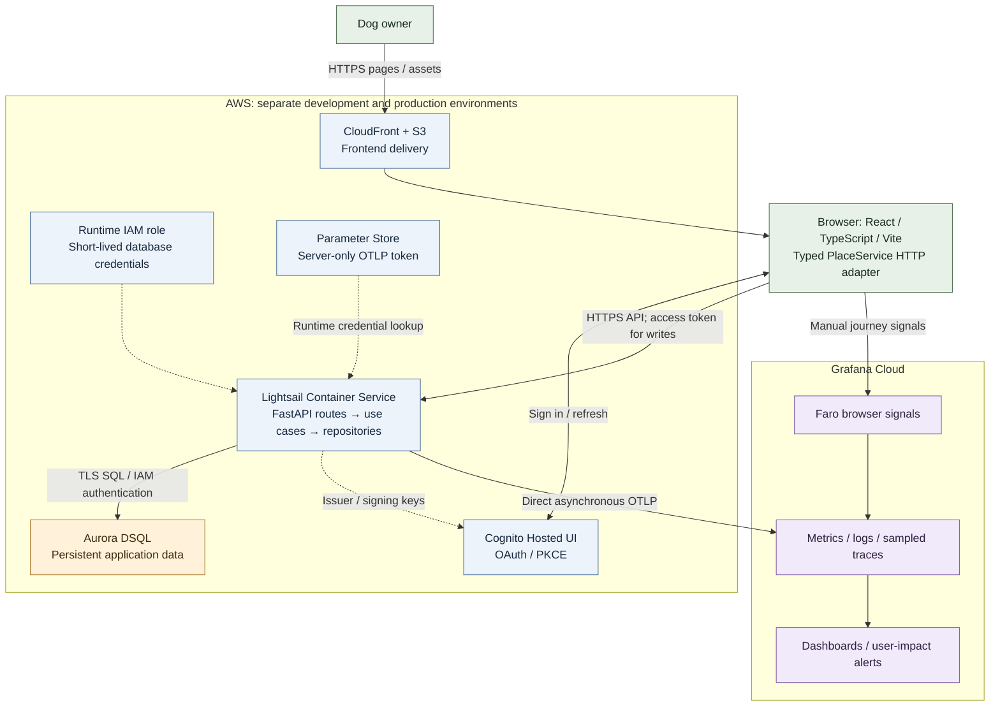
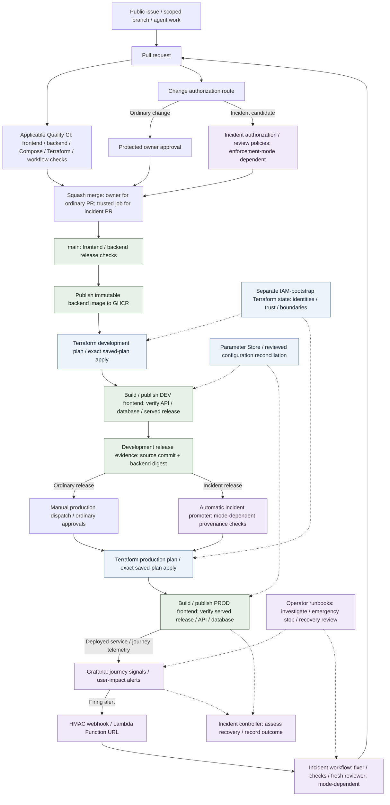

# PawLocal

Find dog-friendly places across South East Queensland, from the Gold Coast through Brisbane and Moreton Bay to the Sunshine Coast.

**[Open PawLocal](https://pawlocal.alanlima.cloud/)** · [Development site](https://pawlocal-dev.alanlima.cloud/) · [Public task tracker](https://github.com/alanlima/pawlocal/issues) · [Delivery plan](docs/submission.md)

[Problem and goal](#problem-and-goal) · [Use the app](#use-the-app) · [Run locally](#run-locally) · [Architecture](#architecture) · [Project self-review guide](#project-self-review-guide) · [Documentation](#documentation)

## Problem and goal

Dog owners must piece together scattered, incomplete or outdated information about parks, beaches, walks and cafés. Fencing, off-leash rules, shade, drinking water and access restrictions can be hard to verify before a visit.

PawLocal's goal is a free, searchable, community-maintained directory that helps people choose an outing and improve the information for the next visitor. Anonymous visitors can browse, search, filter, inspect and share places. Signed-in members can save favourites, rate and review places, suggest locations, add tips or corrections, and report inaccurate or inappropriate content. Contributions publish immediately after validation and can be reported. AI listing drafts require human approval before publication; automated listing generation is not demonstrated by this delivery.

Unknown facilities stay unknown, facility filters use verified details, empty searches explain the result, and API failures stay visible. HTTP mode never silently falls back to demo data. The [product specification](product-spec.md) defines acceptance criteria and exclusions.


*Production, 25 October 2026: this visit displayed 51 listings. [Screenshot provenance](docs/images/delivery/README.md) records environment and limits.*

## Use the app

1. Open the public site. Search by place or area, choose a region, or select a category such as **Dog parks**. **Filters** shows verified facilities; selecting an unrecorded facility can correctly return no matches.
2. Open a place to inspect access information, facilities and community contributions. Check current local signage before visiting. **Share this place** copies its permanent public URL.
3. Use **Sign in** for the hosted Cognito flow. Saving a place while anonymous prompts sign-in; **Saved places** collects favourites after authentication.
4. Use **Write a review**, **Add a helpful tip**, **Suggest an update** or **Add a place** to contribute. Report a listing or published contribution using its report controls. Protected writes require a valid access token and server validation; the UI reports permission, validation and network failures.


*A real place detail page; unverified facilities are explicitly unknown. [Filter, share and sign-in-boundary captures](docs/images/delivery/README.md) extend the walkthrough. [Authenticated local fixture captures](docs/images/delivery/README.md#local-authenticated-persistence) show the real HTTP/API/PostgreSQL path; hosted Cognito sign-in is a separate check.*

## Delivery status

The frontend, API, persistence adapters, local Compose stack, cloud release workflows, hosted instrumentation and incident controller are implemented. Public discovery/detail and production Grafana metrics/logs were inspected on 25 October. The [controlled production drill](https://github.com/alanlima/pawlocal/issues/396) records a real alert, automatic repair PR, actual hosted CI, automatic merge, development verification, production promotion and observed recovery under traffic.

The drill used the approved enforcement-disabled mode (DEC-017). [Incident #399](https://github.com/alanlima/pawlocal/issues/399) reports `RELEASE_COMPLETED_UNVERIFIED`: disabled checks do not count as passed review/provenance/stable-recovery policies. Formal acceptance remains tracked in [#226](https://github.com/alanlima/pawlocal/issues/226), [#230](https://github.com/alanlima/pawlocal/issues/230), [#229](https://github.com/alanlima/pawlocal/issues/229) and [#231](https://github.com/alanlima/pawlocal/issues/231). Backup/restore/HA guarantees and final rollback acceptance are not established here.

Source baseline for this documentation review: `8895b99a549ee0db134cec69bd681618f8db46d7`. The final submission commit remains to be selected in the [delivery plan](docs/submission.md). A live screenshot alone does not identify the frontend bundle revision.

## Run locally

Prerequisites: Git, Docker Engine with Compose v2, and available loopback ports. Node.js and Python are needed for host-side development/tests. From the repository root, copy `.env.example` to `.env` once and replace its local PostgreSQL password. Keep `.env` out of Git.

```powershell
Copy-Item .env.example .env
# Edit PAWLOCAL_POSTGRES_PASSWORD in .env before starting.
docker compose up --build -d
```

Open [the app](http://localhost:5173), [API health](http://localhost:8000/health), [API documentation](http://localhost:8000/docs) and [Grafana](http://localhost:3000). `docker compose ps` shows health. Startup includes frontend, FastAPI, PostgreSQL, Collector, Prometheus, Loki, Tempo and Grafana; migrations run before the API starts. A fresh database has no published places until approved data is loaded.

Root Compose explicitly selects the HTTP adapter even though `.env.example` enables mock mode for standalone Vite development. Local persistence uses PostgreSQL; hosted environments use Aurora DSQL. Compose has no Cognito settings by default: browsing works, but protected writes need configured authentication. For disposable authenticated tests, use the [backend browser harness](backend/README.md#browser-integration-authentication).

`docker compose stop` / `docker compose start` stops/restarts existing containers. `docker compose down` retains named data volumes; the startup command recreates containers. Volume deletion erases local data and belongs only in an intentional disposable reset. See [frontend setup](frontend/README.md#local-frontend-and-observability-stack) and [backend setup](backend/README.md).

### Run checks

Use Python 3.12 in a virtual environment. For a fresh Windows review checkout, use `git clone --config core.autocrlf=false https://github.com/alanlima/pawlocal.git pawlocal-review`, then check out the selected submission commit. Have WSL/Bash available for the deployment-adapter test; CRLF shell scripts fail before its assertions. Install dependencies with `python -m pip install -e './backend[test,dsql-prototype]'` and `npm ci --prefix frontend`. From the root, this single PowerShell command runs frontend unit/component and backend unit/API/repository checks, stopping on failure:

```powershell
& { npm test --prefix frontend; if ($LASTEXITCODE -ne 0) { throw 'Frontend checks failed' }; Push-Location backend; try { python -m pytest; if ($LASTEXITCODE -ne 0) { throw 'Backend checks failed' } } finally { Pop-Location } }
```

Backend API/repository tests use isolated SQLite fixtures by default. PostgreSQL integration **skips** unless `PAWLOCAL_TEST_DATABASE_URL` identifies a dedicated disposable database; configure and migrate it as in [backend CI](.github/workflows/backend-ci.yml) before claiming that coverage. Browser persistence checks need the opted-in harness and `npm run test:e2e:backend --prefix frontend`. [Verification record](docs/submission.md#verification-record) distinguishes reruns from skipped checks.

## Architecture

### End-to-end application architecture

The cloud path below applies separately to development and production. Each environment has its own frontend, API, identity, database and application Terraform state.



CloudFront/S3 serve the frontend; the browser calls the separate HTTPS API host. Deployment injects general configuration; the backend reads the OTLP credential from Parameter Store at runtime. Local HTTP mode uses PostgreSQL and the local Collector stack; explicit standalone mock mode uses the interchangeable mock adapter. Cloud telemetry uses direct Faro/OTLP, rather than the local Collector. Runtime secrets stay outside Terraform state. Diagram paths describe implemented capabilities; the [evidence map](#project-self-review-guide) retains the hosted correlation and identity acceptance gaps. See [architecture](docs/architecture.md), [infrastructure operations](docs/terraform-greenfield-operations.md) and [hosting/cost decisions](docs/stage4-hosting-options.md).

### Operations and CI/CD architecture

Ordinary changes and alert-driven repairs share the release path, with separate authorization routes. Terraform owns deployment changes through the matching environment state.



Development and production use independent application states. Production selects the development-verified source/backend digest and rebuilds frontend assets with production configuration. The incident route has no runtime human approval; DEC-017 can disable software review/provenance/budget/stop/recovery checks, while external GitHub/IAM controls and exact-plan/state ownership remain. The observed drill therefore retains `RELEASE_COMPLETED_UNVERIFIED`. DEC-015 separately disables shared strict release-only rejection. See the [Actions catalogue](docs/github-actions.md) and [canonical enforcement matrix](docs/oncall-setup.md#temporary-incident-enforcement-mode-375--dec-017). Documentation-only changes do not automatically run every application workflow; final rollback acceptance remains with the owner.


*Actual Grafana Cloud panels, 25 October 2026, six-hour window across releases. [Dashboard evidence](docs/images/delivery/README.md) includes the incident dashboard and interpretation limits. Grafana links require access; checked-in captures and the [drill wiki](https://github.com/alanlima/pawlocal/wiki/Incident-drill-2026-10-25-02) are reviewer entry points.*

## Project self-review guide

Evidence map for the [current rubric](https://github.com/DataTalksClub/ai-dev-tools-zoomcamp/blob/main/project/README.md), not an awarded score. Maximum: 24 points; passing requires 10 points **and three peer reviews**, tracked in [#283](https://github.com/alanlima/pawlocal/issues/283).

| Criterion (maximum) | Implementation / inspection | Evidence, status and limits |
| --- | --- | --- |
| Problem description (2) | [Problem and goal](#problem-and-goal), [walkthrough](#use-the-app) | Functionality and expected behavior documented; real screenshots above. |
| Product specification (2) | [Spec](product-spec.md), [OpenAPI](openapi.yaml), [public issues](https://github.com/alanlima/pawlocal/issues) | [#396](https://github.com/alanlima/pawlocal/issues/396) and [agent PR #400](https://github.com/alanlima/pawlocal/pull/400) show tracker use; historical parent acceptance needs reconciliation. |
| Agent team (2) | [Profiles](agents/profiles), [workflow](docs/agent-workflow.md), [AI usage](docs/ai-usage-report.md) | Responsibilities, handoffs and review defined; read with incident exception. |
| Context management (2) | [AGENTS.md](AGENTS.md), [documentation](#documentation) | Modular specification, process, decisions and operations references. |
| Application (2) | [Services](frontend/src/services), [backend](backend/pawlocal), [startup](#run-locally) | Public browse/detail captured; [fresh local PostgreSQL/browser persistence and restart readback](docs/submission.md#local-reproducibility-verification). Hosted Cognito acceptance is separate from the local ephemeral issuer. |
| Testing (2) | [Check command](#run-checks), [backend tests](backend/tests), [strategy](docs/testing.md) | Fresh environment: 73 Vitest + 9 Node + 240 backend checks (no skips), plus one browser persistence test. [Verification scope](docs/submission.md#local-reproducibility-verification) distinguishes local JWT/PostgreSQL from hosted acceptance. |
| Containerization (2) | [Compose](docker-compose.yml), [frontend](frontend/Dockerfile), [backend](backend/Dockerfile) | Fresh isolated build/start passed with all eight services healthy; [commands and scope](docs/submission.md#local-reproducibility-verification). |
| Deployment (2) | [Production](https://pawlocal.alanlima.cloud/), [release](https://github.com/alanlima/pawlocal/actions/runs/40181618456) | Real deployment and discovery/detail captured; reachability alone does not prove authenticated persistence. |
| CI/CD (3) | [Catalogue](docs/github-actions.md), [release](.github/workflows/fullstack-release.yml), [manual promotion](.github/workflows/deploy-production.yml) | [DEV](https://github.com/alanlima/pawlocal/actions/runs/40180921838), [incident PROD](https://github.com/alanlima/pawlocal/actions/runs/40181618456), [historical manual PROD](https://github.com/alanlima/pawlocal/actions/runs/40044690011). Ordinary/incident paths are distinct. |
| Observability (2) | [Operations](docs/hosted-telemetry-operations.md), [definitions](observability), [screenshots](docs/images/delivery/README.md) | Production metrics/logs visible; [#225](https://github.com/alanlima/pawlocal/issues/225) accepts amended DEV correlation. Fresh single-journey metric/log/trace set and [#230](https://github.com/alanlima/pawlocal/issues/230) gates remain. |
| User-impact alerting (1) | [Spec](docs/specs/hosted-observability.md), [drill](https://github.com/alanlima/pawlocal/wiki/Incident-drill-2026-10-25-02) | Real search-filter 5xx alert and Normal under traffic. Formal G1 [#226](https://github.com/alanlima/pawlocal/issues/226) remains open. |
| On-call agent (2) | [Controller](ops/incident-response), [workflow](.github/workflows/incident-responder.yml), [repair](https://github.com/alanlima/pawlocal/pull/400) | [#396](https://github.com/alanlima/pawlocal/issues/396): automatic fix/deploy, observed recovery. [#399](https://github.com/alanlima/pawlocal/issues/399): policy-unverified with enforcement disabled; formal G2/production-origin acceptance open. |

Reviewer walkthrough: public demo → search/filter/detail/share → local run/checks → architecture/agent process → release runs → telemetry and incident timeline → [remaining delivery gates](docs/submission.md).

## Documentation

| Need | Maintained entry point |
| --- | --- |
| Submission form, dates, final commit and evidence | [Delivery plan](docs/submission.md), [#281](https://github.com/alanlima/pawlocal/issues/281), [#284](https://github.com/alanlima/pawlocal/issues/284) |
| Product and API | [Product specification](product-spec.md), [OpenAPI](openapi.yaml) |
| Architecture and stages | [Architecture](docs/architecture.md), [implementation plan](docs/implementation-plan.md), [decisions](docs/decisions.md) |
| Agent responsibilities and context | [Workflow](docs/agent-workflow.md), [team](agents/README.md), [model policy](docs/model-policy.md), [AI usage](docs/ai-usage-report.md) |
| Development and tests | [Frontend](frontend/README.md), [backend](backend/README.md), [testing](docs/testing.md) |
| Development deploy / exact-release promotion | [Actions catalogue and commands](docs/github-actions.md), [Terraform guide](docs/terraform-greenfield-operations.md) |
| Configuration and lifecycle | [Management](docs/configuration-management.md), [inventory](docs/configuration-inventory.md), [production lifecycle](docs/terraform-production-lifecycle.md) |
| Telemetry, dashboards and privacy | [Hosted telemetry](docs/hosted-telemetry-operations.md), [monitoring plan](docs/plans/monitoring-implementation.md) |
| Incident demonstration, investigation and emergency stop | [Setup](docs/oncall-setup.md), [troubleshooting](docs/oncall-troubleshooting.md), [controller operations](ops/incident-response/README.md) |

Operational changes retain existing approvals. Final rollback evidence is being reviewed separately; retired `rollback-development.yml` is an inert historical workflow, not an operational rollback procedure.
