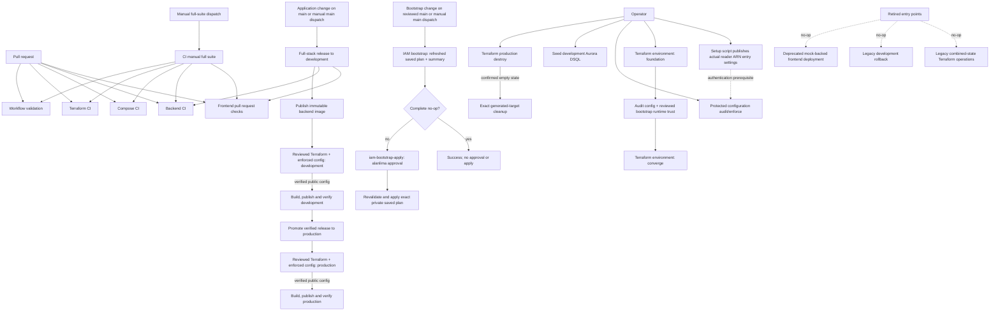

# GitHub Actions workflow reference

This is the central operator and contributor reference for PawLocal's GitHub Actions workflows. It explains when each workflow runs, what it does, which parameters it accepts, and how to obtain inputs that must be copied exactly.

Temporary MVP logging policy (owner-approved 23 October 2026): all GitHub Actions jobs retain ordinary operational stdout/stderr and useful failure context in their logs, using GitHub's normal secret masking. Terraform init/plan/apply and destroy plans use live output by default, independently of the optional exact-plan inspection flag. Programmatic plan/state JSON and credential/secret transport remain internal. The owner accepts operational-log exposure risk while broader workflow review, log purging and Environment recreation are deferred; this changes no approval, ownership or production-promotion gate.

The workflow files remain authoritative. The synchronization test in `tests/ci/test_github_actions_reference.py` fails when a workflow, manual-dispatch input, reusable-call input, or protected configuration reference is added, removed, or renamed without updating this document. Reviewers must still verify that the purpose, sequence, accepted values, and parameter instructions remain accurate when workflow behavior changes.

## Configuration reconciliation delivery contract

[#203](https://github.com/alanlima/pawlocal/issues/203) delivers the [mapping contract](configuration-management.md) and [inventory](configuration-inventory.md). Foundation uses post-apply audit. Converge/Release use preflight enforce, then post-apply enforce before building/publishing from the same verified public snapshot. Failures block publication. Existing saved-plan review and production promotion gates remain unchanged. See the guide for setup, cleanup and recovery.

## Workflow map



Foundation and Converge are one provisioning lifecycle but separate Terraform transactions. AWS generates the Lightsail principal and CloudFront identifiers during Foundation; the bootstrap and environment states consume those exact identifiers before Converge can safely deploy the backend. See the [Terraform operator guide](terraform-greenfield-operations.md#environment-lifecycle-phases) for the detailed reasoning and state boundaries.

## Workflow inventory

| Workflow | Trigger | Purpose | Manual or reusable inputs |
|---|---|---|---|
| [`terraform-iam-bootstrap.yml`](../.github/workflows/terraform-iam-bootstrap.yml) | Relevant pushes to `main`, manual from `main` | Normal-refresh bootstrap plan, no-op completion and owner-approved exact-plan apply. | None |
| [`backend-ci.yml`](../.github/workflows/backend-ci.yml) | Relevant pull requests, relevant pushes to `main`, reusable call | Lint and test the backend against disposable PostgreSQL. | None |
| [`ci.yml`](../.github/workflows/ci.yml) | Manual | Run all CI suites, or the protected development reconciliation smoke call. | `reconciliation_smoke` |
| [`compose-ci.yml`](../.github/workflows/compose-ci.yml) | Relevant pull requests, relevant pushes to `main`, reusable call | Validate, build, start, smoke-test, and tear down the local Compose stack. | None |
| [`deploy-production.yml`](../.github/workflows/deploy-production.yml) | Manual | Promote one development-verified commit and immutable image to production, publish the frontend, and verify the release. | `release_commit`, `backend_image` |
| [`development-dsql-seed.yml`](../.github/workflows/development-dsql-seed.yml) | Manual from `main` | Seed the fixed development-only DSQL catalog and verify it through the development API. | None; uses protected secrets |
| [`frontend-deploy.yml`](../.github/workflows/frontend-deploy.yml) | Relevant pull requests, reusable call | Check, test, and build the HTTP-mode frontend. | None |
| [`frontend-production-deploy.yml`](../.github/workflows/frontend-production-deploy.yml) | Relevant pushes to `main`, manual | Retained no-op for historical links; never deploys. | None |
| [`fullstack-release.yml`](../.github/workflows/fullstack-release.yml) | Relevant pull requests, relevant pushes to `main`, manual | Run frontend/backend checks; on `main`, publish an immutable backend image, deploy development, publish the frontend, verify it, and record deployment evidence. | None |
| [`rollback-development.yml`](../.github/workflows/rollback-development.yml) | Manual | Retained no-op for the retired combined-state rollback path. | None |
| [`reconcile-environment.yml`](../.github/workflows/reconcile-environment.yml) | Manual, reusable call | Synchronize the exact Parameter Store mapping through matching protected approval; audit does not establish release readiness. | `environment`, `mode` |
| [`terraform-ci.yml`](../.github/workflows/terraform-ci.yml) | Relevant pull requests, relevant pushes to `main`, reusable call | Format, initialize without a backend, validate, and test every active Terraform root/module. | None |
| [`terraform-current-stack-operations.yml`](../.github/workflows/terraform-current-stack-operations.yml) | Manual | Retained no-op for the retired combined-state Terraform path. | None |
| [`terraform-environment-destroy.yml`](../.github/workflows/terraform-environment-destroy.yml) | Manual | Prepare, approve, plan, approve again, and destroy the complete production application state. | `environment`, `backend_image`, `confirmation` |
| [`terraform-environment.yml`](../.github/workflows/terraform-environment.yml) | Manual, reusable call | Plan and apply one environment's Foundation, Converge, or Release phase through protected environments. | `environment`, `phase`, `backend_image`, `release_commit`, `release_only` |
| [`workflow-validation.yml`](../.github/workflows/workflow-validation.yml) | Relevant pull requests, relevant pushes to `main`, reusable call | Validate workflow syntax, action-runtime policy, path behavior, and CI policy tests. | None |

## Running manual workflows with GitHub CLI

Authenticate first with `gh auth status`, use an account that can access the repository, and dispatch operational workflows from `main`. Workflow inputs are not secrets; do not put credentials or secret values in them. These no-input commands are safe entry points:

```powershell
$repo = "alanlima/pawlocal"
gh workflow run ci.yml --repo $repo --ref main
gh workflow run fullstack-release.yml --repo $repo --ref main
gh workflow run development-dsql-seed.yml --repo $repo --ref main
```

Use `gh run list --repo $repo --workflow <workflow-file>` to find the resulting run and `gh run watch <run-id> --repo $repo --exit-status` to follow it. `fullstack-release.yml` builds a new immutable image and deploys development; the seed workflow uses protected secrets and is development-only.

For a Foundation plan/apply, leave generated runtime inputs and the image empty:

```powershell
gh workflow run terraform-environment.yml --repo $repo --ref main -f environment=development -f phase=foundation -f release_only=false
```

For Converge, first obtain the immutable image and, for production, its matching development-verified commit using the procedure below:

```powershell
$environment = "production"
$releaseCommit = "REPLACE_WITH_FULL_40_CHARACTER_SHA"
$backendImage = "REPLACE_WITH_GHCR_DIGEST_REFERENCE"
gh workflow run terraform-environment.yml --repo $repo --ref main -f "environment=$environment" -f phase=converge -f "backend_image=$backendImage" -f "release_commit=$releaseCommit" -f release_only=false
```

For normal production Release, use the promotion workflow rather than dispatching the reusable Terraform workflow directly:

```powershell
gh workflow run deploy-production.yml --repo $repo --ref main -f "release_commit=$releaseCommit" -f "backend_image=$backendImage"
```

Production destroy requires the exact current image and exact confirmation text. It still pauses at both protected approval environments:

```powershell
gh workflow run terraform-environment-destroy.yml --repo $repo --ref main -f environment=production -f "backend_image=$backendImage" -f "confirmation=DESTROY production"
```

Do not dispatch `frontend-production-deploy.yml`, `rollback-development.yml`, or `terraform-current-stack-operations.yml` for an operation. Their manual entry points are retained no-ops for historical links.

## CI and validation workflows

### Backend CI

<!-- actions-reference: backend-ci.yml; dispatch-inputs: -; call-inputs: - -->

`backend-ci.yml` runs for backend, API-contract, or Python dependency changes and can be called by another workflow. It starts PostgreSQL 17.6, applies migrations, lints Python and DSQL SQL, and runs backend unit and PostgreSQL integration tests. It accepts no operator inputs and creates no deployment.

### Frontend pull request checks

<!-- actions-reference: frontend-deploy.yml; dispatch-inputs: -; call-inputs: - -->

`frontend-deploy.yml` runs for frontend, contract, package-lock, or release-workflow changes and can be called by another workflow. It installs the pinned frontend dependencies, checks formatting/linting, runs unit tests, and builds the frontend in HTTP mode with non-live CI values. It accepts no operator inputs and publishes nothing.

### Compose CI

<!-- actions-reference: compose-ci.yml; dispatch-inputs: -; call-inputs: - -->

`compose-ci.yml` runs for Compose, container, observability, environment-example, or API-contract changes and can be called by another workflow. It validates the Compose model, builds the full stack, waits for declared health checks, smoke-checks the frontend/API/Grafana endpoints, and always removes the CI stack and volumes. It accepts no operator inputs.

### Terraform CI

<!-- actions-reference: terraform-ci.yml; dispatch-inputs: -; call-inputs: - -->

`terraform-ci.yml` runs for Terraform, lifecycle-helper, and matching CI-test changes and can be called by another workflow. Its matrix covers the bootstrap root, both environment roots, the DSQL setup module, and the shared environment module. It performs formatting, backend-free initialization, validation, rendered-policy tests, and DSQL lifecycle tests. It never plans or applies live infrastructure.

### Workflow validation

<!-- actions-reference: workflow-validation.yml; dispatch-inputs: -; call-inputs: - -->

`workflow-validation.yml` runs for workflow, local-action, CI-script, policy-test, and deployment-adapter changes and can be called by another workflow. It runs an external-action runtime smoke test, pins and runs `actionlint`, and executes the repository's workflow/path/security tests. Changes to this reference also trigger it so the workflow/input inventory cannot silently drift.

### CI manual full suite

<!-- actions-reference: ci.yml; dispatch-inputs: reconciliation_smoke; call-inputs: - -->

`ci.yml` is the manual umbrella workflow. With `reconciliation_smoke=false` (default) it calls the frontend, backend, Compose, Terraform, and workflow-validation reusable workflows. Set the boolean `reconciliation_smoke=true` to run only the protected development audit reconciliation call from the selected reviewed ref. This CI-only harness permits an open-PR feature-branch test before the new workflow is registered on main; temporarily allowlist only that exact ref in `development-apply`, preserve reviewer approval, and remove it after merge. It calls no deployment pipeline and its caller holds no reconciliation concurrency lock.

### Reconcile Environment configuration

<!-- actions-reference: reconcile-environment.yml; dispatch-inputs: environment,operation,confirmation,mode; call-inputs: environment,mode,selection,operation,confirmation,destroy_confirmed,caller_holds_lifecycle_lock -->

`reconcile-environment.yml` accepts `environment` (development/production), `mode` (audit default or enforce), and `operation` (reconcile default or explicit legacy-cleanup). Cleanup also requires exact `confirmation` (`CLEAN legacy development` or `CLEAN legacy production`). Reusable calls additionally accept `selection` (all/default or preflight), internal destroy-cleanup and `destroy_confirmed`; confirmed destroy cleanup is callable only after the existing protected destroy succeeds and verifies the same state empty.

Reusable callers that already hold the environment lifecycle lock pass `caller_holds_lifecycle_lock: true`. Other callers, including manual and CI runs, take that lock themselves.

One mutation job uses `<environment>-apply` for approval and the named `PAWLOCAL_CONFIG_GITHUB_TOKEN` secret. Callers pass that secret explicitly; see [GitHub's reusable secret rules](https://docs.github.com/en/actions/how-tos/reuse-automations/reuse-workflows). Audit warns/skips missing sources and does not establish release readiness. Enforce validates all selected values before writes. Existing-target checks, variable compare/write/read-back and encrypted secret API writes remain mandatory. Reports contain names/statuses only; secret payloads never enter outputs or artifacts.

Converge and Release enforce required handoff inputs before planning; Foundation audit runs after apply without authorizing publication. Successful Converge/Release applies return a verified non-secret `frontend_config` output to the same run's build. Missing/invalid values, failed writes, failed apply or cancellation block publication. `selection=preflight` checks only the seven generated plan/apply handoff inputs; `selection=all` checks the full manifest and public build snapshot. No lifecycle fields are added to YAML.

Use the [setup guide](configuration-management.md#set-up-access), then dispatch:

```powershell
gh workflow run reconcile-environment.yml --repo alanlima/pawlocal --ref main -f environment=development -f mode=enforce
```

A reviewed open-PR development smoke call remains available through `ci.yml` with `reconciliation_smoke=true` on the exact allowed branch. On-demand/CI calls take the same environment lifecycle lock as apply/publication. The four outer pipeline callers hold that lock themselves; nested reconciliation uses a separate call group and its per-environment mutation lock, preventing deadlock. All mutation locks disable cancellation of an active run.

Explicit legacy cleanup checks the active release/recovery consumers and exact configured adapter before deleting only the approved release-Environment names. Removing a mapping or missing a source never deletes anything. See the [inventory](configuration-inventory.md) for history and the [recovery guide](configuration-management.md#values-and-recovery) for retry/destroy/reapply rules.

## Deployment and operations workflows

### Full-stack release to development

<!-- actions-reference: fullstack-release.yml; dispatch-inputs: -; call-inputs: - -->

`fullstack-release.yml` performs checks on relevant pull requests. A relevant push to `main`, or a manual dispatch from `main`, additionally:

1. builds and publishes the backend image to GHCR;
2. binds it to its immutable registry digest;
3. calls `terraform-environment.yml` with the development Release phase;
4. builds and publishes the development frontend;
5. verifies public health, running image identity, DSQL migration/baseline state, and a database-backed place query; and
6. records a successful development deployment containing the commit/image pair and verification evidence.

It accepts no manual inputs because the commit is the selected `main` revision and the image digest is produced by the same run.

Development verification is produced after this run's Terraform Release apply and public checks. The development Release therefore uses the current run's full commit SHA and freshly published immutable image; it does not require a previously verified development deployment. Only production Converge and Release require a commit/image pair from a prior successful verified-development deployment.

### Terraform environment plan and apply

<!-- actions-reference: terraform-environment.yml; dispatch-inputs: environment,phase,backend_image,release_commit,release_only; call-inputs: environment,phase,backend_image,release_commit,release_only -->

`terraform-environment.yml` owns protected plans and exact saved-plan applies for one clean environment state. It uses the matching plan/apply GitHub Environments, transfers the opaque plan through private storage, and verifies the plan metadata and digest before applying it.

| Input | Manual dispatch | Reusable call | Accepted value and meaning |
|---|---|---|---|
| `environment` | Required | Required | `development` or `production`; selects the Terraform root, state key, protected environments, roles, and naming scope. |
| `phase` | Required; defaults to `foundation` | Optional; defaults to `release` | `foundation`, `converge`, or `release`; selects the lifecycle contract described below. |
| `backend_image` | Optional; defaults to empty | Optional; defaults to empty | Empty for Foundation, or `ghcr.io/alanlima/pawlocal-api@sha256:<64 lowercase hex characters>` for Converge or Release. Never use a mutable tag. |
| `release_commit` | Optional; defaults to empty | Optional; defaults to empty | Empty for Foundation. The development full-stack Release supplies the current run's full SHA before that run is verified. Production Converge and Release require the full SHA from a prior successful verified-development deployment paired with the selected image. |
| `release_only` | Required; defaults to `false` | Optional; defaults to `false` | `false` for Foundation/Converge; `true` for Release. It declares the intended version-only scope; automated rejection is temporarily skipped under Issue #148, so exact-plan review remains mandatory. |

Valid combinations:

| Phase | `backend_image` | `release_commit` | `release_only` |
|---|---|---|---:|
| Foundation | Empty | Empty | `false` |
| Development Converge | Immutable digest reference | Optional unless a calling process binds it | `false` |
| Production Converge | Development-verified immutable reference | Matching development-verified full SHA | `false` |
| Development Release | Immutable reference produced by the current full-stack run | Current full SHA | `true` |
| Production Release | Development-verified immutable reference | Matching development-verified full SHA | `true` |

Converge and Release enforce required handoff inputs before planning. The preflight output supplies the current generated values directly to the plan/apply jobs; successful post-apply enforce supplies the public build snapshot. Foundation audit warns about expected missing runtime values and cannot authorize publication. A green apply still requires the existing live release verification.

### Promote verified release to production

<!-- actions-reference: deploy-production.yml; dispatch-inputs: release_commit,backend_image; call-inputs: - -->

`deploy-production.yml` is the normal production application-promotion entry point after the infrastructure has converged. It rejects a commit/image pair unless a successful development deployment recorded matching verification evidence. It then calls the production Release phase, builds the selected commit's frontend with production configuration, publishes it, runs public verification, and records the successful production deployment.

| Input | Required | Accepted value |
|---|---:|---|
| `release_commit` | Yes | Full 40-character `main` commit SHA from one successful verified development deployment. |
| `backend_image` | Yes | Exact `ghcr.io/alanlima/pawlocal-api@sha256:...` value from the same development deployment. |

Do not independently choose a commit and an image. They are one verified pair.

The Release contract intends to change only the Lightsail container deployment version. During the accepted Issue #148 MVP gap, `--skip-enforcement` keeps the automated ownership/release-only rejection disabled. The protected reviewer must therefore inspect the exact rendered plan and reject any additional resource change.

### Terraform production destroy

<!-- actions-reference: terraform-environment-destroy.yml; dispatch-inputs: environment,backend_image,confirmation; call-inputs: - -->

`terraform-environment-destroy.yml` is the supported full production application-state teardown. It creates and applies a preparation plan, creates a fresh destroy plan, requires a second protected approval, applies that exact plan, and verifies that the same production state is present and empty.

| Input | Required | Accepted value | Meaning |
|---|---:|---|---|
| `environment` | Yes | `production` | The workflow cannot target development or bootstrap state. |
| `backend_image` | Yes | Exact immutable image currently recorded in production | Keeps the input configuration identical while preparing and destroying the current state. |
| `confirmation` | Yes | `DESTROY production` | Exact case-sensitive operator confirmation. |

Destroy is not a rollback and does not select a previous release.

### Seed development Aurora DSQL

<!-- actions-reference: development-dsql-seed.yml; dispatch-inputs: -; call-inputs: - -->

`development-dsql-seed.yml` has no dispatch inputs and runs only from `main`. It reads the development-only account, runtime role, DSQL endpoint, and API health URL from the `development-seed` protected Environment, assumes the development runtime role through OIDC, applies the fixed synthetic seed catalog, and verifies the records through the development API. It must never target production.

## Retired workflows

### Deprecated mock-backed frontend deployment

<!-- actions-reference: frontend-production-deploy.yml; dispatch-inputs: -; call-inputs: - -->

`frontend-production-deploy.yml` keeps its historical triggers and name so old links remain understandable. Its only job prints a retirement message. It does not publish the frontend.

### Legacy development rollback

<!-- actions-reference: rollback-development.yml; dispatch-inputs: -; call-inputs: - -->

`rollback-development.yml` is a manual no-op retained for the retired combined-state rollback path. It does not change AWS, Terraform state, or an application release.

### Legacy combined-state Terraform operations

<!-- actions-reference: terraform-current-stack-operations.yml; dispatch-inputs: -; call-inputs: - -->

`terraform-current-stack-operations.yml` is a manual no-op retained for historical links. Use `terraform-environment.yml` for development/production application states and the separately reviewed bootstrap procedure for shared IAM.

## Protected configuration used by operational workflows

<!-- actions-protected-configuration
secrets.PAWLOCAL_API_HEALTH_URL
secrets.PAWLOCAL_AWS_ACCOUNT_ID
secrets.PAWLOCAL_BOOTSTRAP_AWS_ACCESS_KEY_ID
secrets.PAWLOCAL_BOOTSTRAP_AWS_SECRET_ACCESS_KEY
secrets.PAWLOCAL_CLOUDFRONT_CERTIFICATE_ARN
secrets.PAWLOCAL_CONFIG_GITHUB_TOKEN
secrets.PAWLOCAL_DSQL_ENDPOINT
secrets.PAWLOCAL_DSQL_SEED_ROLE_ARN
vars.AWS_REGION
vars.PAWLOCAL_AWS_ACCOUNT_ID
vars.PAWLOCAL_CLOUDFRONT_DISTRIBUTION_ARN
vars.PAWLOCAL_CLOUDFRONT_OAC_ARN
vars.PAWLOCAL_CONFIG_READER_ROLE_ARN
vars.PAWLOCAL_DEPLOY_ADAPTER_PATH
vars.PAWLOCAL_DOMAIN_NAME
vars.PAWLOCAL_ROUTE53_ZONE_ID
vars.PAWLOCAL_RUNTIME_ROLE_ARN
vars.PAWLOCAL_TERRAFORM_APPLY_ROLE_ARN
vars.PAWLOCAL_TERRAFORM_DIAGNOSTIC_LOGS
vars.PAWLOCAL_TERRAFORM_PLAN_BUCKET
vars.PAWLOCAL_TERRAFORM_PLAN_ROLE_ARN
vars.PAWLOCAL_TF_STATE_BUCKET
-->

Workflow-dispatch inputs are not secrets. Operational workflows additionally consume configuration from protected GitHub Environments.

Reconciliation consumes `AWS_REGION`, `PAWLOCAL_CONFIG_READER_ROLE_ARN` and the scoped `PAWLOCAL_CONFIG_GITHUB_TOKEN` secret in the matching protected apply Environment. The owner-operated setup script publishes actual reader-role ARNs to matching release/apply pairs during initial setup or identity changes; existing reconciliation retains ongoing configuration synchronization. Bootstrap Actions do not duplicate it.

### IAM bootstrap plan and apply

<!-- actions-reference: terraform-iam-bootstrap.yml; dispatch-inputs: -; call-inputs: - -->

`terraform-iam-bootstrap.yml` has no manual inputs. Relevant trusted-main pushes or manual main dispatch plan the existing bootstrap state. PRs run backend-free checks only. A complete refreshed no-op succeeds without approval. Changed plans use existing private S3 transfer and wait for `alanlima` in main-only `iam-bootstrap-apply`, with administrator bypass disabled. Apply verifies exact plan digest, source, effective inputs, backend/state generation, run/attempt, supersession and six-hour expiry; it never replans after approval. There is no automatic reader-role publication job. The owner-operated setup script maintains those entry settings; existing reconciliation remains unchanged. Summaries report status/action counts and next steps. Ordinary Terraform operation output is available in step logs under the [temporary MVP logging exception](iam-bootstrap-actions.md#job-summaries-and-recovery); programmatic plan JSON and direct state/API payloads remain internal.

Both bootstrap Environments provide `AWS_REGION`, `PAWLOCAL_AWS_ACCOUNT_ID`, `PAWLOCAL_TF_STATE_BUCKET`, `PAWLOCAL_TERRAFORM_PLAN_BUCKET` and dedicated `PAWLOCAL_BOOTSTRAP_AWS_ACCESS_KEY_ID` / `PAWLOCAL_BOOTSTRAP_AWS_SECRET_ACCESS_KEY` secrets. They also provide `TF_VAR_github_repository`, `TF_VAR_github_owner_id`, `TF_VAR_github_repository_id`, `TF_VAR_route53_zone_id`, `TF_VAR_domain_name`, `TF_VAR_manage_github_oidc_provider`, `TF_VAR_development_lightsail_principal_arn` and `TF_VAR_production_lightsail_principal_arn`. Bootstrap does not consume `PAWLOCAL_CONFIG_GITHUB_TOKEN`; that shared repository secret remains available to existing reconciliation under the owner's accepted location risk. All import flags, root, workspace, project and backend key are fixed in code. See [bootstrap setup and recovery](iam-bootstrap-actions.md) and [identity setup tooling](../ops/iam-bootstrap/README.md).

### Environment plan/apply and destroy

The matching `<environment>-plan` Environment provides these variables:

- `AWS_REGION`
- `PAWLOCAL_AWS_ACCOUNT_ID`
- `PAWLOCAL_TF_STATE_BUCKET`
- `PAWLOCAL_TERRAFORM_PLAN_BUCKET`
- `PAWLOCAL_TERRAFORM_PLAN_ROLE_ARN`
- `PAWLOCAL_DOMAIN_NAME`
- `PAWLOCAL_ROUTE53_ZONE_ID`
- `PAWLOCAL_RUNTIME_ROLE_ARN` after the runtime-trust handoff
- `PAWLOCAL_CLOUDFRONT_DISTRIBUTION_ARN` after Foundation
- `PAWLOCAL_CLOUDFRONT_OAC_ARN` after Foundation

It also provides the secret `PAWLOCAL_CLOUDFRONT_CERTIFICATE_ARN`. Foundation deliberately clears the three generated runtime target variables and `backend_image` before planning; Converge, Release, and destroy require the matching current values.

The matching `<environment>-apply` Environment provides `AWS_REGION`, `PAWLOCAL_AWS_ACCOUNT_ID`, `PAWLOCAL_TF_STATE_BUCKET`, `PAWLOCAL_TERRAFORM_PLAN_BUCKET`, and `PAWLOCAL_TERRAFORM_APPLY_ROLE_ARN`. The `production-destroy-prepare` and `production-destroy` approval Environments provide that same apply-side set. They do not supply Terraform configuration values because they apply the exact saved plan produced under `production-plan`.

`PAWLOCAL_TERRAFORM_DIAGNOSTIC_LOGS` is read through the GitHub `vars` context and retains its existing explicit saved-plan inspection and ownership-review gate behavior. Ordinary operation logs are always visible under the temporary MVP policy; enabling normal logging does not set this flag or bypass its review requirement.

Lambda and CloudWatch Logs operations for the Cognito pre sign-up trigger use the stable Terraform provider alias `aws.cognito_deployment`; Cognito itself and every unrelated resource continue to use the default provider. Each plan or destroy-plan job constructs the delegated role `pawlocal-<environment>-cognito-terraform-plan`. Each apply, teardown-preparation apply, or destroy-apply job constructs `pawlocal-<environment>-cognito-terraform-apply`. The ARN is derived from the workflow-local `AWS_PARTITION=aws`, the already required 12-digit `PAWLOCAL_AWS_ACCOUNT_ID`, the exact environment, and the normalized `plan` or `apply` purpose. No new GitHub role-ARN variable and no default `TF_VAR_cognito_pre_sign_up_role_arn` are used.

After the existing environment role receives fresh credentials, the workflow sets the validated Terraform `project_name` input to its approved default `pawlocal` and derives the shared-config profile as `<project_name>-cognito-deployment`. It writes that profile outside the checkout with mode `0600`; Terraform derives the same profile name from `var.project_name`. The profile uses `credential_source = Environment`, the deterministic `pawlocal-*` delegated role required by DEC-009, a purpose-specific session name, and `duration_seconds = 3600`. The workflow does not set `AWS_PROFILE`, so the default provider keeps the environment credentials. It masks the delegated ARN, verifies the delegated STS caller, blanks the profile, ARN, and config path during plan diagnostics, and removes the project-derived file in an `if: always()` cleanup step.

The delegated hop is role chaining and cannot exceed one hour. Every Terraform plan or apply job has the same one-hour ceiling and starts with fresh base credentials. An expired, interrupted, or failed operation must generate a new saved plan and repeat review; never retry or apply stale plan material. Bootstrap outputs `cognito_terraform_role_arns` and `cognito_pre_sign_up_role_arns` are post-apply verification evidence only and are not copied into workflow configuration.

The Cognito pre-sign-up function is packaged by `terraform-aws-modules/lambda/aws` pinned to [v8.12.0](https://github.com/terraform-aws-modules/terraform-aws-lambda/releases/tag/v8.12.0) from its one-file `source_path`. Package identity uses the module's stable source-content filename, not a workflow ID. `trigger_on_package_timestamp = false` and `ignore_source_code_hash = true` leave code-change detection to that filename. Normal saved plans force only the module-local `local_file.archive_plan[0]` and `null_resource.archive[0]` replacements. The saved plan therefore schedules the module's sidecar and package build on the fresh apply runner, including partial retries, while apply checks the exact planned commit and a clean tracked tree immediately before using the plan. Only the opaque saved plan and metadata use private S3 transfer; no Lambda package is uploaded or downloaded separately. Teardown preparation does not force local package replacements, so the strict preparation guard sees no Lambda/module change. Final destroy has no Lambda-specific package step or check: it applies the reviewed delete-only plan and deletes the function and its environment-owned supporting resources. Moving an existing run-specific filename to this stable identity can cause one migration code update; subsequent unchanged-source plans must leave Lambda unchanged. Real source changes change the content filename and still deploy; function configuration changes remain managed normally.

### Development and production release environments

The matching release Environment provides:

- `AWS_REGION`
- `PAWLOCAL_DEPLOY_ROLE_ARN`
- `PAWLOCAL_DEPLOY_ADAPTER_PATH`
- `PAWLOCAL_PUBLIC_BASE_URL`
- `PAWLOCAL_API_HEALTH_URL`
- `PAWLOCAL_FRONTEND_BUCKET`
- `PAWLOCAL_CLOUDFRONT_DISTRIBUTION_ID`
- `VITE_API_BASE_URL`
- `VITE_COGNITO_DOMAIN`
- `VITE_COGNITO_CLIENT_ID`
- `VITE_COGNITO_REDIRECT_URI`
- `VITE_COGNITO_LOGOUT_URI`
- `VITE_COGNITO_SCOPES`

Generated values now synchronize through the reviewed Parameter Store mapping and protected reconciliation workflow. The bootstrap Lightsail runtime-trust handoff remains a separate reviewed operation.

### Development seed environment

The `development-seed` Environment provides these secrets:

- `PAWLOCAL_AWS_ACCOUNT_ID`
- `PAWLOCAL_DSQL_SEED_ROLE_ARN`
- `PAWLOCAL_DSQL_ENDPOINT`
- `PAWLOCAL_API_HEALTH_URL`

## How to obtain complex parameters

### Obtain the verified `release_commit` and `backend_image` pair

Use the values recorded by one successful development deployment. Do not reconstruct an image reference from a tag and do not combine values from different deployments.

1. List recent development deployment records:

   ```bash
   gh api --method GET repos/alanlima/pawlocal/deployments -f environment=development -f per_page=100 --jq '.[] | select(.payload.evidence_validated == true) | [.id, .created_at, .payload.release_commit, .payload.backend_image, .payload.workflow_run_id, .payload.workflow_run_attempt] | @tsv'
   ```

2. Select the intended deployment and confirm its latest status is successful:

   ```bash
   gh api repos/alanlima/pawlocal/deployments/REPLACE_WITH_DEPLOYMENT_ID/statuses --jq 'max_by(.created_at) | [.state, .log_url] | @tsv'
   ```

3. Confirm the originating workflow completed successfully and its head SHA matches `release_commit`:

   ```bash
   gh api repos/alanlima/pawlocal/actions/runs/REPLACE_WITH_RUN_ID/attempts/REPLACE_WITH_ATTEMPT --jq '[.name, .conclusion, .head_sha, .html_url] | @tsv'
   ```

4. Require the selected attempt to report `success`, and require its `head_sha` to equal the deployment payload's `release_commit`.

5. Copy `.payload.release_commit` exactly into `release_commit` and `.payload.backend_image` exactly into `backend_image`. The image must include `@sha256:` followed by 64 lowercase hexadecimal characters.

6. Use the pair unchanged for production Converge or `deploy-production.yml`. Production eligibility independently verifies the recorded evidence.

### Obtain Foundation handoff values

Foundation intentionally leaves generated runtime inputs empty. After its reviewed apply:

1. Initialize the matching environment root against its existing backend using the operator guide.
2. Read the single non-secret output object:

   ```bash
   terraform -chdir=infra/terraform/environments/<environment> output -json environment_targets
   ```

3. Copy only the matching output fields to their matching protected configuration:

   | `environment_targets` field | Protected configuration use |
   |---|---|
   | `cloudfront_distribution_arn` | `PAWLOCAL_CLOUDFRONT_DISTRIBUTION_ARN` in the plan Environment |
   | `cloudfront_oac_arn` | `PAWLOCAL_CLOUDFRONT_OAC_ARN` in the plan Environment |
   | `frontend_bucket` | `PAWLOCAL_FRONTEND_BUCKET` in the release Environment |
   | `cloudfront_distribution_id` | `PAWLOCAL_CLOUDFRONT_DISTRIBUTION_ID` in the release Environment |
   | `frontend_url` | `PAWLOCAL_PUBLIC_BASE_URL`; append `/auth/callback` for `VITE_COGNITO_REDIRECT_URI` and `/` for `VITE_COGNITO_LOGOUT_URI` |
   | `api_health_url` | `PAWLOCAL_API_HEALTH_URL`; replace the terminal `/health` with `/api/v1` for `VITE_API_BASE_URL` |
   | `cognito_client_id` | `VITE_COGNITO_CLIENT_ID` |
   | `dsql_endpoint` | `PAWLOCAL_DSQL_ENDPOINT` in `development-seed` only |
   | `lightsail_principal_arn` | Matching bootstrap runtime-trust input; do not place it directly in a release Environment |

4. The generated Cognito hosted-domain prefix is not exposed by `environment_targets`. Read it from the same state without changing the resource:

   ```bash
   terraform -chdir=infra/terraform/environments/<environment> state show -no-color 'module.pawlocal.aws_cognito_user_pool_domain.application'
   ```

   Set `VITE_COGNITO_DOMAIN` to `https://<domain-prefix>.auth.<aws-region>.amazoncognito.com` using the returned `domain` and matching `aws_region`. Set `VITE_COGNITO_SCOPES` to the configured client scopes, currently `openid email profile`.

5. Pass the exact `lightsail_principal_arn` to a fresh bootstrap plan for the same environment and review/apply that saved plan.

6. Read the resulting publisher and runtime roles from `identity_app_role_arns`:

   ```bash
   terraform -chdir=infra/terraform/iam-bootstrap output -json identity_app_role_arns
   ```

   Use `<environment>_frontend` for `PAWLOCAL_DEPLOY_ROLE_ARN` and `<environment>_runtime` for `PAWLOCAL_RUNTIME_ROLE_ARN`. The reviewed deployment adapter path is `ops/deployment-adapters/lightsail-dsql.sh`.

7. Update only the matching environment's protected variables and secrets. Never copy development values to production or production values to development.
8. Generate a fresh Converge plan. Do not reuse the Foundation plan.

### Obtain the current image for production destroy

The destroy input must describe the image currently configured in production, not merely the newest development image.

1. List production deployments:

   ```bash
   gh api --method GET repos/alanlima/pawlocal/deployments -f environment=production -f per_page=100 --jq '.[] | [.id, .created_at, .ref, .payload.backend_image] | @tsv'
   ```

2. Check the selected candidate's latest status and use only a successful record:

   ```bash
   gh api repos/alanlima/pawlocal/deployments/REPLACE_WITH_DEPLOYMENT_ID/statuses --jq 'max_by(.created_at) | [.state, .log_url] | @tsv'
   ```

3. Compare its immutable image reference with `environment_targets.backend_image` from the current production Terraform state:

   ```bash
   terraform -chdir=infra/terraform/environments/production output -json environment_targets
   ```

4. Supply that exact reference as `backend_image` and type `DESTROY production` as the confirmation. If the successful deployment record and current state disagree, stop instead of guessing.

### Obtain the CloudFront ACM certificate ARN

CloudFront requires its viewer certificate in `us-east-1`. This is an operator-controlled prerequisite, not the Lightsail API certificate created by the environment root.

1. List issued ACM certificates in `us-east-1`:

   ```bash
   aws acm list-certificates --region us-east-1 --certificate-statuses ISSUED
   ```

2. Describe the intended certificate and verify its domain coverage, status, and account before copying its ARN:

   ```bash
   aws acm describe-certificate --region us-east-1 --certificate-arn <certificate-arn>
   ```

3. Store the exact ARN as the `PAWLOCAL_CLOUDFRONT_CERTIFICATE_ARN` secret in the matching `<environment>-plan` Environment. Apply jobs consume the reviewed saved plan and do not need this secret. Do not use a Lightsail certificate ARN.

### Obtain development seed targets

1. Read the matching development `environment_targets` output after Converge.
2. Use its DSQL endpoint and API health URL for the matching protected seed values.
3. Read `identity_app_role_arns.development_runtime` from the bootstrap state for the seed role.
4. Read `aws_account_id` from the bootstrap state and verify the runtime role belongs to that account.
5. Update only `development-seed`; never place production targets in this Environment.

## Maintenance checklist

When adding, removing, renaming, or changing a workflow:

1. Update the workflow map if its relationships changed.
2. Update the inventory row and detailed purpose section.
3. Update the input table and complex-parameter procedure when an input or accepted format changed.
4. Update the matching `actions-reference` metadata for both manual-dispatch and reusable-call inputs.
5. Update the protected-configuration prose and `actions-protected-configuration` metadata when variable or secret consumption changed; the metadata records `vars.` and `secrets.` contexts separately.
6. Run `python -m unittest tests.ci.test_github_actions_reference` and the applicable workflow tests.
