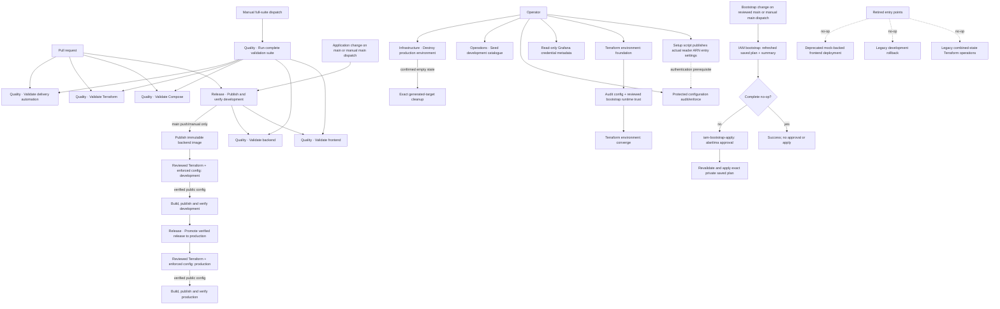

# GitHub Actions workflow reference

## Proposed unattended incident extension (#239)

The owner-approved MVP has no runtime human approval: signed alert → trusted admission → fixer → fresh reviewer/verdict broker → trusted PR → real candidate CI → separate trusted squash merge → verified development → automatic exact-release production dispatch → verified recovery. The optional approval switch is deferred. Existing workflow inventory below describes current implementation; this section specifies changes under #228/#229/#231.

Proposed `incident-responder.yml` jobs run trusted control logic from `main`. The broker binds reviewer evidence to base/candidate SHA, candidate tree and patch; it does not fabricate a GitHub check. The separate squash-merge job uses the publisher App only after real required CI, current head/base, bound verdict and resolved threads pass, through normal PR protections with no bypass. The App merge triggers `fullstack-release.yml`. A separate promoter uses job-local `GITHUB_TOKEN` with `actions: write` to dispatch only `deploy-production.yml` on `main`, with exact development-verified `release_commit` and `backend_image`. Actions write itself is repository-wide; trusted code and token isolation enforce the fixed workflow target. Verify that production run and served identities/recovery; dispatch acceptance is not deployment proof. Credential-bearing jobs never execute candidate scripts; model jobs have no merge, production query or deployment credentials.

Current CodeOwner review and production Environment reviewers prevent unattended operation. Removing them also affects ordinary paths. [#245](https://github.com/alanlima/pawlocal/issues/245) must first implement an App-issuer-bound required `PawLocal change authorization` status: trusted immutable control validates exact incident proof, while ordinary PRs require protected owner approval. It also gates every shared production/infrastructure entrypoint before credentials, admitting only authenticated release-only incident lineage or ordinary owner approval. A caller flag/actor/title/label is never proof. See the [complete discriminator, credential boundary and inventory acceptance](specs/incident-responder.md#preserving-ordinary-approvals-245). Only after independent verification may one-time setup replace shared reviewers while retaining actual CI, PR/squash/thread resolution, main-only trust, force-push/deletion protections and no bypass actors. No live policy is changed here; existing ordinary gates remain until their replacement is proved.

Admission through trusted PR publication has one 20-minute absolute deadline. A separate proposed 60-minute absolute deadline from that PR covers CI/merge/dev/prod/recovery without extending model quota. After expiry start no new mutation; reconcile bounded in-flight Terraform/deployment results without blind cancellation and escalate failed/unknown recovery. Initial model/rate/budget, credential, privacy and billable provisioning setup remains separate. This documentation changes no live settings or deployments.

This is the central operator and contributor reference for PawLocal's GitHub Actions workflows. It explains when each workflow runs, what it does, which parameters it accepts, and how to obtain inputs that must be copied exactly.

Temporary MVP logging policy (owner-approved 23 October 2026): all GitHub Actions jobs retain ordinary operational stdout/stderr and useful failure context in their logs, using GitHub's normal secret masking. Terraform init/plan/apply and destroy plans use live output by default, independently of the optional exact-plan inspection flag. Programmatic plan/state JSON and credential/secret transport remain internal. The owner accepts operational-log exposure risk while broader workflow review, log purging and Environment recreation are deferred; this changes no approval, ownership or production-promotion gate.

The workflow files remain authoritative. The synchronization test in `tests/ci/test_github_actions_reference.py` fails when a workflow, manual-dispatch input, reusable-call input, or protected configuration reference is added, removed, or renamed without updating this document. Reviewers must still verify that the purpose, sequence, accepted values, and parameter instructions remain accurate when workflow behavior changes.

## Configuration reconciliation delivery contract

[#203](https://github.com/alanlima/pawlocal/issues/203) delivers the [mapping contract](configuration-management.md) and [inventory](configuration-inventory.md). Foundation uses post-apply audit. Converge/Release use preflight enforce, then post-apply enforce before building/publishing from the same verified public snapshot. Failures block publication. Existing saved-plan review and production promotion gates remain unchanged. See the guide for setup, cleanup and recovery.

## Find the workflow for your task

| I want to... | Entry point | Accountable owner |
|---|---|---|
| Validate a PR | Automatic `fullstack-release.yml`, `compose-ci.yml`, `terraform-ci.yml`, `workflow-validation.yml`, according to paths below | Platform; Frontend/Backend own their checks |
| Run all checks | `ci.yml` manual | Platform |
| Release development | `fullstack-release.yml` on main/manual main | Platform |
| Promote production | `deploy-production.yml` with exact verified commit/image | Platform; owner approval |
| Provision or converge | `terraform-environment.yml` with environment/phase | Platform; owner approval |
| Reconcile configuration | `reconcile-environment.yml` | Platform; matching apply approval |
| Configure monitoring | Separate `grafana-development-setup.yml` / `grafana-production-setup.yml` | Platform; matching apply approval |
| Seed development | `development-dsql-seed.yml` | Backend/Platform; protected seed approval |
| Investigate/recover an incident | `incident-responder.yml`; see responder runbook | Platform; trusted controller |
| Destroy production | `terraform-environment-destroy.yml` | Platform; separate saved-plan approvals |

All current filenames are tracked Stage A exceptions under #272/DEC-014. New filenames use `<purpose>-<task>.yml`; workflows remain flat. The machine-readable [catalogue](../.github/workflow-catalogue.json) pins the exact display name per workflow. Navigation categories do not replace trust gates. The observed active ruleset `25363056` requires issuer-bound `PawLocal change authorization` from App `5450140`, with no bypass and PR/squash/thread resolution. Quality CI contexts were absent in that read-only snapshot; addressing that protection gap is separately scoped. No live settings are changed by this migration.

## Workflow map



Foundation and Converge are one provisioning lifecycle but separate Terraform transactions. AWS generates the Lightsail principal and CloudFront identifiers during Foundation; the bootstrap and environment states consume those exact identifiers before Converge can safely deploy the backend. See the [Terraform operator guide](terraform-greenfield-operations.md#environment-lifecycle-phases) for the detailed reasoning and state boundaries.

## Workflow inventory

All workflow YAML, authentication/approval steps and domain scripts remain authoritative. Inputs are public operator values; detailed accepted values and recovery procedures follow below. `call:` denotes internal reusable inputs, not a dispatch button.

| Workflow / display name | Trigger and callers | Exact inputs | Mutation / Environment / lock | Evidence and recovery |
|---|---|---|---|---|
| [`backend-ci.yml`](../.github/workflows/backend-ci.yml)<br>Quality · Validate backend<br>Previously: Backend CI | workflow_call; callers `ci.yml`, `fullstack-release.yml` | None | Disposable CI PostgreSQL only; no Environment; caller-specific cancellable backend lock | Job logs/summary and test artifacts where declared; correct cause and rerun applicable validation |
| [`frontend-deploy.yml`](../.github/workflows/frontend-deploy.yml)<br>Quality · Validate frontend<br>Previously: Frontend pull request checks | workflow_call; callers `ci.yml`, `fullstack-release.yml` | None | Validation only; no Environment; caller-specific cancellable frontend lock | Job logs/summary and test artifacts where declared; correct cause and rerun applicable validation |
| [`compose-ci.yml`](../.github/workflows/compose-ci.yml)<br>Quality · Validate Compose<br>Previously: Compose CI | pull_request, push, workflow_call; callers `ci.yml` | None | Disposable local Docker stack; no Environment; cancellable Compose lock | Job logs/summary and test artifacts where declared; correct cause and rerun applicable validation |
| [`terraform-ci.yml`](../.github/workflows/terraform-ci.yml)<br>Quality · Validate Terraform<br>Previously: Terraform CI | pull_request, push, workflow_call; callers `ci.yml` | None | Offline validation; no Environment; cancellable Terraform CI lock | Job logs/summary and test artifacts where declared; correct cause and rerun applicable validation |
| [`workflow-validation.yml`](../.github/workflows/workflow-validation.yml)<br>Quality · Validate delivery automation<br>Previously: Workflow validation | pull_request, push, workflow_call; callers `ci.yml` | None | Offline tests and disposable fixture/image; no Environment; cancellable validation lock | Job logs/summary and test artifacts where declared; correct cause and rerun applicable validation |
| [`ci.yml`](../.github/workflows/ci.yml)<br>Quality · Run complete validation suite<br>Previously: CI manual full suite | workflow_dispatch | None | Quality only; no Environment/outer lock; component locks apply | Job logs/summary and test artifacts where declared; correct cause and rerun applicable validation |
| [`fullstack-release.yml`](../.github/workflows/fullstack-release.yml)<br>Release · Publish and verify development<br>Previously: Full-stack release to development | pull_request, push, workflow_dispatch | None | PR: checks only; main: image/frontend release + Terraform development; development/child plan/apply; lifecycle-development (PR cancellable, mutation non-cancelling) | Immutable image, manifest, validated verification + deployment record; failed/unknown release stops promotion |
| [`deploy-production.yml`](../.github/workflows/deploy-production.yml)<br>Release · Promote verified release to production<br>Previously: Promote verified release to production | workflow_dispatch | dispatch: `release_commit`, `backend_image`, `incident_environment`, `expected_workflow_sha` | Exact verified release only; production/child plan/apply and ordinary or authenticated incident approval; lifecycle-production non-cancelling | Production manifest/verification + deployment record; stop on eligibility/source mismatch |
| [`terraform-iam-bootstrap.yml`](../.github/workflows/terraform-iam-bootstrap.yml)<br>Infrastructure · Reconcile bootstrap identities<br>Previously: Terraform IAM bootstrap plan and apply | push, workflow_dispatch | None | IAM exact saved plan; iam-bootstrap-plan/apply, changed plan owner approval; bootstrap lock non-cancelling | Private digest-bound saved plan + manifest/summary; stale/failed/partial requires fresh plan/approval |
| [`terraform-environment.yml`](../.github/workflows/terraform-environment.yml)<br>Infrastructure · Plan and apply environment<br>Previously: Terraform environment plan and apply | workflow_dispatch, workflow_call; callers `fullstack-release.yml`, `deploy-production.yml` | dispatch: `environment`, `phase`, `backend_image`, `release_commit`, `release_only`; call: `enforce_guards`, `environment`, `phase`, `backend_image`, `release_commit`, `release_only` | Exact saved plan/apply; matching plan/apply or authenticated release incident route; lifecycle-environment, nested release uses terraform-environment; non-cancelling | Private digest-bound saved plan and public same-run config; fresh exact plan after stale/partial failure |
| [`terraform-environment-destroy.yml`](../.github/workflows/terraform-environment-destroy.yml)<br>Infrastructure · Destroy production environment<br>Previously: Terraform production destroy | workflow_dispatch | dispatch: `environment`, `backend_image`, `confirmation` | Production teardown only; production-plan, production-destroy-prepare, production-destroy; child cleanup production-apply; lifecycle-production non-cancelling | Reviewed preparation + delete-only plans; verify empty state before cleanup; fresh plan on failure |
| [`development-dsql-seed.yml`](../.github/workflows/development-dsql-seed.yml)<br>Operations · Seed development catalogue<br>Previously: Seed development Aurora DSQL | workflow_dispatch | None | Fixed development catalogue data; development-seed; seed lock non-cancelling | Existing job summary/receipt or public handoff; follow domain recovery guidance below, preserve gates |
| [`reconcile-environment.yml`](../.github/workflows/reconcile-environment.yml)<br>Operations · Reconcile environment configuration<br>Previously: Reconcile Environment configuration | workflow_dispatch, workflow_call; callers `terraform-environment.yml` | dispatch: `environment`, `fail_on_error`, `mode`; call: `environment`, `fail_on_error`, `mode`, `caller_holds_lifecycle_lock` | Exact mapped GitHub configuration; matching apply Environment; lifecycle-environment + configuration-environment, nested call group; non-cancelling | Existing job summary/receipt or public handoff; follow domain recovery guidance below, preserve gates |
| [`cleanup-destroyed-configuration.yml`](../.github/workflows/cleanup-destroyed-configuration.yml)<br>Operations · Clean up destroyed environment configuration<br>Previously: Clean up destroyed environment configuration | workflow_call; callers `terraform-environment-destroy.yml` | call: `environment`, `confirmation`, `destroy_confirmed` | Exact generated-setting deletion after confirmed destroy; matching apply Environment; configuration-environment non-cancelling | Existing job summary/receipt or public handoff; follow domain recovery guidance below, preserve gates |
| [`grafana-access-check.yml`](../.github/workflows/grafana-access-check.yml)<br>Operations · Verify Grafana access<br>Previously: Grafana read-only access check | workflow_dispatch | dispatch: `stack_url`, `region`, `sm_backend_url` | Bounded GET-only metadata; no Environment; no mutation lock | Existing job summary/receipt or public handoff; follow domain recovery guidance below, preserve gates |
| [`grafana-development-setup.yml`](../.github/workflows/grafana-development-setup.yml)<br>Operations · Configure development monitoring<br>Previously: Grafana development folder and Faro setup | workflow_dispatch | dispatch: `mode`, `stack_url`, `region`, `public_bindings_json`, `datasource_uids_json`, `frontend_origin` | Grafana folder/Faro discover/plan/apply; development-apply; Grafana development lock non-cancelling | Existing job summary/receipt or public handoff; follow domain recovery guidance below, preserve gates |
| [`grafana-production-setup.yml`](../.github/workflows/grafana-production-setup.yml)<br>Operations · Configure production monitoring<br>Previously: Grafana production folder and Faro setup | workflow_dispatch | dispatch: `mode`, `stack_url`, `region`, `public_bindings_json`, `datasource_uids_json`, `frontend_origin` | Grafana folder/Faro discover/plan/apply; production-apply; Grafana production lock non-cancelling | Existing job summary/receipt or public handoff; follow domain recovery guidance below, preserve gates |
| [`change-authorization.yml`](../.github/workflows/change-authorization.yml)<br>Automation · Authorize proposed changes<br>Previously: Change authorization | pull_request_target | None | Issuer-bound status only; incident-change-authorization or ordinary-change-approval; per-PR cancellable authorization lock | Existing job summary/receipt or public handoff; follow domain recovery guidance below, preserve gates |
| [`incident-responder.yml`](../.github/workflows/incident-responder.yml)<br>Automation · Recover from an application incident<br>Previously: Controlled incident response | workflow_dispatch | dispatch: `environment`, `schema_version`, `alerts_json` | Bounded application candidate/publication/merge/exact release; oncall/incident protected environments; serialized global non-cancelling queue | Bound receipts, authentic CI and deadline/recovery evidence; stop/escalate unsupported or uncertain outcomes |
| [`frontend-production-deploy.yml`](../.github/workflows/frontend-production-deploy.yml)<br>Retired · Static frontend deployment<br>Previously: Deprecated mock-backed frontend deployment (disabled) | push, workflow_dispatch | None | Retired no-op; no credentials, Environment or deployment; keep fail-closed stub | Existing job summary/receipt or public handoff; follow domain recovery guidance below, preserve gates |
| [`rollback-development.yml`](../.github/workflows/rollback-development.yml)<br>Retired · Combined-state development rollback<br>Previously: Legacy development rollback (disabled) | workflow_dispatch | None | Retired no-op; no credentials, Environment or deployment; keep fail-closed stub | Existing job summary/receipt or public handoff; follow domain recovery guidance below, preserve gates |
| [`terraform-current-stack-operations.yml`](../.github/workflows/terraform-current-stack-operations.yml)<br>Retired · Combined-state infrastructure operations<br>Previously: Legacy combined-state Terraform operations (disabled) | workflow_dispatch | None | Retired no-op; no credentials, Environment or deployment; keep fail-closed stub | Existing job summary/receipt or public handoff; follow domain recovery guidance below, preserve gates |

Ownership: Platform Engineer owns these workflows and setup actions; Frontend and Backend Engineers own their domain validation, Backend owns seed data. Orchestrator owns coordination and acceptance; independent Reviewer assesses the change and owner controls ordinary merge/approval.

## Running manual workflows with GitHub CLI

Authenticate first with `gh auth status`, use an account that can access the repository, and dispatch operational workflows from `main`. Workflow inputs are not secrets; do not put credentials or secret values in them. These no-input commands are safe entry points:

```powershell
$repo = "alanlima/pawlocal"
gh workflow run ci.yml --repo $repo --ref main
gh workflow run fullstack-release.yml --repo $repo --ref main
gh workflow run development-dsql-seed.yml --repo $repo --ref main
```

Use `gh run list --repo $repo --workflow <workflow-file>` to find the resulting run and `gh run watch <run-id> --repo $repo --exit-status` to follow it. `fullstack-release.yml` builds a new immutable image and deploys development; the seed workflow uses protected secrets and is development-only.

For a Foundation plan/apply, leave generated runtime inputs and the image empty:

```powershell
gh workflow run terraform-environment.yml --repo $repo --ref main -f environment=development -f phase=foundation -f release_only=false
```

For Converge, first obtain the immutable image and, for production, its matching development-verified commit using the procedure below:

```powershell
$environment = "production"
$releaseCommit = "REPLACE_WITH_FULL_40_CHARACTER_SHA"
$backendImage = "REPLACE_WITH_GHCR_DIGEST_REFERENCE"
gh workflow run terraform-environment.yml --repo $repo --ref main -f "environment=$environment" -f phase=converge -f "backend_image=$backendImage" -f "release_commit=$releaseCommit" -f release_only=false
```

For normal production Release, use the promotion workflow rather than dispatching the reusable Terraform workflow directly:

```powershell
gh workflow run deploy-production.yml --repo $repo --ref main -f "release_commit=$releaseCommit" -f "backend_image=$backendImage"
```

Production destroy requires the exact current image and exact confirmation text. It still pauses at both protected approval environments:

```powershell
gh workflow run terraform-environment-destroy.yml --repo $repo --ref main -f environment=production -f "backend_image=$backendImage" -f "confirmation=DESTROY production"
```

Do not dispatch `frontend-production-deploy.yml`, `rollback-development.yml`, or `terraform-current-stack-operations.yml` for an operation. Their manual entry points are retained no-ops for historical links.

## CI and validation workflows

### Quality · Validate backend

<!-- actions-reference: backend-ci.yml; dispatch-inputs: -; call-inputs: - -->

`backend-ci.yml` is callable by `fullstack-release.yml` for automatic source/contract/dependency validation and by `ci.yml` for the manual full suite. It starts PostgreSQL 17.6, applies migrations, lints Python and DSQL SQL, and runs backend unit and PostgreSQL integration tests. It accepts no operator inputs and creates no deployment.

### Quality · Validate frontend

<!-- actions-reference: frontend-deploy.yml; dispatch-inputs: -; call-inputs: - -->

`frontend-deploy.yml` is callable by `fullstack-release.yml` for automatic source/contract/dependency validation and by `ci.yml` for the manual full suite. It installs the pinned frontend dependencies, checks formatting/linting, runs unit tests, and builds the frontend in HTTP mode with non-live CI values. It accepts no operator inputs and publishes nothing.

### Quality · Validate Compose

<!-- actions-reference: compose-ci.yml; dispatch-inputs: -; call-inputs: - -->

`compose-ci.yml` runs for Compose, container, observability, environment-example, or API-contract changes and can be called by another workflow. It validates the Compose model, builds the full stack, waits for declared health checks, smoke-checks the frontend/API/Grafana endpoints, and always removes the CI stack and volumes. It accepts no operator inputs.

### Quality · Validate Terraform

<!-- actions-reference: terraform-ci.yml; dispatch-inputs: -; call-inputs: - -->

`terraform-ci.yml` runs for Terraform, lifecycle-helper, and matching CI-test changes and can be called by another workflow. Its matrix covers the bootstrap root, both environment roots, the DSQL setup module, and the shared environment module. It performs formatting, backend-free initialization, validation, rendered-policy tests, and DSQL lifecycle tests. It never plans or applies live infrastructure.

### Quality · Validate delivery automation

<!-- actions-reference: workflow-validation.yml; dispatch-inputs: -; call-inputs: - -->

`workflow-validation.yml` runs for workflow, local-action, CI-script, policy-test, and deployment-adapter changes and can be called by another workflow. It runs an external-action runtime smoke test, pins and runs `actionlint`, and executes the repository's workflow/path/security tests. Changes to this reference also trigger it so the workflow/input inventory cannot silently drift. The same Python 3.12 quality job installs the pinned credential-free Codex sandbox fixture and verifies real TestClient requests through the incident test-only launcher while external socket creation remains denied. No model inference or API credentials are used.

### Quality · Run complete validation suite

<!-- actions-reference: ci.yml; dispatch-inputs: -; call-inputs: - -->

`ci.yml` runs all five reusable Quality suites. It has no reconciliation input, credentials or operational job. For configuration synchronization, dispatch the existing `reconcile-environment.yml` Operations workflow with the matching environment, mode and strictness; its protected apply Environment, audit/enforce behavior and lifecycle lock remain authoritative. The temporary pre-registration feature-branch harness has been retired now that the operational dispatcher exists on main.

### Operations · Reconcile environment configuration

<!-- actions-reference: reconcile-environment.yml; dispatch-inputs: environment,fail_on_error,mode; call-inputs: environment,fail_on_error,mode,caller_holds_lifecycle_lock -->

`reconcile-environment.yml` accepts `environment`, reporting/output `mode`, and the `fail_on_error` boolean; reusable callers additionally pass the internal lifecycle-lock flag. The script and reusable call warn by default; manual dispatch defaults `fail_on_error` to true for operator verification. Terraform explicitly passes false so it can repair SSM access tags using existing protected configuration when synchronization is unavailable. It copies the single `parameter-mapping.yaml`: read existing SSM values and add/update matching GitHub Environment variables/secrets. Missing SSM values or destination Environments warn and skip in both modes. Access errors stop synchronization, retain their operational diagnostics, and warn unless `fail_on_error` is true; no Environment is implicitly created. Existing on-call targets require exactly one `main` branch deployment policy before source reads.

| Input | Manual dispatch | Reusable call | Meaning |
|---|---|---|---|
| `environment` | Required | Required | Matching development or production configuration. |
| `mode` | `audit` default | `audit` default | Existing reporting/output selection: `audit` or `enforce`. |
| `fail_on_error` | `true` default | `false` default | Explicitly require a failing workflow when synchronization cannot complete. |
| `caller_holds_lifecycle_lock` | Not exposed | `false` default | Internal flag for callers already holding the environment lifecycle lock. |

The matching `<environment>-apply` gate and explicit `PAWLOCAL_CONFIG_GITHUB_TOKEN` remain. Variables use comparison/read-back; secrets use encrypted API writes. Consumers separately validate required pre-plan/build configuration; skipped values never authorize publication. Outputs contain only existing public consumer projections and never secrets. Failed synchronization exposes no verified configuration or release snapshot, even when warning-only execution lets the caller continue.

### Internal destroy configuration cleanup

<!-- actions-reference: cleanup-destroyed-configuration.yml; dispatch-inputs: -; call-inputs: environment,confirmation,destroy_confirmed -->

`cleanup-destroyed-configuration.yml` has no manual entry point. The existing protected production destroy workflow calls it only after successful destroy or verified empty-state recovery. It preserves exact confirmation, caller and target checks and per-environment mutation locking. Public reconciliation exposes no cleanup operation or confirmation selector.

Use the [setup guide](configuration-management.md#set-up-access), then dispatch:

```powershell
gh workflow run reconcile-environment.yml --repo alanlima/pawlocal --ref main -f environment=development -f mode=enforce
```

Manual Operations reconciliation takes the same environment lifecycle lock as apply/publication. The outer pipeline callers hold that lock themselves; nested reconciliation uses a separate call group and its per-environment mutation lock, preventing deadlock. All mutation locks disable cancellation of an active run.

Explicit legacy cleanup checks the active release/recovery consumers and exact configured adapter before deleting only the approved release-Environment names. Removing a mapping or missing a source never deletes anything. See the [inventory](configuration-inventory.md) for history and the [recovery guide](configuration-management.md#values-and-recovery) for retry/destroy/reapply rules.

## Deployment and operations workflows

### Release · Publish and verify development

<!-- actions-reference: fullstack-release.yml; dispatch-inputs: -; call-inputs: - -->

`fullstack-release.yml` performs checks on relevant pull requests, including changes to `docs/oncall-setup.md` or `docs/oncall-troubleshooting.md`. These two operator-guide exceptions apply only to pull-request paths so their required frontend/backend checks run; guide-only pushes remain excluded from automatic publication/deployment. A relevant push to `main`, or a manual dispatch from `main`, additionally:

1. builds and publishes the backend image to GHCR;
2. binds it to its immutable registry digest;
3. calls `terraform-environment.yml` with the development Release phase;
4. builds and publishes the development frontend;
5. verifies public health, running image identity, DSQL migration/baseline state, and a database-backed place query; and
6. records a successful development deployment containing the commit/image pair and verification evidence.

It accepts no manual inputs because the commit is the selected `main` revision and the image digest is produced by the same run.

Development verification is produced after this run's Terraform Release apply and public checks. The development Release therefore uses the current run's full commit SHA and freshly published immutable image; it does not require a previously verified development deployment. Only production Converge and Release require a commit/image pair from a prior successful verified-development deployment.

### Infrastructure · Plan and apply environment

<!-- actions-reference: terraform-environment.yml; dispatch-inputs: environment,phase,backend_image,release_commit,release_only; call-inputs: rollback_only,enforce_guards,environment,phase,backend_image,release_commit,release_only -->

`terraform-environment.yml` owns protected plans and exact saved-plan applies for one clean environment state. It uses the matching plan/apply GitHub Environments, transfers the opaque plan through private storage, and verifies the plan metadata and digest before applying it.

| Input | Manual dispatch | Reusable call | Accepted value and meaning |
|---|---|---|---|
| `enforce_guards` | Not accepted | Optional; defaults to `true` | Incident caller's resolved on-call Environment mode; exact `true`/`false`; ordinary manual/call routes retain `true`. |
| `environment` | Required | Required | `development` or `production`; selects the Terraform root, state key, protected environments, roles, and naming scope. |
| `phase` | Required; defaults to `foundation` | Optional; defaults to `release` | `foundation`, `converge`, or `release`; selects the lifecycle contract described below. |
| `backend_image` | Optional; defaults to empty | Optional; defaults to empty | Empty for Foundation, or `ghcr.io/alanlima/pawlocal-api@sha256:<64 lowercase hex characters>` for Converge or Release. Never use a mutable tag. |
| `release_commit` | Optional; defaults to empty | Optional; defaults to empty | Empty for Foundation. The development full-stack Release supplies the current run's full SHA before that run is verified. Production Converge and Release require the full SHA from a prior successful verified-development deployment paired with the selected image. |
| `release_only` | Required; defaults to `false` | Optional; defaults to `false` | `false` for Foundation/Converge; `true` for Release. It declares the intended version-only scope; automated rejection is temporarily skipped under Issue #148, so exact-plan review remains mandatory. |

Valid combinations:

| Phase | `backend_image` | `release_commit` | `release_only` |
|---|---|---|---:|
| Foundation | Empty | Empty | `false` |
| Development Converge | Immutable digest reference | Optional unless a calling process binds it | `false` |
| Production Converge | Development-verified immutable reference | Matching development-verified full SHA | `false` |
| Development Release | Immutable reference produced by the current full-stack run | Current full SHA | `true` |
| Production Release | Development-verified immutable reference | Matching development-verified full SHA | `true` |

Converge and Release enforce required handoff inputs before planning. The preflight output supplies the current generated values directly to the plan/apply jobs; successful post-apply enforce supplies the public build snapshot. Foundation audit warns about expected missing runtime values and cannot authorize publication. A green apply still requires the existing live release verification.

### Release · Promote verified release to production

<!-- actions-reference: deploy-production.yml; dispatch-inputs: release_commit,backend_image,incident_environment,expected_workflow_sha; call-inputs: release_commit,backend_image,incident_environment,expected_workflow_sha,rollback_from_deployment_id,rollback_to_deployment_id,rollback_reason -->

`deploy-production.yml` is the normal production application-promotion entry point after the infrastructure has converged. It rejects a commit/image pair unless a successful development deployment recorded matching verification evidence. It then calls the production Release phase, builds the selected commit's frontend with production configuration, publishes it, runs public verification, and records the successful production deployment.

| Input | Required | Accepted value |
|---|---:|---|
| `release_commit` | Yes | Full 40-character `main` commit SHA from one successful verified development deployment. |
| `backend_image` | Yes | Exact `ghcr.io/alanlima/pawlocal-api@sha256:...` value from the same development deployment. |
| `incident_environment` | No | Empty for ordinary promotion; incident controller supplies `development` or `production` to resolve its origin on-call Environment override. |
| `expected_workflow_sha` | No | Optional exact workflow-source assertion; incident controller binds it to the selected commit. This is a routing/provenance input, not authorization. |

Do not independently choose a commit and an image. They are one verified pair. A development deployment that later becomes inactive remains valid historical verification when its trusted status history leads back to success and its exact recorded workflow run attempt succeeded on `main` through a push or manual dispatch. Current runtime identity checks still require the latest deployment to be successful; failed, incomplete or unknown current deployments cannot fall back to older successes.

The Release contract intends to change only the Lightsail container deployment version. During the accepted Issue #148 MVP gap, `--skip-enforcement` keeps the summary helper's automated ownership/release-only rejection disabled. Owner-approved [#305](https://github.com/alanlima/pawlocal/issues/305) also disables the shared strict release-plan invocation by commenting out the original step under [DEC-015](decisions.md#dec-015--temporary-disabling-of-shared-strict-release-plan-invocation-305). This affects ordinary and incident releases equally: non-release changes, including Lambda updates, are no longer rejected by that validator. Differentiated policies remain deferred in [#308](https://github.com/alanlima/pawlocal/issues/308). Existing authorization, exact saved-plan integrity and infrastructure approval requirements remain; live Environment reviewer settings must be checked rather than assumed. This disabled step creates no new approval hold.

### Infrastructure · Destroy production environment

<!-- actions-reference: terraform-environment-destroy.yml; dispatch-inputs: environment,backend_image,confirmation; call-inputs: - -->

`terraform-environment-destroy.yml` is the supported full production application-state teardown. It creates and applies a preparation plan, creates a fresh destroy plan, requires a second protected approval, applies that exact plan, and verifies that the same production state is present and empty.

| Input | Required | Accepted value | Meaning |
|---|---:|---|---|
| `environment` | Yes | `production` | The workflow cannot target development or bootstrap state. |
| `backend_image` | Yes | Exact immutable image currently recorded in production | Keeps the input configuration identical while preparing and destroying the current state. |
| `confirmation` | Yes | `DESTROY production` | Exact case-sensitive operator confirmation. |

Destroy is not a rollback and does not select a previous release.

### Operations · Seed development catalogue

<!-- actions-reference: development-dsql-seed.yml; dispatch-inputs: -; call-inputs: - -->

`development-dsql-seed.yml` has no dispatch inputs and runs only from `main`. It reads the development-only account, runtime role, DSQL endpoint, and API health URL from the `development-seed` protected Environment, assumes the development runtime role through OIDC, applies the fixed synthetic seed catalog, and verifies the records through the development API. It must never target production.

## Retired workflows

### Deprecated mock-backed frontend deployment

<!-- actions-reference: frontend-production-deploy.yml; dispatch-inputs: -; call-inputs: - -->

`frontend-production-deploy.yml` keeps its historical triggers and name so old links remain understandable. Its only job prints a retirement message. It does not publish the frontend.

### Legacy development rollback

<!-- actions-reference: rollback-development.yml; dispatch-inputs: -; call-inputs: - -->

`rollback-development.yml` is a manual no-op retained for the retired combined-state rollback path. It does not change AWS, Terraform state, or an application release.

### Legacy combined-state Terraform operations

<!-- actions-reference: terraform-current-stack-operations.yml; dispatch-inputs: -; call-inputs: - -->

`terraform-current-stack-operations.yml` is a manual no-op retained for historical links. Use `terraform-environment.yml` for development/production application states and the separately reviewed bootstrap procedure for shared IAM.

## Protected configuration used by operational workflows

<!-- actions-protected-configuration
secrets.GRAFANA_CLOUD_ACCESS_POLICY_TOKEN
secrets.GRAFANA_SERVICE_ACCOUNT_TOKEN
secrets.GRAFANA_FARO_ACCESS_POLICY_TOKEN
secrets.GRAFANA_SYNTHETIC_MONITORING_TOKEN
secrets.OPENAI_API_KEY
secrets.PAWLOCAL_API_HEALTH_URL
secrets.PAWLOCAL_AWS_ACCOUNT_ID
secrets.PAWLOCAL_BOOTSTRAP_AWS_ACCESS_KEY_ID
secrets.PAWLOCAL_BOOTSTRAP_AWS_SECRET_ACCESS_KEY
secrets.PAWLOCAL_CLOUDFRONT_CERTIFICATE_ARN
secrets.PAWLOCAL_CONFIG_GITHUB_TOKEN
secrets.PAWLOCAL_DSQL_ENDPOINT
secrets.PAWLOCAL_DSQL_SEED_ROLE_ARN
secrets.PAWLOCAL_GRAFANA_QUERY_TOKEN
secrets.PAWLOCAL_ONCALL_PUBLISHER_APP_PRIVATE_KEY
vars.AWS_REGION
vars.PAWLOCAL_AWS_ACCOUNT_ID
vars.PAWLOCAL_CLOUDFRONT_DISTRIBUTION_ARN
vars.PAWLOCAL_CLOUDFRONT_OAC_ARN
vars.PAWLOCAL_CONFIG_READER_ROLE_ARN
vars.PAWLOCAL_DEPLOY_ADAPTER_PATH
vars.PAWLOCAL_DOMAIN_NAME
vars.PAWLOCAL_GRAFANA_URL
vars.PAWLOCAL_HOSTED_OBSERVABILITY_CONFIG
vars.PAWLOCAL_ONCALL_DISPATCH_ACTOR
vars.PAWLOCAL_ONCALL_ENABLED
vars.PAWLOCAL_ONCALL_ENFORCE_GUARDS
vars.PAWLOCAL_ONCALL_MODEL_PROFILE
vars.PAWLOCAL_ONCALL_PUBLISHER_APP_ID
vars.PAWLOCAL_ONCALL_PUBLISHER_INSTALLATION_ID
vars.PAWLOCAL_ONCALL_QUOTA_ISSUE
vars.PAWLOCAL_ONCALL_RECEIVER_CONFIG
vars.PAWLOCAL_PRODUCTION_TELEMETRY_READ_APPROVED
vars.PAWLOCAL_PUBLIC_BASE_URL
vars.PAWLOCAL_ROUTE53_ZONE_ID
vars.PAWLOCAL_RUNTIME_ROLE_ARN
vars.PAWLOCAL_TERRAFORM_APPLY_ROLE_ARN
vars.PAWLOCAL_TERRAFORM_DIAGNOSTIC_LOGS
vars.PAWLOCAL_TERRAFORM_PLAN_BUCKET
vars.PAWLOCAL_TERRAFORM_PLAN_ROLE_ARN
vars.PAWLOCAL_TF_STATE_BUCKET
vars.VITE_API_BASE_URL
-->

Workflow-dispatch inputs are not secrets. Operational workflows additionally consume configuration from protected GitHub Environments.

`PAWLOCAL_ONCALL_ENFORCE_GUARDS` is a public operator variable in `oncall-development` / `oncall-production`, overriding the repository fallback and defaulting to `false`. A runner step resolves it after entering the origin Environment; controller jobs use the preflight snapshot, independent authorization/release entrypoints resolve their current origin setting, and ordinary routes retain `true`. Production dispatch carries `incident_environment` and reusable Terraform receives the resolved `enforce_guards` input. Exact `true` restores policies; invalid values error. See the canonical [guard matrix and configuration contract](oncall-setup.md#temporary-incident-enforcement-mode-375--dec-017) for evidence, unchanged receiver checks and external controls; this operator control is outside Parameter Store synchronization.

`PAWLOCAL_HOSTED_OBSERVABILITY_CONFIG` is an optional protected plan-Environment variable containing the reviewed public Grafana object (`enabled`, `stack_url`, `otlp_endpoint`, `otlp_instance_id`, `faro_collector_url`, and optional existing `kms_key_arn`). It defaults to null/disabled. The plan workflow validates its exact public shape before Terraform; apply uses the same saved plan. It never contains token payloads, and enabling it requires the separately reviewed live setup and source lifecycle.

Reconciliation consumes `AWS_REGION`, `PAWLOCAL_CONFIG_READER_ROLE_ARN` and the scoped `PAWLOCAL_CONFIG_GITHUB_TOKEN` secret in the matching protected apply Environment. The owner-operated setup script publishes actual reader-role ARNs to matching release/apply pairs during initial setup or identity changes; existing reconciliation retains ongoing configuration synchronization. Bootstrap Actions do not duplicate it.

### IAM bootstrap plan and apply

<!-- actions-reference: terraform-iam-bootstrap.yml; dispatch-inputs: -; call-inputs: - -->

`terraform-iam-bootstrap.yml` has no manual inputs. Relevant trusted-main pushes or manual main dispatch plan the existing bootstrap state. PRs run backend-free checks only. A complete refreshed no-op succeeds without approval. Changed plans use existing private S3 transfer and wait for `alanlima` in main-only `iam-bootstrap-apply`, with administrator bypass disabled. Apply verifies exact plan digest, source, effective inputs, backend/state generation, run/attempt, supersession and six-hour expiry; it never replans after approval. There is no automatic reader-role publication job. The owner-operated setup script maintains those entry settings; existing reconciliation remains unchanged. Summaries report status/action counts and next steps. Ordinary Terraform operation output is available in step logs under the [temporary MVP logging exception](iam-bootstrap-actions.md#job-summaries-and-recovery); programmatic plan JSON and direct state/API payloads remain internal.

Both bootstrap Environments provide `AWS_REGION`, `PAWLOCAL_AWS_ACCOUNT_ID`, `PAWLOCAL_TF_STATE_BUCKET`, `PAWLOCAL_TERRAFORM_PLAN_BUCKET` and dedicated `PAWLOCAL_BOOTSTRAP_AWS_ACCESS_KEY_ID` / `PAWLOCAL_BOOTSTRAP_AWS_SECRET_ACCESS_KEY` secrets. They also provide `TF_VAR_github_repository`, `TF_VAR_github_owner_id`, `TF_VAR_github_repository_id`, `TF_VAR_route53_zone_id`, `TF_VAR_domain_name`, `TF_VAR_manage_github_oidc_provider`, `TF_VAR_development_lightsail_principal_arn` and `TF_VAR_production_lightsail_principal_arn`. Bootstrap does not consume `PAWLOCAL_CONFIG_GITHUB_TOKEN`; that shared repository secret remains available to existing reconciliation under the owner's accepted location risk. All import flags, root, workspace, project and backend key are fixed in code. See [bootstrap setup and recovery](iam-bootstrap-actions.md) and [identity setup tooling](../ops/iam-bootstrap/README.md).

### Environment plan/apply and destroy

The matching `<environment>-plan` Environment provides these variables:

- `AWS_REGION`
- `PAWLOCAL_AWS_ACCOUNT_ID`
- `PAWLOCAL_TF_STATE_BUCKET`
- `PAWLOCAL_TERRAFORM_PLAN_BUCKET`
- `PAWLOCAL_TERRAFORM_PLAN_ROLE_ARN`
- `PAWLOCAL_DOMAIN_NAME`
- `PAWLOCAL_ROUTE53_ZONE_ID`
- `PAWLOCAL_RUNTIME_ROLE_ARN` after the runtime-trust handoff
- `PAWLOCAL_CLOUDFRONT_DISTRIBUTION_ARN` after Foundation
- `PAWLOCAL_CLOUDFRONT_OAC_ARN` after Foundation

It also provides the secret `PAWLOCAL_CLOUDFRONT_CERTIFICATE_ARN`. Foundation deliberately clears the three generated runtime target variables and `backend_image` before planning; Converge, Release, and destroy require the matching current values.

The matching `<environment>-apply` Environment provides `AWS_REGION`, `PAWLOCAL_AWS_ACCOUNT_ID`, `PAWLOCAL_TF_STATE_BUCKET`, `PAWLOCAL_TERRAFORM_PLAN_BUCKET`, and `PAWLOCAL_TERRAFORM_APPLY_ROLE_ARN`. The `production-destroy-prepare` and `production-destroy` approval Environments provide that same apply-side set. They do not supply Terraform configuration values because they apply the exact saved plan produced under `production-plan`.

`PAWLOCAL_TERRAFORM_DIAGNOSTIC_LOGS` is read through the GitHub `vars` context and retains its existing explicit saved-plan inspection and ownership-review gate behavior. Ordinary operation logs are always visible under the temporary MVP policy; enabling normal logging does not set this flag or bypass its review requirement.

Lambda and CloudWatch Logs operations for the Cognito pre sign-up trigger use the stable Terraform provider alias `aws.cognito_deployment`; Cognito itself and every unrelated resource continue to use the default provider. Each plan or destroy-plan job constructs the delegated role `pawlocal-<environment>-cognito-terraform-plan`. Each apply, teardown-preparation apply, or destroy-apply job constructs `pawlocal-<environment>-cognito-terraform-apply`. The ARN is derived from the workflow-local `AWS_PARTITION=aws`, the already required 12-digit `PAWLOCAL_AWS_ACCOUNT_ID`, the exact environment, and the normalized `plan` or `apply` purpose. No new GitHub role-ARN variable and no default `TF_VAR_cognito_pre_sign_up_role_arn` are used.

After the existing environment role receives fresh credentials, the workflow sets the validated Terraform `project_name` input to its approved default `pawlocal` and derives the shared-config profile as `<project_name>-cognito-deployment`. It writes that profile outside the checkout with mode `0600`; Terraform derives the same profile name from `var.project_name`. The profile uses `credential_source = Environment`, the deterministic `pawlocal-*` delegated role required by DEC-009, a purpose-specific session name, and `duration_seconds = 3600`. The workflow does not set `AWS_PROFILE`, so the default provider keeps the environment credentials. It masks the delegated ARN, verifies the delegated STS caller, blanks the profile, ARN, and config path during plan diagnostics, and removes the project-derived file in an `if: always()` cleanup step.

The delegated hop is role chaining and cannot exceed one hour. Every Terraform plan or apply job has the same one-hour ceiling and starts with fresh base credentials. An expired, interrupted, or failed operation must generate a new saved plan and repeat review; never retry or apply stale plan material. Bootstrap outputs `cognito_terraform_role_arns` and `cognito_pre_sign_up_role_arns` are post-apply verification evidence only and are not copied into workflow configuration.

The Cognito pre-sign-up function is packaged by `terraform-aws-modules/lambda/aws` pinned to [v8.12.0](https://github.com/terraform-aws-modules/terraform-aws-lambda/releases/tag/v8.12.0) from its one-file `source_path`. Package identity uses the module's stable source-content filename, not a workflow ID. `trigger_on_package_timestamp = false` and `ignore_source_code_hash = true` leave code-change detection to that filename. Normal saved plans force only the module-local `local_file.archive_plan[0]` and `null_resource.archive[0]` replacements. The saved plan therefore schedules the module's sidecar and package build on the fresh apply runner, including partial retries, while apply checks the exact planned commit and a clean tracked tree immediately before using the plan. Only the opaque saved plan and metadata use private S3 transfer; no Lambda package is uploaded or downloaded separately. Teardown preparation does not force local package replacements, so the strict preparation guard sees no Lambda/module change. Final destroy has no Lambda-specific package step or check: it applies the reviewed delete-only plan and deletes the function and its environment-owned supporting resources. Moving an existing run-specific filename to this stable identity can cause one migration code update; subsequent unchanged-source plans must leave Lambda unchanged. Real source changes change the content filename and still deploy; function configuration changes remain managed normally.

### Development and production release environments

The matching release Environment provides:

- `AWS_REGION`
- `PAWLOCAL_DEPLOY_ROLE_ARN`
- `PAWLOCAL_DEPLOY_ADAPTER_PATH`
- `PAWLOCAL_PUBLIC_BASE_URL`
- `PAWLOCAL_API_HEALTH_URL`
- `PAWLOCAL_FRONTEND_BUCKET`
- `PAWLOCAL_CLOUDFRONT_DISTRIBUTION_ID`
- `VITE_API_BASE_URL`
- `VITE_COGNITO_DOMAIN`
- `VITE_COGNITO_CLIENT_ID`
- `VITE_COGNITO_REDIRECT_URI`
- `VITE_COGNITO_LOGOUT_URI`
- `VITE_COGNITO_SCOPES`

Generated values now synchronize through the reviewed Parameter Store mapping and protected reconciliation workflow. The bootstrap Lightsail runtime-trust handoff remains a separate reviewed operation.

### Development seed environment

The `development-seed` Environment provides these secrets:

- `PAWLOCAL_AWS_ACCOUNT_ID`
- `PAWLOCAL_DSQL_SEED_ROLE_ARN`
- `PAWLOCAL_DSQL_ENDPOINT`
- `PAWLOCAL_API_HEALTH_URL`

## How to obtain complex parameters

### Obtain the verified `release_commit` and `backend_image` pair

Use the values recorded by one successful development deployment. Do not reconstruct an image reference from a tag and do not combine values from different deployments.

1. List recent development deployment records:

   ```bash
   gh api --method GET repos/alanlima/pawlocal/deployments -f environment=development -f per_page=100 --jq '.[] | select(.payload.evidence_validated == true) | [.id, .created_at, .payload.release_commit, .payload.backend_image, .payload.workflow_run_id, .payload.workflow_run_attempt] | @tsv'
   ```

2. Select the intended deployment and confirm its latest status is successful:

   ```bash
   gh api repos/alanlima/pawlocal/deployments/REPLACE_WITH_DEPLOYMENT_ID/statuses --jq 'max_by(.created_at) | [.state, .log_url] | @tsv'
   ```

3. Confirm the originating workflow completed successfully and its head SHA matches `release_commit`:

   ```bash
   gh api repos/alanlima/pawlocal/actions/runs/REPLACE_WITH_RUN_ID/attempts/REPLACE_WITH_ATTEMPT --jq '[.name, .conclusion, .head_sha, .html_url] | @tsv'
   ```

4. Require the selected attempt to report `success`, and require its `head_sha` to equal the deployment payload's `release_commit`.

5. Copy `.payload.release_commit` exactly into `release_commit` and `.payload.backend_image` exactly into `backend_image`. The image must include `@sha256:` followed by 64 lowercase hexadecimal characters.

6. Use the pair unchanged for production Converge or `deploy-production.yml`. Production eligibility independently verifies the recorded evidence.

### Obtain Foundation handoff values

Foundation intentionally leaves generated runtime inputs empty. After its reviewed apply:

1. Initialize the matching environment root against its existing backend using the operator guide.
2. Read the single non-secret output object:

   ```bash
   terraform -chdir=infra/terraform/environments/<environment> output -json environment_targets
   ```

3. Copy only the matching output fields to their matching protected configuration:

   | `environment_targets` field | Protected configuration use |
   |---|---|
   | `cloudfront_distribution_arn` | `PAWLOCAL_CLOUDFRONT_DISTRIBUTION_ARN` in the plan Environment |
   | `cloudfront_oac_arn` | `PAWLOCAL_CLOUDFRONT_OAC_ARN` in the plan Environment |
   | `frontend_bucket` | `PAWLOCAL_FRONTEND_BUCKET` in the release Environment |
   | `cloudfront_distribution_id` | `PAWLOCAL_CLOUDFRONT_DISTRIBUTION_ID` in the release Environment |
   | `frontend_url` | `PAWLOCAL_PUBLIC_BASE_URL`; append `/auth/callback` for `VITE_COGNITO_REDIRECT_URI` and `/` for `VITE_COGNITO_LOGOUT_URI` |
   | `api_health_url` | `PAWLOCAL_API_HEALTH_URL`; replace the terminal `/health` with `/api/v1` for `VITE_API_BASE_URL` |
   | `cognito_client_id` | `VITE_COGNITO_CLIENT_ID` |
   | `dsql_endpoint` | `PAWLOCAL_DSQL_ENDPOINT` in `development-seed` only |
   | `lightsail_principal_arn` | Matching bootstrap runtime-trust input; do not place it directly in a release Environment |

4. The generated Cognito hosted-domain prefix is not exposed by `environment_targets`. Read it from the same state without changing the resource:

   ```bash
   terraform -chdir=infra/terraform/environments/<environment> state show -no-color 'module.pawlocal.aws_cognito_user_pool_domain.application'
   ```

   Set `VITE_COGNITO_DOMAIN` to `https://<domain-prefix>.auth.<aws-region>.amazoncognito.com` using the returned `domain` and matching `aws_region`. Set `VITE_COGNITO_SCOPES` to the configured client scopes, currently `openid email profile`.

5. Pass the exact `lightsail_principal_arn` to a fresh bootstrap plan for the same environment and review/apply that saved plan.

6. Read the resulting publisher and runtime roles from `identity_app_role_arns`:

   ```bash
   terraform -chdir=infra/terraform/iam-bootstrap output -json identity_app_role_arns
   ```

   Use `<environment>_frontend` for `PAWLOCAL_DEPLOY_ROLE_ARN` and `<environment>_runtime` for `PAWLOCAL_RUNTIME_ROLE_ARN`. The reviewed deployment adapter path is `ops/deployment-adapters/lightsail-dsql.sh`.

7. Update only the matching environment's protected variables and secrets. Never copy development values to production or production values to development.
8. Generate a fresh Converge plan. Do not reuse the Foundation plan.

### Obtain the current image for production destroy

The destroy input must describe the image currently configured in production, not merely the newest development image.

1. List production deployments:

   ```bash
   gh api --method GET repos/alanlima/pawlocal/deployments -f environment=production -f per_page=100 --jq '.[] | [.id, .created_at, .ref, .payload.backend_image] | @tsv'
   ```

2. Check the selected candidate's latest status and use only a successful record:

   ```bash
   gh api repos/alanlima/pawlocal/deployments/REPLACE_WITH_DEPLOYMENT_ID/statuses --jq 'max_by(.created_at) | [.state, .log_url] | @tsv'
   ```

3. Compare its immutable image reference with `environment_targets.backend_image` from the current production Terraform state:

   ```bash
   terraform -chdir=infra/terraform/environments/production output -json environment_targets
   ```

4. Supply that exact reference as `backend_image` and type `DESTROY production` as the confirmation. If the successful deployment record and current state disagree, stop instead of guessing.

### Obtain the CloudFront ACM certificate ARN

CloudFront requires its viewer certificate in `us-east-1`. This is an operator-controlled prerequisite, not the Lightsail API certificate created by the environment root.

1. List issued ACM certificates in `us-east-1`:

   ```bash
   aws acm list-certificates --region us-east-1 --certificate-statuses ISSUED
   ```

2. Describe the intended certificate and verify its domain coverage, status, and account before copying its ARN:

   ```bash
   aws acm describe-certificate --region us-east-1 --certificate-arn <certificate-arn>
   ```

3. Store the exact ARN as the `PAWLOCAL_CLOUDFRONT_CERTIFICATE_ARN` secret in the matching `<environment>-plan` Environment. Apply jobs consume the reviewed saved plan and do not need this secret. Do not use a Lightsail certificate ARN.

### Obtain development seed targets

1. Read the matching development `environment_targets` output after Converge.
2. Use its DSQL endpoint and API health URL for the matching protected seed values.
3. Read `identity_app_role_arns.development_runtime` from the bootstrap state for the seed role.
4. Read `aws_account_id` from the bootstrap state and verify the runtime role belongs to that account.
5. Update only `development-seed`; never place production targets in this Environment.

## Maintenance checklist

When adding, removing, renaming, or changing a workflow:

1. Update the workflow map if its relationships changed.
2. Update the inventory row and detailed purpose section.
3. Update the input table and complex-parameter procedure when an input or accepted format changed.
4. Update the matching `actions-reference` metadata for both manual-dispatch and reusable-call inputs.
5. Update the protected-configuration prose and `actions-protected-configuration` metadata when variable or secret consumption changed; the metadata records `vars.` and `secrets.` contexts separately.
6. Run `python -m unittest tests.ci.test_github_actions_reference` and the applicable workflow tests.


## Optional incident receiver Terraform inputs (Issue #227)

`PAWLOCAL_ONCALL_RECEIVER_CONFIG` is a public JSON operator input in the matching plan Environment, including `production-plan` for both destroy plans. It defaults to `null`; no reconciliation mapping is added. Its reviewed App/installation/repository IDs, alert/service allow-lists and optional exact existing KMS ARN feed `TF_VAR_oncall_receiver`. Apply consumes the saved plan unchanged, not an apply-side reconstruction. It never contains private PEM/HMAC values.

After the existing Cognito profile setup, every plan/apply/production-recovery job appends the fixed `<project_name>-oncall-deployment` profile to that same private temporary config. The trusted job selects only the matching `pawlocal-<environment>-oncall-terraform-{plan,apply}` identity. Default-disabled resources never assume it, so normal releases need no new credentials. The existing always-run cleanup removes both profiles together. Keep enabled configuration until approved Terraform teardown removes the receiver; disabling configuration is not permission to remove state bindings.

Normal enabled saved plans force only the on-call module's local `archive_plan`/`archive` packaging sidecars, following the existing fresh-runner Lambda pattern. Teardown does not build a receiver package. Bootstrap additionally consumes optional operator `TF_VAR_oncall_environments` (default `[]`) and `TF_VAR_oncall_receiver_kms_key_arns` (default `{}`) in both protected bootstrap Environments. The manifest binds these typed collection inputs and rejects changed or unbound values. Bootstrap code/plan approval and environment apply remain separate; no secret values are Terraform inputs.

See the [independent receiver contract and activation runbook](../ops/incident-response/README.md). This is dormant implementation; it does not configure live App/Grafana accounts or authorize an apply.


## Grafana read-only credential metadata check

<!-- actions-reference: grafana-development-setup.yml; dispatch-inputs: mode,stack_url,region,public_bindings_json,datasource_uids_json,frontend_origin; call-inputs: - -->

[`grafana-development-setup.yml`](../.github/workflows/grafana-development-setup.yml) is a main-only manual launcher for the existing
folder/Faro provisioner, using the protected `development-apply` approval target.
It defaults to read-only discovery. Plan/apply require a complete reviewed public
manifest with production disabled/null and the exact reviewed development origin.
It uses existing Grafana credentials and has no AWS, model, dashboard, alert,
synthetic or production operation. Discovery and successful setup retain the
provisioner's public-only handoff artifact; setup does not enable application
telemetry. See the [development setup procedure](../observability/grafana/cloud/README.md#development-only-hosted-launcher).

An optional existing `GRAFANA_FARO_ACCESS_POLICY_TOKEN` can separate Faro writes;
when absent, the reviewed provisioner uses the existing Cloud policy token. This
launcher does not create or expand either credential.

<!-- actions-reference: grafana-production-setup.yml; dispatch-inputs: mode,stack_url,region,public_bindings_json,datasource_uids_json,frontend_origin; call-inputs: - -->

[grafana-production-setup.yml](../.github/workflows/grafana-production-setup.yml) is a main-only manual launcher for the existing
folder/Faro provisioner, using the protected production-apply approval target.
It defaults to read-only discovery. Plan/apply require a complete reviewed public
manifest with production enabled and the exact reviewed production origin.
It uses existing Grafana credentials and has no AWS, model, dashboard, alert,
synthetic or development operation. Discovery and successful setup retain the
provisioner's public-only handoff artifact; setup does not enable application
telemetry. See the [production setup procedure](../observability/grafana/cloud/README.md#production-hosted-launcher).


<!-- actions-reference: grafana-access-check.yml; dispatch-inputs: stack_url,region,sm_backend_url; call-inputs: - -->

Run `grafana-access-check.yml` manually from `main` after its reviewed workflow is merged. Supply the approved stack HTTPS origin and actual Grafana region slug at runtime; optionally supply the actual Synthetic Monitoring REST API origin (not the probe gRPC endpoint). No deployment/account identifiers are committed as defaults.

The job reads four repository secrets: `GRAFANA_CLOUD_ACCESS_POLICY_TOKEN` for Cloud/Faro metadata, `GRAFANA_SERVICE_ACCOUNT_TOKEN` for stack folder/datasource lists, `PAWLOCAL_GRAFANA_QUERY_TOKEN` for self-permissions metadata only, and `GRAFANA_SYNTHETIC_MONITORING_TOKEN` for optional probe/check lists. Their presence is not validity evidence. Repository secrets are not intrinsically main-only credentials; the trusted workflow and helper enforce the main/manual execution restriction.

Cloud connection metadata accepts a validated Grafana HTTPS origin or the exact `/otlp` endpoint (with optional trailing slash). The shared provisioner normalizes discovery to exactly one `/otlp` suffix and uses that same endpoint comparison before any provisioning write. Arbitrary signal paths, credentials, query strings and ports are rejected.

Only bounded GETs to fixed API paths on validated Grafana hosts are permitted; redirects are rejected. Logs/summary contain fixed capability PASS/PENDING/FAIL results and counts, never returned bodies, tokens, account identities, datasource contents or alert data. Missing SM binding/credentials or dependent metadata produces PENDING. Failed auth/shape/transport produces FAIL. The summary reports only fixed failure categories (`http-error`, `network`, `invalid-json`, `response-too-large`, `redirect`, `response-shape`, `internal-error`) and a numeric HTTP status when available. An HTTP status identifies the protocol result, not a conclusion that a token is invalid; no response body or extra account/secret metadata is exposed. A metadata PASS does not prove write scopes, production telemetry authorization/isolation, complete setup, successful ingestion or Free eligibility. This workflow performs no AWS/model operation, production alert/telemetry query, token/app/rule/contact-point creation or other mutation.

Primary contracts: [service-account permission debugging](https://grafana.com/docs/grafana/latest/administration/service-accounts/#debug-the-permissions-of-a-service-account-token), the [pinned provisioning client/runbook](../observability/grafana/cloud/README.md), and [Synthetic Monitoring API](https://github.com/grafana/synthetic-monitoring-api-go-client/blob/836cd7e209af74554519f5153d05d3990af5af2f/smapi.go). Legacy Grafana API compatibility still needs actual stack verification.

## Automation · Recover from an application incident

<!-- actions-reference: incident-responder.yml; dispatch-inputs: environment,schema_version,alerts_json; call-inputs: - -->

[incident-responder.yml](../.github/workflows/incident-responder.yml) accepts the receiver's normalized environment/schema/grouped alert input. It has no default model or budget. Under DEC-017 / #375, incident policy enforcement defaults off; skipped checks are recorded explicitly and recovery is unverified. When enforcement is enabled, trusted preflight requires main, claims/deduplicates a generation and reserves both model executions before exposing the API gateway. Separate isolated fixer/check/reviewer jobs bind a candidate; trusted jobs publish, authenticate actual PR CI, squash merge and promote the exact development-verified release. [The Actions runbook](../ops/incident-response/ACTIONS.md) documents credentials, quotas, deadlines, recovery and pending one-time activation. Always-run admission, model-execution and overall job summaries compare observed provider tokens with configured limits and conservative charged allocations, including missing/failed/skipped outcomes; numeric reporting outputs are diagnostic only. The finalizer job runs for no-claim outcomes too, while its incident mutation step retains the claimed-issue gate. See the runbook token usage section for partial observations and cost/reservation semantics.

Matching on-call Environments provide public `PAWLOCAL_ONCALL_ENABLED`, `PAWLOCAL_ONCALL_MODEL_PROFILE`, `PAWLOCAL_ONCALL_QUOTA_ISSUE`, `PAWLOCAL_ONCALL_DISPATCH_ACTOR`, `PAWLOCAL_ONCALL_PUBLISHER_APP_ID`, `PAWLOCAL_ONCALL_PUBLISHER_INSTALLATION_ID`, `PAWLOCAL_GRAFANA_URL` and `PAWLOCAL_PRODUCTION_TELEMETRY_READ_APPROVED`. Protected `OPENAI_API_KEY`, `PAWLOCAL_GRAFANA_QUERY_TOKEN` and `PAWLOCAL_ONCALL_PUBLISHER_APP_PRIVATE_KEY` are scoped to trusted consumers; model processes receive none of the query/App credentials. The public recovery URLs reuse canonical `VITE_API_BASE_URL` and `PAWLOCAL_PUBLIC_BASE_URL` source mappings. Model, rates, spending authority, App permissions and privacy/live release acceptance remain unconfigured until reviewed setup.


## Automation · Authorize proposed changes

<!-- actions-reference: change-authorization.yml; dispatch-inputs: -; call-inputs: - -->

[change-authorization.yml](../.github/workflows/change-authorization.yml) runs on trusted `main` in response to pull request target events. With incident enforcement enabled, it classifies authenticated machine incident candidates and strictly verifies allowlisted paths and publication receipts before posting `PawLocal change authorization`. With the default disabled mode, an `incident/` branch selects the incident route without those policy verdicts and the status explicitly records skipped verification. The route uses the existing `incident-change-authorization` Environment; its external protection is unaffected. The bounded incident branch origin selects a separate on-call mode-resolution job; ordinary branches skip that job and never enter an on-call Environment. Ordinary pull requests enter the protected `ordinary-change-approval` environment requiring owner approval, then verify unchanged head and base SHAs before posting `PawLocal change authorization`. Both authorization environments provide `PAWLOCAL_ONCALL_PUBLISHER_APP_PRIVATE_KEY` for status token minting, strictly downscoped to `{ statuses: 'write' }`.

## Migration dependency map (#272)

| Boundary | Consumers retained or updated atomically | Verification |
|---|---|---|
| Display names | Catalogue, workflow map and detailed headings; Terraform `github.workflow` parent-name list; cleanup destroy `CALLER_WORKFLOW` | Catalogue policy and configuration nested-lock/caller tests |
| Filenames | All 22 retain names; local `uses`, incident admission `fullstack-release.yml`, production dispatch `deploy-production.yml`, release eligibility APIs and historical links unchanged | Path/reference and incident promotion suites |
| Job/status contexts | `Backend checks / Backend checks`, `Frontend checks and HTTP-mode build / frontend`; App-issued `PawLocal change authorization` | Catalogue pins nested names; incident candidate authenticity and authorization tests |
| Triggers | Sole automatic frontend/backend owner is release candidate route; source/contract/dependency path union; shared action paths included in validation and relevant consumers | Trigger matrix tests; component workflows callable-only |
| Lifecycle | Development/production release outer lifecycle locks; Terraform nested distinct group keyed by exact caller names; reconcile nested/per-environment lock; destroy caller name and cleanup lock | Configuration integration exercises nested parent/generic callers and non-cancellation |
| Source/evidence | Production selects verified release source at root, current trusted tools/action under `.configuration-tools`; no filename/source or evidence schema migration | Production action-source regression, eligibility, receipt and provenance tests |
| Script ownership | `.github/scripts/` holds existing Terraform workflow helpers; `scripts/ci/` is a reserved filter/home with no tracked baseline files; `ops/configuration/`, `ops/change-authorization/`, `ops/incident-response/`, `ops/deployment-adapters/` retain domain logic | Ownership/runtime scans include composite metadata and action helpers |

The existing `.github/scripts/` and `ops/` inventory found distinct domain owners and strong path/provenance consumers; `scripts/ci/` currently has no tracked files. No broad relocation is justified here. Workflow job dependencies, permissions, Environments, credentials, saved-plan operations, approval gates and evidence handoffs stay visible in YAML.

## Automatic trigger matrix and duplicate resolution

Before this migration, a frontend-only PR ran frontend validation directly **and** through `fullstack-release.yml` (two frontend jobs), plus its backend candidate check. A backend-only PR similarly ran backend validation twice plus its frontend candidate check. API changes duplicated both. Relevant main backend changes also ran direct backend validation plus release validation. Component workflows now run only when called: the automatic release candidate route owns each check exactly once. `ci.yml` remains an intentional manual rerun of all suites.

| Representative change | Before: automatic PR owners | After: automatic PR owners | Coverage and exceptions |
|---|---|---|---|
| `frontend/src/App.tsx` | Frontend + Release (frontend twice) | Release (frontend + backend once each) | Main release also checks both |
| `backend/pawlocal/main.py` | Backend + Release (backend twice) | Release (frontend + backend once each) | Main duplicate backend validation removed |
| `openapi.yaml` | Frontend + Backend + Release + Compose | Release + Compose | Both candidate checks plus cross-layer Compose |
| `docker-compose.yml` | Release + Compose | Release + Compose | Intentional candidate/build and integrated stack checks |
| `infra/terraform/main.tf` | Terraform | Terraform | Offline validation; no release just for Terraform source |
| `.github/workflows/fullstack-release.yml` | Frontend + Release + delivery validation | Release + delivery validation | Candidate contract and YAML/security checks |
| `.github/workflows/backend-ci.yml` | Backend + delivery validation | Release + delivery validation | Both candidate checks; main release gains equivalent check coverage |
| `ops/configuration/reconcile.py` | Release + delivery validation | Release + delivery validation | Operational fixture validation remains separate |
| `package-lock.json`, `poetry.lock`, `uv.lock` | Component only | Release | Union preserved for PR/main; main frontend lockfiles now also trigger verified development release |
| `.github/actions/setup-frontend-toolchain/action.yml` | No previous action | Release + delivery validation | Exercises consumer build/checks; same coverage on main |
| `.github/actions/setup-terraform-toolchain/action.yml` | No previous action | Terraform + delivery validation | Offline toolchain validation; apply/bootstrap remain gated entrypoints |
| `README.md`, `docs/testing.md`, component Markdown | None | None | Approved docs-only exclusions retained |
| `docs/github-actions.md`, `docs/terraform-greenfield-operations.md`, `docs/iam-bootstrap-actions.md`, `ops/iam-bootstrap/README.md` | Delivery validation | Delivery validation | Existing explicit guide exceptions retained |

Quality delivery validation intentionally exercises fixtures and policies also used by Terraform/Compose; they validate different integration boundaries. Its disposable Docker runtime smoke is distinct from the Compose journey. These are retained, intentional checks. No required status is removed or renamed. Real candidate CI remains bound to the exact workflow/job contract authenticated by the incident controller.

## Shared action contracts and extraction evidence

Platform Engineer owns both actions. They accept no credentials, approvals, environment selectors or Terraform operation commands and define no output/evidence schema. Caller step failures propagate normally, and stdout/stderr remain operational logs. Actions require a completed checkout.

| Action | Contract | Consumers and before/after duplication |
|---|---|---|
| [`setup-frontend-toolchain`](../.github/actions/setup-frontend-toolchain/action.yml) | No inputs/outputs. Node `22`, `actions/setup-node@v7`, npm cache keyed by `frontend/package-lock.json`; `npm ci` explicitly in `frontend` (caller defaults do not propagate) | Frontend checks, development build, production build, configuration-recovery fixture: four identical Node/cache/install sequences become four calls to one definition. Builds, Playwright install and caller-specific configuration stay in workflows. Production calls current trusted `.configuration-tools/.github/actions/...` so old verified release source need not contain this action. |
| [`setup-terraform-toolchain`](../.github/actions/setup-terraform-toolchain/action.yml) | Required `terraform-version`: exact reviewed pin supplied by caller (`1.14.3` or matching `TERRAFORM_VERSION`); `hashicorp/setup-terraform@v4`, wrapper always `false`. No outputs | Offline Terraform matrix, delivery fixture, environment plan/apply, bootstrap plan/apply, production prepare plan/apply and destroy plan/apply: ten repeated setup blocks become ten calls. Existing caller version pins and all plan/credential/gate steps stay explicit. |

Frontend and Terraform were extracted first. Subsequent comparison supports two deferrals:

- **Python:** Backend uses Python 3.12 plus pip caching against `backend/pyproject.toml` and editable test/DSQL dependencies. Workflow fixtures install configuration requirements, bootstrap installs its pinned HCL/transfer requirements, and incident jobs deliberately bind interpreter paths and isolated execution. Most share only a single setup-python invocation. Wrapping that one step adds indirection or unrelated cache/dependency options; retain explicit setup and domain installations. No unused `setup-python-toolchain/` directory is added.
- **Served frontend verification:** Both release workflows install Chromium and call the existing `ops/configuration/verify-served-auth.mjs` domain script. Development uses same-run current source/configuration and `github.sha`; production selects an older verified checkout, current trusted tools and `inputs.release_commit`. Evidence recording, adapter verification and promotion eligibility remain caller-specific. The script already shares substantive browser logic; wrapping two steps would require source/config/evidence routing inputs and obscure the trusted-source split. Retain the domain script and explicit steps; no unused `verify-served-frontend/` directory is added.

Retired workflows remain exactly the three non-deploying stubs; no removal or trigger retirement is included. Recovery follows their existing deferred-issue message, never reactivation of combined-state operations. Grafana setup emits its existing public-only discovery/setup handoff and uses the [hosted setup runbook](../observability/grafana/cloud/README.md); discovery failures require correcting approved metadata/credentials before a new protected run. Grafana access emits fixed capability results only. Configuration publishes verified public snapshots or warnings without secret artifacts; use the [configuration recovery guide](configuration-management.md#values-and-recovery). Incident receipts and escalation follow the [controller runbook](../ops/incident-response/ACTIONS.md). These are documented evidence contracts, not live acceptance from this refactor.

The existing delivery-automation quality job also runs an explicit credential-free incident handoff fixture after Python/Node setup. It exercises real distinct-UID source traversal, actual pytest fail/fail/pass and full backend checks, Vitest JSON reports, TypeScript/Vite compilation, and fresh review binding. Its test-only adapter maps the model identity to an existing local UID and kills only recorded fixture process groups; production isolation and process policy remain in force.

Incident candidate validation and its fresh trusted rerun perform required backend quality before authentic regression execution: Ruff, DSQL baseline lint, candidate search SQL rendering/lint, Alembic and full pytest. Their existing jobs and the delivery-quality fixture job use a disposable PostgreSQL 17.6 service bound only to loopback; no deployment or cloud database credentials are projected. The explicit distinct-UID fixture proves dirty generated imports cannot produce eligible evidence and all three PostgreSQL integration tests execute without skips. The same pinned CLI fixture verifies real Ruff check/fix/check without changing the Python AST or external-network denial. Required backend candidate CI remains unchanged and mandatory; workflow names, jobs, triggers, permissions and catalogue identities are preserved.

## Release · Roll back production

<!-- actions-reference: release-rollback-production.yml; dispatch-inputs: target,deployment_id,reason,preview_only; call-inputs: - -->

Open [release-rollback-production.yml](../.github/workflows/release-rollback-production.yml) in Actions, choose **Run workflow** on `main`, and provide:

| Input | Use |
|---|---|
| `target` | Default **Previous verified production release**, or **Specific production deployment**. The dropdown contains fixed choices, not a live history list. |
| `deployment_id` | Empty for the default choice. For a specific target, use its numeric GitHub production deployment ID from a previous successful release record. No commit or image input is needed. |
| `reason` | Required single line, up to 500 characters; include the incident link when available. |
| `preview_only` | Select to resolve/show the target without deployment or AWS credentials. Default false executes the rollback. |

Review the selection summary: current/target deployment IDs, exact commit and immutable image, original run link and date. The default selects the most recent earlier distinct commit/image pair with trusted historical production and matching development success; repeated deployments of the current pair are ignored. Historical `inactive` retirement does not erase a successful original attempt. Manual rollback accepts validated boolean backend telemetry evidence in either enabled or disabled mode; incident admission retains its additional enabled-telemetry requirement. Failed/unknown current deployment or ambiguous/incomplete history fails closed. History lookup is bounded to 1,000 records; missing targets require reconciliation rather than an unbounded search. Records from automatic Environment entry without the canonical release payload are not treated as verified application releases; an uncertain newest record blocks rollback rather than being silently skipped.

**Verified refers to the recorded release checks. It does not prove every search/category works.** An earlier deployment may contain a known application defect despite passing health/general discovery verification. Use preview and select a known healthy specific deployment when the previous distinct release is unsuitable. Confirm schema compatibility before dispatch: rollback restores application code and the immutable backend image, not database/schema/data state. The frontend is rebuilt from the selected source with current trusted tools and reconciled configuration, rather than restoring a stored frontend archive.

Manual rollback release-history provenance, current/historical verification and its bounded read-only GitHub client belong to [`ops/release_evidence.py`](../ops/release_evidence.py). Rollback imports that neutral module directly and does not load incident admission, quota, controls or its enforcement switch. Incident admission retains its separate incident-only implementation and policies; its production producer allowlist recognizes the trusted rollback wrapper so incidents can identify production after a manual rollback. Local manifest validation remains in `ops/validate-release-metadata.py`.

The wrapper calls the existing [production promotion workflow](../.github/workflows/deploy-production.yml); it does not implement another deployment path. Its reusable-call inputs add `rollback_from_deployment_id`, `rollback_to_deployment_id` and `rollback_reason` to the existing release inputs. The canonical workflow owns the production lifecycle lock and revalidates both records plus current deployment identity before Terraform/publication. A changed current deployment stops the run; start a fresh rollback. The nested Terraform lock recognizes the rollback parent name to avoid taking the same lock twice. Existing main-only trust, ordinary authorization/Environments, release eligibility and exact saved-plan handling remain; incident promoter dispatch inputs are unchanged.

Only rollback calls set reusable Terraform `rollback_only=true`: its strict application release plan guard runs before exact-plan transfer/apply, regardless of the incident enforcement toggle. It rejects unrelated infrastructure changes; the shared #305 exception remains unchanged for ordinary/incident promotions. If a plan contains unexpected changes, stop and reconcile separately; do not bypass the rollback guard.

Success is recorded only after Terraform, frontend publication, deployment adapter verification and served OAuth configuration checks pass. The new production deployment payload retains standard release evidence plus `operation=rollback`, `rollback_from_deployment_id`, `rollback_to_deployment_id`, and `rollback_reason`. The final summary links the source/target/new deployment IDs and restored pair. The source and target records remain immutable historical evidence. Failure before recording is not successful recovery evidence. Inspect Actions logs for failure and actual runtime state before another attempt.

After success, verify served frontend commit, API/running image, place discovery/details and the affected journey (for example Hiking search), and capture frontend screenshots. Link run, deployment IDs and checks in the incident record/wiki. CI and release health alone are insufficient for incident recovery acceptance.
