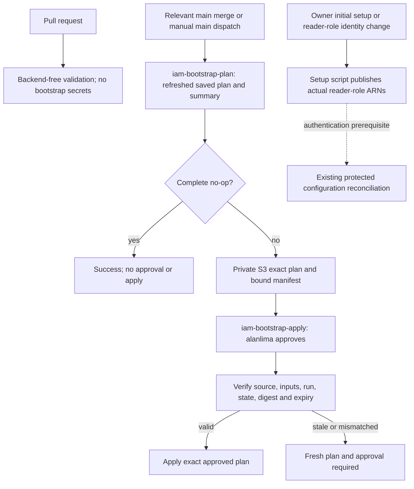

# IAM bootstrap Actions

The [bootstrap workflow](../.github/workflows/terraform-iam-bootstrap.yml) plans only `infra/terraform/iam-bootstrap` against the existing `pawlocal/iam-bootstrap/terraform.tfstate` backend. A complete no-op finishes without approval. A changed plan waits in `iam-bootstrap-apply` for `alanlima` to approve that exact saved plan. It does not deploy application environments or orchestrate Foundation-to-Converge.

The owner approved implementation in [#191](https://github.com/alanlima/pawlocal/issues/191) on 23 October 2026, then simplified reader-role publication into the owner-operated setup script. Existing reconciliation retains ongoing configuration synchronization. Bootstrap has two jobs, plan and apply; there is no automatic handoff job or handoff-only operation.

## Workflow and approvals

Relevant pushes to reviewed `main` plan automatically. Manual `workflow_dispatch` from `main` has no inputs and also plans. No arbitrary root, backend, destroy flag, import switch or resource target is accepted.

Runs use `pawlocal-terraform-iam-bootstrap` with `cancel-in-progress: false`, separate from application Terraform/release/seed/destroy groups. A newer run invalidates a plan before apply starts; it never cancels an active apply. Default GitHub concurrency can replace an older pending request, so it does not guarantee every dispatch executes. Terraform native backend locking remains mandatory.

## Protected Environments

Explicitly create and verify these in repository **Settings → Environments** before issuing credentials:

| Environment | Deployment branches | Reviewer | Administrator bypass |
|---|---|---|---|
| `iam-bootstrap-plan` | Selected branch `main` only; no tags | None | Disabled |
| `iam-bootstrap-apply` | Selected branch `main` only; no tags | `alanlima` | Disabled |

Allow owner self-review while `alanlima` is the only reviewer; otherwise the owner cannot approve his own dispatch. Independent implementation and saved-plan review remain required. Never approve through an agent or weaken protections to unblock a run.

The workflow token needs only `contents: read` and `actions: read` for source/run/supersession checks. Bootstrap performs no GitHub writes and references neither `PAWLOCAL_CONFIG_GITHUB_TOKEN` nor an OIDC token.

## Bootstrap variables

Set these variables identically in both bootstrap Environments, from current reviewed configuration and actual outputs. Do not create another backend/transfer bucket. GitHub variable names are case insensitive.

| Variable | Authoritative source |
|---|---|
| `AWS_REGION` | Existing backend/resource region, currently `ap-southeast-2`; maps to `TF_VAR_aws_region` |
| `PAWLOCAL_AWS_ACCOUNT_ID` | Existing 12-digit account ID, checked against caller identity |
| `PAWLOCAL_TF_STATE_BUCKET` | Existing encrypted/versioned bucket; maps to `TF_VAR_terraform_state_bucket_name` |
| `PAWLOCAL_TERRAFORM_PLAN_BUCKET` | Actual bootstrap `plan_transfer_bucket_name` output |
| `TF_VAR_github_repository` | `alanlima/pawlocal` |
| `TF_VAR_github_owner_id` | Immutable owner ID `4245961` |
| `TF_VAR_github_repository_id` | Immutable repository ID `1423024931` |
| `TF_VAR_route53_zone_id` | Existing approved hosted zone |
| `TF_VAR_domain_name` | Existing approved base domain |
| `TF_VAR_manage_github_oidc_provider` | `true` while bootstrap owns the provider |
| `TF_VAR_development_lightsail_principal_arn` | Actual development `environment_targets.lightsail_principal_arn` |
| `TF_VAR_production_lightsail_principal_arn` | Actual production `environment_targets.lightsail_principal_arn` |

Empty principal inputs are permitted only for verified pre-Foundation environments. Clearing an existing principal can remove runtime trust and needs explicit plan review; it is not a missing-input fallback. Any plan/apply input difference invalidates the plan.

Terraform `1.14.3`, default workspace, project `pawlocal`, backend key and three false import switches are fixed in code. A future import requires separate scope, review and confirmation; routine dispatch cannot enable it.

## Dedicated identity and secrets

Use one externally owned programmatic-only user, `pawlocal-terraform-bootstrap-actions`, without console login, personal administrator policy or root credentials. Its tags identify project, purpose, owner `alanlima` and the external account-bootstrap lifecycle.

The [setup tool and policy guide](../ops/iam-bootstrap/README.md) cover explicit owner inspection, identity/policy setup, key upload, reader-role publication and rotation. This tool never runs inside Actions. Its narrow exception covers only this user, dedicated policies/boundary, keys and matching GitHub setup. Ordinary infrastructure remains Terraform-owned.

Store `PAWLOCAL_BOOTSTRAP_AWS_ACCESS_KEY_ID` and `PAWLOCAL_BOOTSTRAP_AWS_SECRET_ACCESS_KEY` as Environment secrets in **both** bootstrap Environments. Do not set `AWS_SESSION_TOKEN` for this normal IAM key. No credential values may enter tfvars, Terraform outputs/state, shell arguments, logs, job outputs, artifacts or repository files. The tool transfers new credentials through memory/stdin. GitHub acceptance and secret-name metadata can be checked; plaintext cannot be read back.

Independently review exact identity grants and boundary before attachment. Effective access covers current bootstrap IAM resources, the bootstrap state/lock, private bootstrap plan prefix, existing transfer-bucket configuration and exact bootstrap-owned String SSM keys. Provider refresh requires documented metadata exceptions: configured-region `ssm:DescribeParameters` and exact transfer-bucket `s3:ListBucket` for `HeadBucket`. The latter exposes object-key metadata throughout the shared bucket, not application-plan contents.

Explicit boundary denies block direct role assumption and S3 resource-policy access outside the approved objects, and restrict deletion to the lock. Owned role trust/inline-policy authoring can still delegate authority to another principal: independent review of the actual saved-plan policy content remains indispensable. Do not claim the boundary prevents every possible privileged IAM delegation.

Both jobs use the same user, so planning has the same AWS permission ceiling as apply. The Environment gate protects execution, not a separate read-only AWS identity. Reviewed main code, repository protections and the independently controlled boundary remain part of the security model.

## Publish reader-role entry settings

Run the setup tool's explicit `publish-reader-roles` command during initial setup or after an approved change recreates a reader role. It reads actual current bootstrap outputs, verifies both roles and all existing targets, compares values, writes differences and reads destinations back. It uses the owner's local CLI authentication without copying a workflow token or issuing a new credential.

| Actual `configuration_reader_role_arns` output key | Existing destinations | Variable |
|---|---|---|
| `development` | `development`, `development-apply` | `PAWLOCAL_CONFIG_READER_ROLE_ARN` |
| `production` | `production`, `production-apply` | `PAWLOCAL_CONFIG_READER_ROLE_ARN` |

This variable is a reconciliation prerequisite, outside its Parameter Store mapping. Reconciliation does not write it; after authentication, the existing workflow synchronizes its approved configuration. There is no second recurring sync workflow or application lock added by #191. Publish against stable reviewed state before dependent reconciliation/deployment. Retry partial variable-write failures through the same idempotent setup command, never an old Terraform plan. Reports contain names/statuses, not token or ARN values.

The owner accepted repository Actions secret storage of `PAWLOCAL_CONFIG_GITHUB_TOKEN` for existing reconciliation to avoid duplicate maintenance. It remains a bounded-expiry fine-grained credential selecting only this repository with Environments read/write permission. Other eligible workflows can reference it; this is not Environment-secret isolation. Same-name Environment secrets take precedence and retain their lifecycle until deliberately changed. Bootstrap and owner publication do not consume this stored secret.

## Job summaries and recovery

Open the run Summary first. It shows safe validation/plan/apply status, action counts, sensitive/unknown markers with values withheld, exact plan digest/expiry and the next operator action. A genuine no-op says no changes and no approval required. Failure summaries identify the failed phase and what remains incomplete without claiming success from missing evidence.

For changes, inspect the actual private plan with the authorized reviewer. Counts alone do not prove least privilege. The manifest binds binary digest, source/lockfile, complete effective inputs, run/attempt, backend target and state lineage/serial/S3 generation. Normal refresh is mandatory. Drift, output-only changes and state moves cannot be no-ops. Imports, forgets, unsupported provider actions, deferred/incomplete plans and unknown check results stop safely.

Plans expire after six hours, although existing S3 retention is one day. Source/input/digest/state-generation/run mismatch, newer bootstrap run, failed/cancelled/partial apply or expiry requires a fresh dispatch, plan review and approval. Never rerun only apply, regenerate the plan after approval, force-unlock a live writer or edit state.

After successful apply, publish reader-role entry settings only if identity changed, then use existing reconciliation/deployment with its separate gates. Partial apply requires inspection and a fresh normal-refresh plan; its approval cannot be reused. No recovery authorizes application deployment or billable infrastructure changes.

## Credential lifecycle and verification

Record owner, creation time, rotation deadline and last-use audit without secret payloads. Initial setup recorded a 90-day deadline. Rotation overlaps at most two keys briefly, updates both Environments, verifies a fresh genuine no-op, then disables/deletes the old key through the external owner. Failed upload must report recoverable status and revoke an unusable new key.

On suspected exposure revoke immediately, inspect IAM last-used/CloudTrail privately, replace secrets and request a fresh plan. Retirement disables workflow access first, then the owner revokes keys and removes the user/dedicated policies/boundary after attachment inspection. Terraform-owned resource retirement needs separate reviewed scope.

Before merge run backend-free helper/workflow/policy/setup tests and independent review. Cover action/drift/output/state changes, unknown/deferred/check results, wrong identity/backend/state, stale/superseded plans, digest/input mismatches, safe missing-config/partial-failure summaries, secret sentinels, policy escapes, key recovery and idempotent four-target publication.

Live acceptance requires an error-free merged trusted-main run. A no-op proves the authenticated plan and no-approval path. A changed-plan run additionally requires owner approval and exact apply evidence; tests or a passing PR never substitute for live execution.
