# Delivery screenshot evidence

Captured on **25 October 2026** during the #284 documentation review. Production application/Grafana captures and local test-fixture captures are separated below; no generated UI image or fixture is presented as production evidence. Captures were inspected before inclusion for credentials and personal/customer data; visible telemetry is operational route/status/duration/release and correlation metadata.

The source audit baseline is `8895b99a549ee0db134cec69bd681618f8db46d7`, with [production release run 40181618456](https://github.com/alanlima/pawlocal/actions/runs/40181618456). The application footer displayed `BUILD local`, so these captures cannot independently bind the served frontend bundle to that commit. Dashboard time windows include multiple backend releases. Use exact workflow manifests for release provenance.

## Application

All application images use [production](https://pawlocal.alanlima.cloud/). These are anonymous read-only journeys; no production contribution or favourite was created.

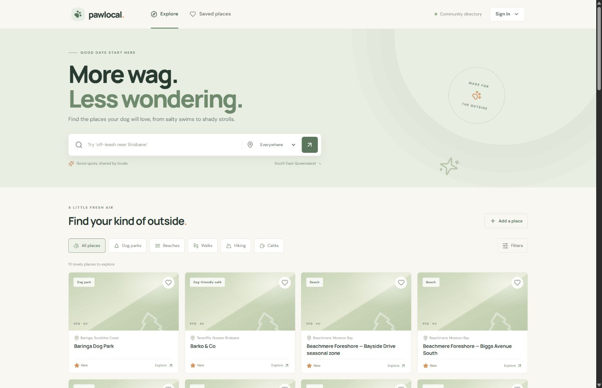

*Discovery displayed 51 listings at capture time.*

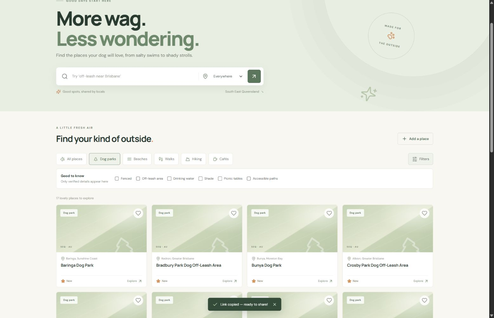

*Dog parks returned 17 listings; Filters exposes verified-only facility choices. Counts can change.*

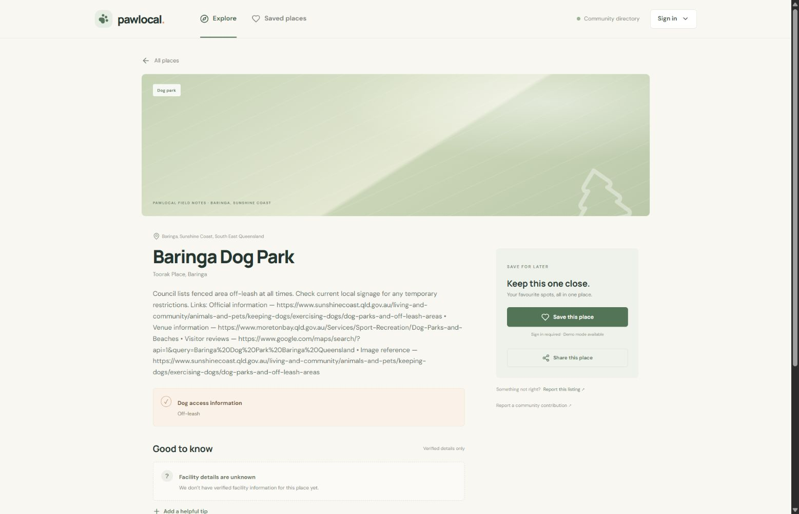

*Baringa Dog Park, permanent path `/places/99fa90f5-d755-5ee7-ab93-0818d5810cef`. Facts belong to the published listing; this capture is not a new verification of council rules.*

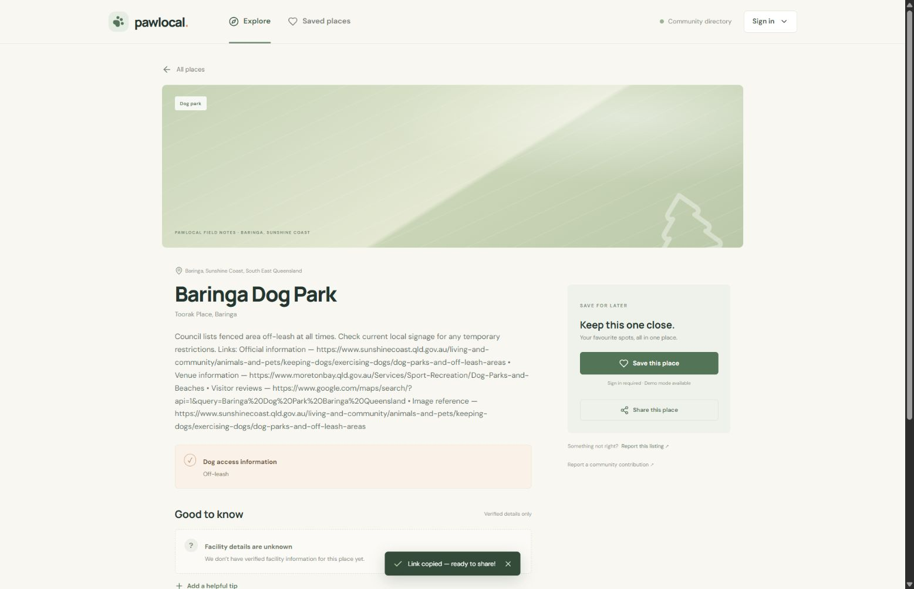

*Share this place displayed “Link copied — ready to share!”.*

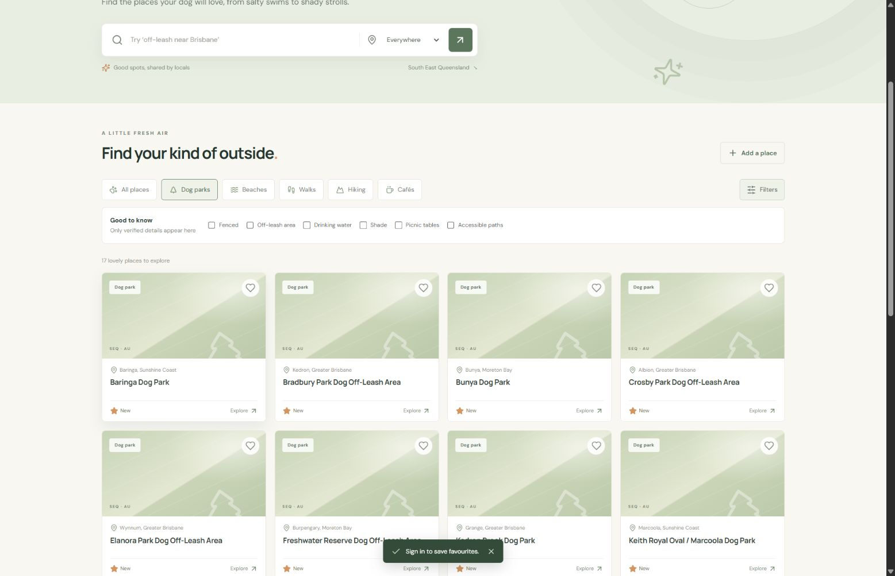

*Anonymous Save displayed “Sign in to save favourites.” This proves the UI boundary. The separate local captures below demonstrate authenticated persistence with a test issuer; hosted Cognito sign-in remains a separate check.*

## Local authenticated persistence

These captures are **local synthetic test fixtures**, not real places or production sessions. The real frontend/HTTP adapter, FastAPI token validation and PostgreSQL were exercised through the existing ephemeral-issuer harness on source head `5a79eab793aeb63ef0941d5c1a33d210f0f3c303`. The three authenticated frames are unedited JPEG screencast frames from the successful Playwright run (800 × 450); the full trace, tokens and network payloads are excluded. [Commands and persistence readback](../../submission.md#local-reproducibility-verification) explain what passed.

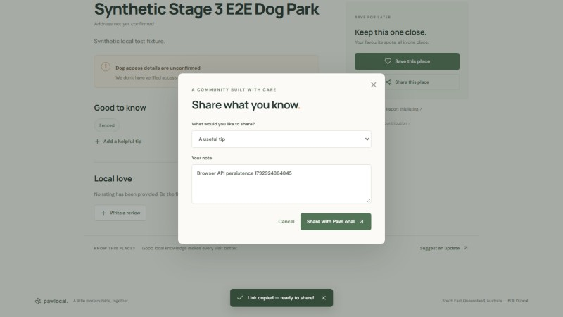

*The signed-in fixture fills a useful-tip contribution; the test then asserts HTTP 201. The text and place are explicitly synthetic.*

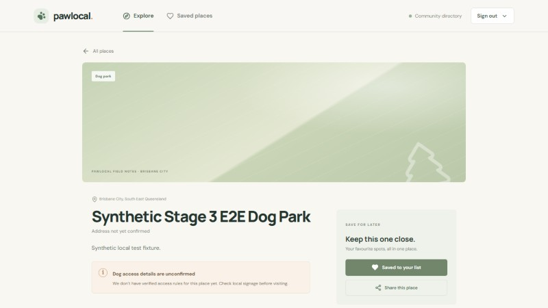

*The fresh browser context reads “Saved to your list” from the real API/database.*

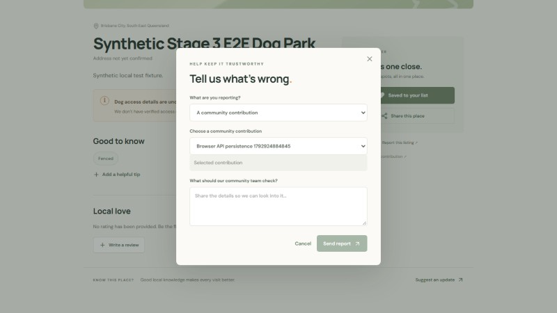

*The previously submitted contribution remains available as a report target after a new browser context. The test also verifies report creation; it does not submit this fresh-context form again.*

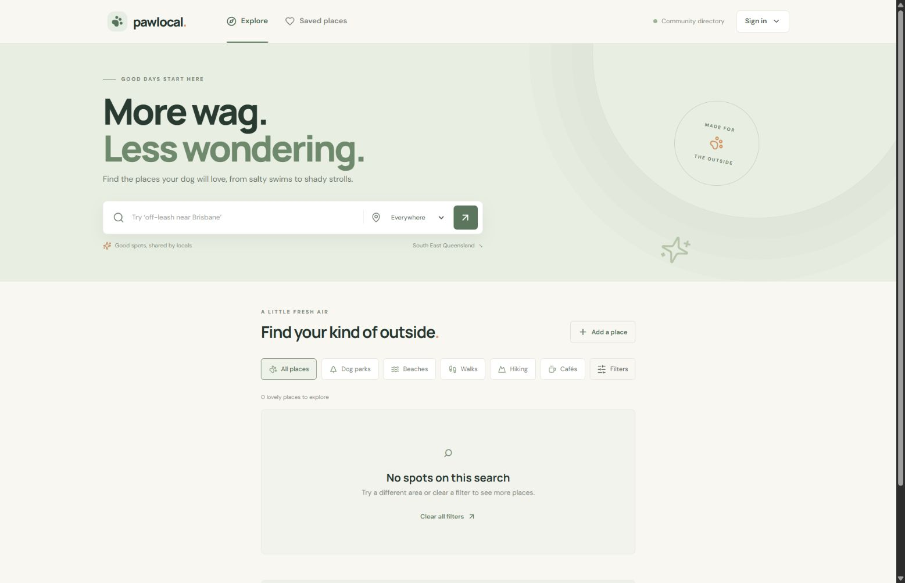

*Fresh root Compose HTTP mode with no seeded places. This is the normal application database; the harness uses a separate disposable database.*

## Grafana dashboards

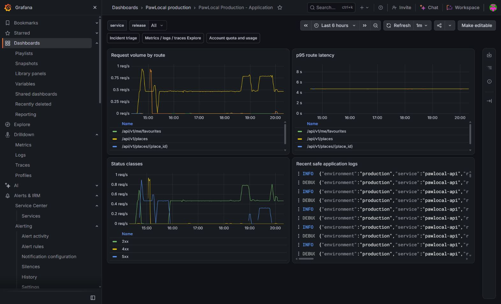

*[Application dashboard](https://alanlima.grafana.net/d/pawlocal-production-application): last six hours, all releases. Request volume, p95 route latency, status classes and actual structured logs are visible. A trace ID in a log is not proof that its trace was retrieved or correlated with the browser journey.*

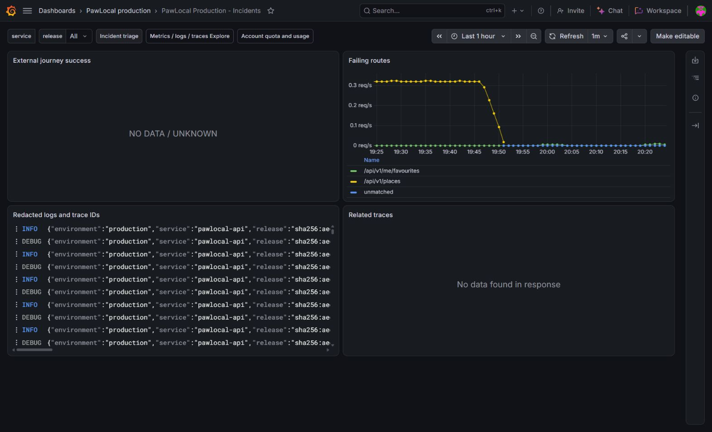

*[Incident dashboard](https://alanlima.grafana.net/d/pawlocal-production-incidents): last hour, all releases. The external journey panel shows `NO DATA / UNKNOWN`; related traces shows “No data found in response”; metrics/logs do not establish complete monitoring acceptance. Grafana URLs require authorized stack access; these checked-in images remain the public evidence.*

## Incident demonstration

The existing [drill 02 wiki](https://github.com/alanlima/pawlocal/wiki/Incident-drill-2026-10-25-02) contains 19 inspected screenshots with timestamps, both attempts and exact run/PR links. [#396](https://github.com/alanlima/pawlocal/issues/396) records automatic repair and observed recovery; [#399](https://github.com/alanlima/pawlocal/issues/399) remains `RELEASE_COMPLETED_UNVERIFIED` because enforcement was disabled. See the [delivery plan](../../submission.md) for acceptance gaps and final release binding.

## Architecture diagrams

The application and operations/CI/CD images use custom layouts with official AWS service icons, explicit environment boundaries, and separate external-system and automation zones. README embeds high-resolution PNGs; the matching SVGs remain available for full-size inspection. The layouts and original icon inputs are kept under [source/](source/README.md). They describe implemented capabilities; the README captions retain the separate live acceptance limitations. These illustrations are separate from the eleven runtime JPEG screenshots above.
