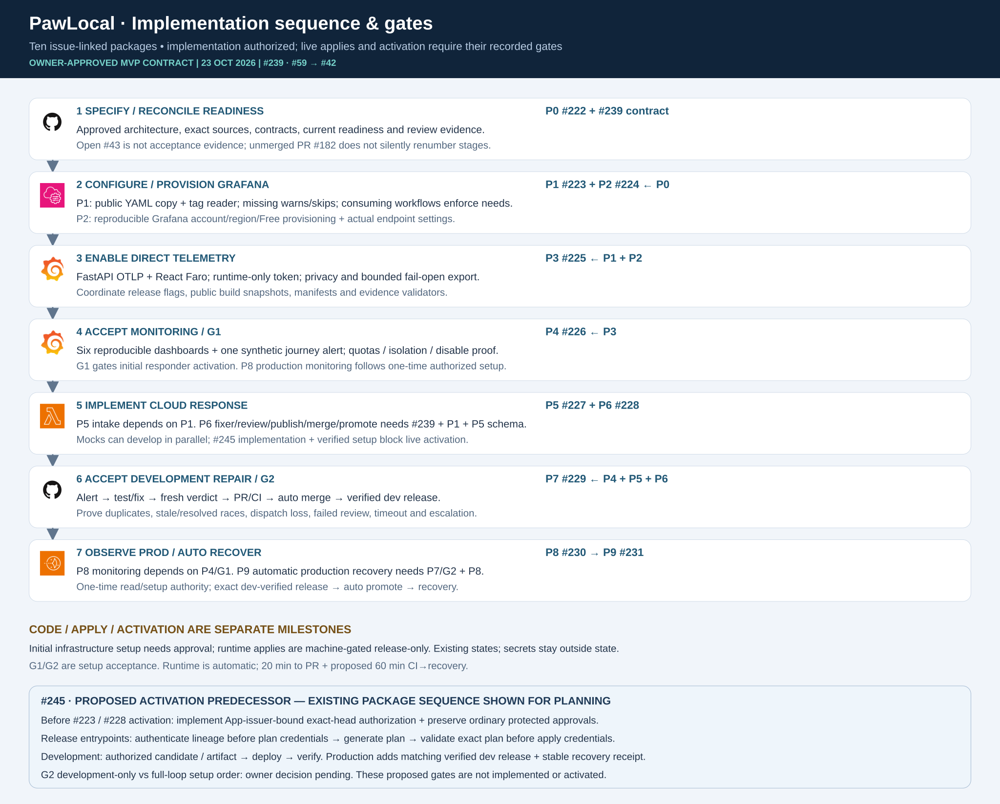
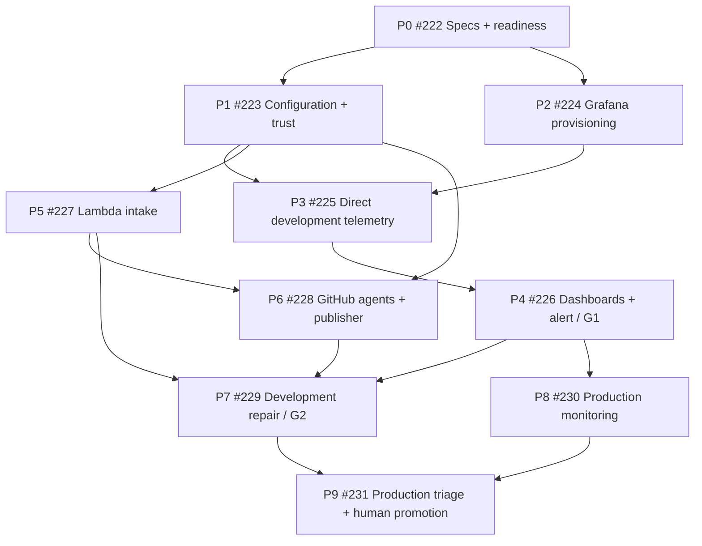

# Monitoring integration — implementation plan

**Status: owner-authorized documentation and non-live implementation; no provisioning or production activation implied.** Baselines [#59](https://github.com/alanlima/pawlocal/issues/59) and [#42](https://github.com/alanlima/pawlocal/issues/42). The ten linked packages below are the delivery sequence. Read [hosted observability](../specs/hosted-observability.md), [incident responder](../specs/incident-responder.md) and [DEC-011](../decisions.md#dec-011--hosted-observability-and-minimal-cloud-incident-responder).

## Baseline and activation gates

The agreed design is direct FastAPI OTLP and React Faro to Grafana Cloud Free, optional queried CloudWatch, then signed webhook → one Lambda Function URL → fixed GitHub-hosted Codex workflow. Stale open #43 does not establish readiness; reconcile actual release/persistence/protected-gate evidence in P0. PR #182 remains an unmerged stage-renumber proposal. Issue identities and the milestones here govern this work without silently adopting conflicting stage text.

Non-live implementation, mocks and schema work are authorized. Affected live activation/acceptance requires reviewed #59 direct Faro and #42 independent accepted-dispatch/204 amendments, current readiness, privacy/isolation/cost review, verified identities, reviewed exact saved plans and explicit owner apply approval. G1 accepts development monitoring; G2 accepts development repair. Production monitoring and triage require their own approvals. No issue status or green skipped deployment establishes acceptance.

## Ten packages, sequence and dependencies

| ID / issue | Parent | Deliverable / accountable owner | Depends on | Exit evidence |
|---|---|---|---|---|
| P0 [#222](https://github.com/alanlima/pawlocal/issues/222) | #59 | Specifications, baseline, diagrams and readiness / orchestrator + owner | Existing evidence and selected design | Reviewed specs/config source contract, issue amendments and recorded live-readiness gates; implementation completion not claimed |
| P1 [#223](https://github.com/alanlima/pawlocal/issues/223) | #59 | Configuration reconciliation and trust setup / platform + reviewer | P0 | Exact SSM sources/minimal mappings/inventory/consumers; explicit on-call target allowlist; reviewed roles/KMS/token authority; approved secret-source setup handoff; protected human review/publication boundaries |
| P2 [#224](https://github.com/alanlima/pawlocal/issues/224) | #59 | Reproducible Grafana setup / platform | P0 | Approved account/region/Free quotas/data residency; source-controlled provisioning, hosted Faro/OTLP settings and scoped credentials; no UI-only source of truth |
| P3 [#225](https://github.com/alanlima/pawlocal/issues/225) | #59 | Direct development telemetry and release contract / frontend + backend + platform | P1 + P2 | Correlated redacted journey, bounded async backend export, Faro public collector URL, exact runtime SSM token loading/rotation; coherent enabled/disabled manifests/build/workflow/runtime evidence |
| P4 [#226](https://github.com/alanlima/pawlocal/issues/226) | #59 | Six dashboards, synthetic alert and G1 / platform + independent reviewer + owner | P3 | Usable templates, bounded usage/privacy/isolation, firing/resolved/no-data and disabled/outage/recovery demonstration against exact development release; G1 accepted |
| P5 [#227](https://github.com/alanlima/pawlocal/issues/227) | #42 | Minimal Lambda intake / backend + platform | P1; G1 before live wiring | Raw-body HMAC/timestamp/schema/limits/allowlists, fixed dispatch, 204 only after acceptance, non-2xx failure; reviewed plan and approved apply; documented weaker delivery boundary |
| P6 [#228](https://github.com/alanlima/pawlocal/issues/228) | #42 | Trusted GitHub fixer/reviewer/publisher / platform + engineer owners | P1 + P5 input schema | Pinned Action/CLI and approved model profile, monthly admission quota with token/cost reservation, two independent model calls, one attempt/active run, 20-minute admitted deadline, trusted incident claim/freshness checks, isolated credentials and publisher; denied authority tests |
| P7 [#229](https://github.com/alanlima/pawlocal/issues/229) | #42 | Development repair demonstration and G2 / integration owner + reviewer + owner | P4 + P5 + P6 | Automatic alert → triage/test/fix/fresh review/PR → human squash merge → exact verified development release and recovery; duplicate/lost/cancelled/stale/timeout/escalation cases; G2 accepted |
| P8 [#230](https://github.com/alanlima/pawlocal/issues/230) | #59 | Production monitoring / platform + owner | P4/G1 + separate production approvals | Matching configuration, approved saved plan/apply, six dashboards, isolation/usage/privacy/rotation/fail-open smoke evidence; #59 closes only on full acceptance |
| P9 [#231](https://github.com/alanlima/pawlocal/issues/231) | #42 | Production triage and human promotion / owner + platform + reviewer | P7/G2 + P8 | Explicit production read/run-budget approval, bounded alert-origin PR only; owner manual protected promotion of exact development-verified SHA/digest; actual journey/recovery observation and audit |

P8 can run alongside development responder work after G1. P5/P6 use mocks and fixed schemas before live wiring; the P5 schema must be agreed before P6 integration. P9 has two distinct milestones: enable production-origin triage only with explicit read/budget authorization, and demonstrate owner-approved promotion. An already reviewed development fix can exercise promotion before production-origin agent runs are enabled; an end-to-end production-alert demonstration requires that triage milestone first.

[Editable SVG](../images/monitoring/stage5-monitoring-implementation-sequence.svg)

## Parallel work and merge/apply order

1. P0 makes the agreed choices reviewable and reconciles live readiness; it does not halt authorized mocks because #43 is open. P1/P2 proceed concurrently once their contracts are reviewed. P5 schema design and P6 mock job work can proceed without live credentials.
2. Identity changes are independently reviewed/merged, then the owner approves the exact saved bootstrap plan before environment resources need new rights. Existing bootstrap/development/production ownership stays intact; no fourth state or manual state edits.
3. P3 integrates settings, runtime direct export and browser Faro in a verifiable development release. P4 proves all six dashboards and the safe alert; G1 blocks live responder wiring. Disabled mode stays functional.
4. P5/P6 integrate against fixed schemas; P7 demonstrates development-only synthetic incidents and G2. Model review cannot provide human merge approval. P8 can proceed after G1 with separate production monitoring approval.
5. P9 requires G2 and production monitoring acceptance. Production-origin telemetry reads/run budgets are explicitly approved; production deployment remains manual protected promotion through existing workflows, never an agent tool.

Critical path for a production alert to yield a deployed fix: P0 → P1/P2 → P3 → P4/G1 → P5/P6 integration → P7/G2 → P9, with P8 a parallel prerequisite. Estimates wait for account/API access, signing, privacy, direct-export and trusted-publication feasibility evidence.

## Configuration and source lifecycle

P1 implements the [exact source/destination contract](../specs/hosted-observability.md#exact-planned-ssm-source-and-destination-contract). Change producers, `ops/configuration/parameter-mapping.yaml`, inventory and consumers together. Keep six minimal mapping fields only. Add only `oncall-development` / `oncall-production` to the currently restrictive target validator, establish protected main-only targets first, verify token/reader authority and negative tests. Review feature-specific selection so disabled deployments do not require missing Grafana settings.

Terraform publishes non-secret Strings; exact runtime SSM SecureStrings remain outside Terraform payloads. P1 records the narrowly approved owner creation/population/rotation procedure, not implied authorization. Backend reads exact OTLP token; Lambda exact HMAC/dispatch key. Query token alone synchronizes into `PAWLOCAL_GRAFANA_QUERY_TOKEN` through an exact-key/KMS/context-limited reconciliation reader; verify successful encrypted GitHub secret API write, never plaintext read-back. OpenAI/publisher keys remain protected GitHub secrets outside synchronization.

P2 source-controls Grafana provisioning and returns actual stack/OTLP/instance/Faro settings. P3 coordinates module runtime flags, fullstack/prod/Terraform workflow forced-off checks, frontend release config/validation, release/evidence schemas, Python metadata validator and Lightsail evidence. Keep actual telemetry mode and immutable release identity coherent; do not disable unrelated eligibility checks.

## Validation, failure and lifecycle evidence

P5 tests exact raw-body HMAC/timestamp, base64 request handling, malformed/oversized/foreign payload denial, fixed repo/workflow/main restriction, missing GitHub acceptance and observed retry. A lost response may duplicate a dispatch; accepted dispatch is neither durable AWS recording nor completed work. The scope/status/OpenAPI-host amendment is required before affected live activation/acceptance.

P6 serializes `cancel-in-progress: false` with verified bounded queue behavior. Trusted preflight checks current alert state and issue/PR generation markers (environment/fingerprint/startsAt), including closed outcomes, and claims the attempt before model use. Concurrency is not deduplication or exactly-once persistence. Test stale firing after resolved, grouped alerts, duplicate/lost acknowledgements, cancellation and queue overflow; owner inspection/replay is the recovery path.

Reproduce against affected deployed SHA, fix on trusted current main and report release lag if already fixed. Bind patch/base/candidate/report hashes and independently rerun tests; invalidate review when inputs change. The credential-bearing publisher validates deterministic evidence and never executes candidate scripts or trusts a model assertion that tests passed. Fixes exclude workflows, IAM/auth/security policy, secrets, infrastructure and data repair.

Model, reasoning effort and service tier remain pending selection. Both independent calls require an explicitly approved protected model/rate profile and separately funded API project; no hardcoded default or numeric spend allowance is approved. One attempt per incident generation; one active remediation per environment. Propagate a trusted absolute 20-minute deadline from admission across preflight/model/tests/review/publishing and inter-job scheduling. Initial queue waiting is excluded. Per-job 20 minutes is insufficient. Rejected/timed-out work escalates; no automatic fix/retry loop. No monthly spend amount is approved here. Admission remains disabled until the owner approves a model/rate profile, monthly quota and token/cost bounds.

P7 proves success plus low-confidence escalation, failed tests/review, unavailable provider, timeout, dedupe and stale-state safety. P8/P9 verify privacy/authorization and denied production deployment access. Recovery requires actual release identity, original regression, healthy external journey, resolved alert and observation window. Failed production smoke escalates through existing owner-approved Terraform/release recovery procedures under #44; no automatic infrastructure rollback is introduced.

## Completion boundaries

Each package records linked issue/PR, tested commit, real checks and independent review. Provisioning additionally records reviewed exact saved plan and approved apply; green/skipped workflows are not deployment evidence. G1/G2 and production approvals are recorded separately. This specs PR completes documentation criteria in #222 only; it does not close #59/#42 or claim live monitoring/responder availability.
