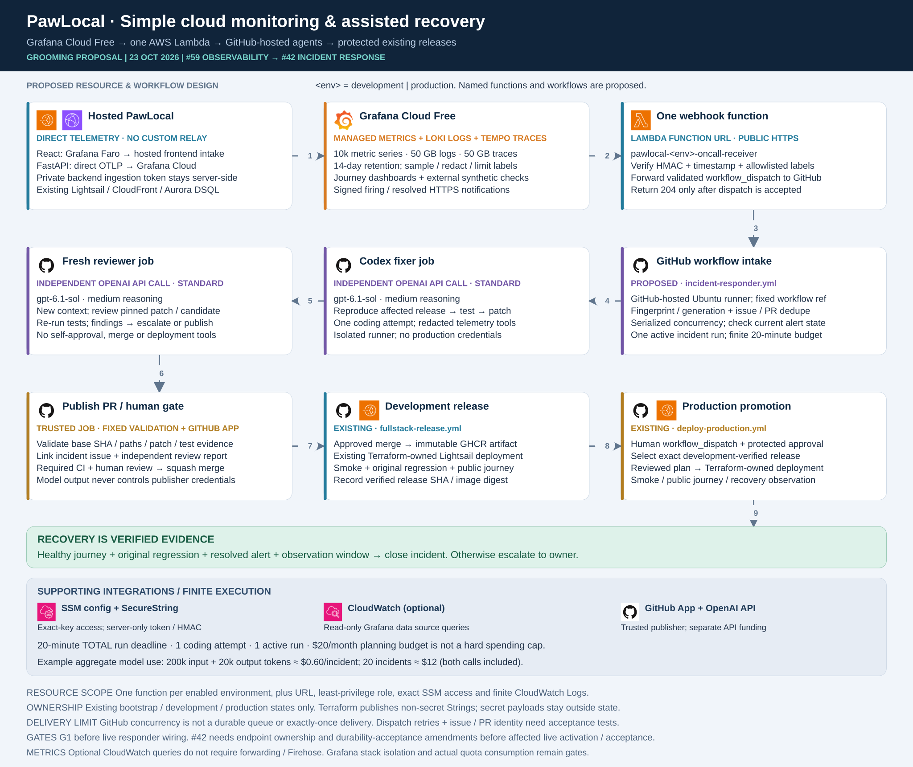

# Hosted observability specification — Issue #59

**Status: approved design baseline; implementation and live acceptance are separate.** Instrumentation and dashboard sources are implemented; [#225](https://github.com/alanlima/pawlocal/issues/225) records amended development acceptance. This specification retains the original setup/activation requirements and does not certify current live settings. Use the [delivery evidence](../submission.md) for dated deployments, captures and remaining #226/#230 acceptance. This specification covers [#59](https://github.com/alanlima/pawlocal/issues/59); the dependent [incident responder](incident-responder.md) belongs to [#42](https://github.com/alanlima/pawlocal/issues/42). Read the [ten-package implementation plan](../plans/monitoring-implementation.md).

## Scope, baseline and readiness

Enable Grafana Cloud Free for the hosted search → API → database → place-details journey, first development, then separately approved production. Local Compose observability remains governed by [the local specification](observability.md). Six reproducible dashboards, privacy, fail-open delivery, one reviewed user-impact alert and recovery evidence are the delivery outcomes.

The baseline issues still describe a custom server-side browser relay and backend-owned durable webhook intake. This specification explicitly selects direct Faro hosted intake and a separate Function URL with accepted-dispatch semantics. The related issue/contract amendments must be reviewed and recorded before their affected live activation and acceptance; this PR does not claim existing issue acceptance criteria already match.

[#43](https://github.com/alanlima/pawlocal/issues/43) is a stale open tracking issue, not reliable evidence that Stage 4 passed or failed. P0 reconciles readiness using current deployment, persistence, protected-release and review evidence. [PR #182](https://github.com/alanlima/pawlocal/pull/182) is an unmerged stage-renumbering proposal; this work uses issue identities and P0–P9 milestones rather than silently applying its stage numbering. Approved mock-based implementation/specification work can proceed while readiness is reconciled. Live telemetry/responder activation requires the applicable readiness, privacy, cost, IAM and owner gates; issue state alone cannot grant or deny that acceptance.

Current readiness evidence: [development release run 39809521175](https://github.com/alanlima/pawlocal/actions/runs/39809521175) and [production promotion run 39812132462](https://github.com/alanlima/pawlocal/actions/runs/39812132462) completed application apply/reconciliation/verification for source SHA `3ee834f`. A read-only audit on 23 October 2026 returned HTTP 200 for both frontend roots, API `/health` and `/api/v1/places?limit=1`. This establishes reachable release surfaces, not hosted monitoring or responder acceptance. #191 and #203–#206 are closed; #43/#75/#135 are open historical umbrella trackers whose status cannot replace this evidence. Recent green [run 39865715956](https://github.com/alanlima/pawlocal/actions/runs/39865715956) skipped deployment and is not new deployment proof. P0 accepts reviewed readiness gates, not automatic closure of those umbrella issues.

## Selected Grafana account

The owner selected **one shared Grafana Cloud stack for all environments**, with separate Faro applications and **Free as the intended operating limit**. Stack URL/ID, region, OTLP connection and datasource UIDs come from approved deployment configuration and read-only discovery; reusable design docs do not embed personal account identifiers. Trial entitlements are not evidence of Free capacity; verify actual account quotas and per-signal privacy before activation.

Use separate `pawlocal-development` / `pawlocal-production` Faro apps with exact matching origins in that same stack. API credential access, datasource bindings, actual Free quotas/retention and per-signal read/privacy proof remain pending. Disabled configuration remains disabled. Do not select separate accounts as the solution or treat folders/labels as authorization: withhold signals the requester cannot access safely. These public setup observations authorize no provisioning or model admission.

## Architecture



[Editable SVG](../images/monitoring/stage5-monitoring-cloud-agent.svg) · [editing and attribution](../images/monitoring/README.md)

- FastAPI exports batched asynchronous OTLP/HTTP directly to Grafana Cloud with a private server-side ingestion credential.
- React uses Grafana Faro's hosted frontend collector and public application key. No private Grafana ingestion token goes into browser code.
- Optional Grafana infrastructure panels query CloudWatch through a separately scoped read-only datasource role. No Firehose, forwarding service or custom relay.
- Signed Grafana alerts call one Lambda Function URL per enabled environment; GitHub-hosted jobs perform agent work. The [responder specification](incident-responder.md) owns that lifecycle.

The existing application remains private S3/CloudFront frontend, Lightsail Container Services API, Aurora DSQL and Cognito. No always-on collector/agent server is introduced. If direct export cannot meet privacy/reliability criteria, return an explicit design amendment before adding a collector.

## Grafana Cloud Free and telemetry operation

Published allowances, checked against the official source on 23 October 2026, include **10,000 active metric series, 50 GB/month each of logs and traces, 14-day retention, 50,000 frontend sessions, 100,000 API synthetic executions and 10,000 browser synthetic executions/month**. New-account Frontend Observability sessions, logs and traces can each count against their respective allowances; do not budget sessions as inclusive of the other signals. See [frontend billing](https://grafana.com/docs/grafana-cloud/platform/pricing-and-usage/frontend-observability/). Confirm actual account/stack aggregation, region, users and rate limits; two environments do not imply double the allowance. [Grafana pricing](https://grafana.com/pricing/)

Use bounded environment/service/route/release dimensions. No raw search terms, user/place IDs or trace IDs as metric labels. Proposed initial combined targets are below 5,000 series and 10 GB/month each of logs/traces, then measure actual ingestion. Surface quota usage, export failure and no-data; missing telemetry means unknown health.

Faro's hosted endpoint embeds a **public application key**, distinct from a private ingestion/read token. Restrict exact frontend origins, sample sessions and redact/disable personal fields, query strings, console/error contents and user metadata before export. Preserve trace context only to approved API origins; avoid duplicate instrumentation. [Faro setup](https://grafana.com/docs/grafana-cloud/observe-and-act/monitor-applications/frontend-observability/instrument/faro/)

Backend exporters redact at source, batch asynchronously, bound queues/retries/timeouts and fail open. Database spans contain stable operations/latency/errors without SQL, bind values or credentials. Grafana supports direct SDK export but recommends a collector for production reliability. The agreed simpler topology accepts less transport resilience; prove application-side privacy, sampling, outage/disabled behaviour before production. No collector is silently added. [Direct OTLP guidance](https://grafana.com/docs/grafana-cloud/send-data/otlp/send-data-otlp/)

### Six source-controlled dashboards

| Stable UID | Purpose |
|---|---|
| `pawlocal-journey` | Search → API → DSQL → details volume, latency, failures and availability |
| `pawlocal-application` | Routes/status codes, percentiles, exceptions, process signals and release |
| `pawlocal-dependencies` | DSQL/dependency latency and safe error classes |
| `pawlocal-releases` | Before/after release comparisons and deployment annotations |
| `pawlocal-telemetry` | Export failures, missing signals, quotas and ingestion health |
| `pawlocal-incidents` | Environment/release/route/trace navigation and incident/PR links |

Definitions, bindings, variables, thresholds and links must be reproducible under `observability/`. Folders/labels are not authorization. Verify token/datasource scopes per signal; withhold production reads until isolation is proven. Optional CloudWatch queries add API costs and do not supply unsupported DSQL host metrics.

Start with one synthetic development search/detail failure alert. Finalize query, sample count, threshold/window, no-data/error behaviour, runbook and recovery observation period. One execution per five-minute probe across two environments is approximately 17,280 executions/30-day month; verify multi-step billing. No production fault controls.


## State, configuration and secret ownership

Existing bootstrap owns IAM identities/trust/boundaries; matching development/production states own monitoring resources, finite logs, exact policies and non-secret SSM Strings. No fourth state. Cognito-only delegation does not authorize monitoring resources.

Use SSM Parameter Store as the single Grafana configuration/secret source. Terraform publishes non-secret Strings only. SecureString creation/population/rotation needs a narrowly approved owner procedure outside Terraform payload handling; this document does not itself authorize live secret mutation or infer an infrastructure ownership exception. P1 records that handoff. No duplicate Secrets Manager containers, secret Terraform resource values/data sources, output/artifact or `TF_VAR_*` payloads.

### Exact planned SSM source and destination contract

Expand `{environment}` to exactly development/production. R = matching release Environment, P = `{environment}-plan`, O = proposed `oncall-{environment}`. Planned rows below are not active YAML; each destination becomes its own minimal mapping entry.

| Exact `store_key` | Type / source owner | GitHub `env_name` / destination | Concrete consumer |
|---|---|---|---|
| `/pawlocal/{environment}/config/observability/enabled` | String; approved desired toggle, environment state publishes | `PAWLOCAL_TELEMETRY_ENABLED` → P | Backend runtime toggle |
| `/pawlocal/{environment}/config/frontend/telemetry-enabled` | Public String; matching application state | `VITE_TELEMETRY_ENABLED` → R | Independent frontend build toggle |
| `/pawlocal/{environment}/config/grafana/stack-url` | String; discovered via `grafana_cloud_stack` or approved Grafana setup input, environment state publishes | `PAWLOCAL_GRAFANA_URL` → O | Trusted preflight/query/dashboard origin |
| `/pawlocal/{environment}/config/grafana/otlp-endpoint` | String; discovered via `grafana_cloud_stack` or approved Grafana setup input, environment state publishes | `OTEL_EXPORTER_OTLP_ENDPOINT` → P | Backend direct exporter |
| `/pawlocal/{environment}/config/grafana/otlp-instance-id` | String; discovered via `grafana_cloud_stack` or approved Grafana setup input, environment state publishes | `PAWLOCAL_GRAFANA_OTLP_INSTANCE_ID` → P | Backend server-side authentication identity |
| `/pawlocal/{environment}/config/grafana/faro-collector-url` | String; discovered via `grafana_frontend_o11y_app`, environment state publishes | `VITE_FARO_COLLECTOR_URL` → R | Browser Faro; public identity discovered from actual setup |
| `/pawlocal/{environment}/config/oncall/webhook-url` | String; matching state derives Function URL | `PAWLOCAL_GRAFANA_WEBHOOK_URL` → O | Trusted Grafana contact-point provision/verification job |
| `/pawlocal/{environment}/secrets/grafana/query-token` | SecureString; approved owner procedure outside Terraform | `PAWLOCAL_GRAFANA_QUERY_TOKEN` → O as GitHub secret | Trusted telemetry preflight only |
| `/pawlocal/{environment}/secrets/grafana/otlp-token` | SecureString; approved owner procedure outside Terraform | No GitHub mapping | Matching backend runtime reads exact key |
| `/pawlocal/{environment}/secrets/grafana/webhook-hmac` | SecureString; approved owner procedure outside Terraform | No GitHub mapping | Matching receiver and approved signing setup |
| `/pawlocal/{environment}/secrets/oncall/dispatch-app-private-key` | SecureString; approved owner procedure outside Terraform | No GitHub mapping | Matching receiver only |

Inventory collisions before source creation; never overwrite/adopt silently. Approved Grafana endpoint/instance/Faro values originate from actual Grafana setup, not invented AWS URLs. Do not add a separate Faro app-key parameter unless the supported collector URL/SDK API requires an identified extra consumer. Backend derives its exact secret path from validated environment; no unused ARN mapping. `OTEL_SDK_DISABLED` is inverse of the one backend toggle.

Use only `store_key`, `environment`, `github_environment`, `env_name`, optional `secret`, optional `validations`. The single active YAML contains public rows with `secret: false`. The copier warns and skips missing sources or destination Environments in both modes; permission errors fail. Consuming release/responder workflows enforce their required configuration and enabled/disabled modes. Public reader admission uses the three #237 authorization tags. The query-token example below is a future proposal, absent from the active mapping and public reader grant until separate secret-reader scope and lifecycle approval.

```yaml
store_key: /pawlocal/{environment}/secrets/grafana/query-token
environment: [development, production]
github_environment: "oncall-{environment}"
env_name: PAWLOCAL_GRAFANA_QUERY_TOKEN
secret: true
validations: [required]
```

### Required synchronization and release changes

1. P1 changes actual `ops/configuration/parameter-mapping.yaml`, inventory, source producers and consumers together. No speculative/unused mapping rows or fingerprint machinery.
2. P1 explicitly allows only `oncall-development` / `oncall-production` as additional targets. Missing targets warn and skip without source reads or creation; existing on-call targets must have an exact main-only branch policy before source reads. Review reader/API token authority and test foreign/mismatched targets remain denied. Initial target setup is separate from the unattended incident lifecycle; do not add deployment OIDC to on-call jobs.
3. Public reconciliation uses tag-conditioned SSM reads. Future query-token synchronization requires separately approved exact SSM access and necessary KMS decrypt permission with matching encryption context; it is not active in P1. Runtime backend reads only its matching OTLP token; receiver only matching HMAC/dispatch key. No by-path/history/broad secret reads. Verify public values by read-back; verify secret synchronization by successful encrypted GitHub API write, never plaintext comparison/read-back.
4. Extend frontend field/snapshot validation and public build consumption for `VITE_FARO_COLLECTOR_URL` and reviewed enabled/disabled modes; private tokens never enter public snapshots/bundles.
5. P3 coordinates Terraform runtime flags, `fullstack-release.yml`, `deploy-production.yml`, `terraform-environment.yml`, `frontend/src/config/releaseConfig.ts`, release-config validation, release/evidence schemas, `ops/validate-release-metadata.py` and the Lightsail adapter. Existing paths force/validate false. Preserve immutable identity/production eligibility while representing actual telemetry mode.

`OPENAI_API_KEY` and `PAWLOCAL_ONCALL_PUBLISHER_APP_PRIVATE_KEY` are separately provisioned protected on-call Environment secrets outside SSM synchronization. Public App identifiers remain static operator settings unless a concrete synchronized consumer justifies a new reviewed mapping. Runtime-only OTLP/HMAC/dispatch values never synchronize to GitHub. Initial values/rotation are an explicit approved owner handoff; prove refresh/disable/outage safety without payload disclosure.

## Acceptance and operations

G1 requires exact development release/digest, all six dashboards, bounded usage, correlation, privacy review, disable/outage/recovery tests and signed alert evidence. P8 separately approves production enablement, isolation and smoke evidence before #59 closure. Grafana folders/environment labels do not establish authorization; prove actual read scopes per signal before production agent reads.

Operators must be able to reproduce dashboard provisioning from `observability/`, verify a synthetic journey, disable exports without breaking the app, rotate ingestion credentials safely, inspect no-data/export health and revert a configuration release through existing protected Terraform/release procedures. Dashboard drift is reconciled through source PRs. The approved region/account, data residency, initial thresholds and retention/usage proof are P0/P4 decisions; this specification does not pretend the account has been configured.

## Proposed source-population decision (#241)

[DEC-013 / the monitoring secret lifecycle proposal](monitoring-secret-lifecycle.md) evaluates sensitive ephemeral write-only Terraform inputs and exact ephemeral SSM maintenance reads. It proposes an isolated owner setup runner without permanent GitHub copies of runtime-only credentials. This is an unaccepted amendment to secret-input wording, not source population, permission approval or live acceptance; the active public-only copier/query-secret-inactive contract above remains unchanged.

## Unattended incident handoff (#239)

After initial monitoring/privacy/credential/protection acceptance, the configured alert wakes the fully automatic controller: fix → fresh bound review → trusted PR → real CI → auto squash merge → verified dev → exact production promotion → verified recovery. There is no runtime human approval; the optional switch is deferred. Receiver route hints are omitted; configured alert authority and downstream rule validation govern incidents, while source/security scopes remain bounded. Initial setup and failed/out-of-scope escalation are separate from an approval-wait state. See DEC-012 and the responder specification.

Frontend-first #225 amendment: public application-owned `/pawlocal/{environment}/config/frontend/telemetry-enabled` maps to `VITE_TELEMETRY_ENABLED` in R, independent of the backend observability flag. See the frontend-first rollout in `docs/hosted-telemetry-operations.md` for the operator JSON, migration order and versioned release contract.
