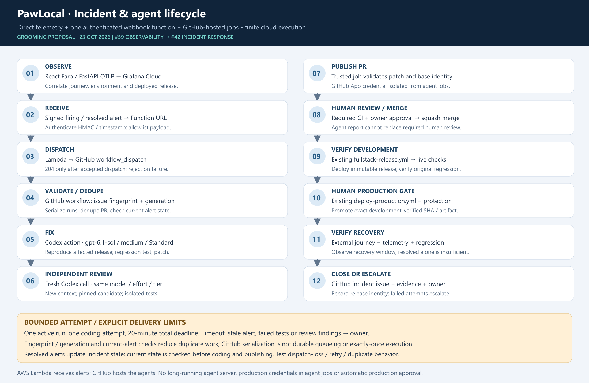

# Incident responder specification — Issue #42

**Status: agreed simplified design for planning; implementation and live acceptance pending.** Baseline [#42](https://github.com/alanlima/pawlocal/issues/42), dependent on development acceptance G1 under [#59 hosted observability](hosted-observability.md). See the [implementation plan](../plans/monitoring-implementation.md) and [DEC-011](../decisions.md#dec-011--hosted-observability-and-minimal-cloud-incident-responder).

## Explicit amendment and readiness boundary

The selected design replaces the older backend `POST /api/v1/webhooks/grafana/alerts`, durable recording/queue and `202` proposal with **one independent Lambda Function URL**, HMAC authentication and `204` only after accepted GitHub dispatch. It weakens receiver durability: there is no AWS incident database/queue and no exactly-once promise. Record the reviewed #42 acceptance/host/OpenAPI amendment before live activation. This docs PR does not change the running API or add a fictional backend route to `openapi.yaml`; the implementation PR defines a separate receiver contract/host rather than silently claiming the application API owns it.

P0 records live-readiness evidence; stale open #43 and unmerged PR #182 are not definitive deployment status. Approved mock/schema/job work can proceed while live gates are resolved. Cost/apply, protected publication, G1, G2 and production approvals remain explicit.

## Resources and ownership

### Resource inventory and ownership

Names below are proposed, not deployed IDs. `<env>` is exactly `development` or `production`; development goes first. Generated Function URLs and Grafana stack/account identifiers come from approved setup.

| Component | Proposed name / existing source | Responsibility |
|---|---|---|
| Existing application | `infra/terraform/modules/pawlocal-environment` and matching roots | Existing S3/CloudFront, Lightsail, DSQL and Cognito; direct exporter configuration |
| Receiver Lambda + role | `pawlocal-<env>-oncall-receiver` | Validate webhook; read only matching secrets; request fixed dispatch; no AWS mutation |
| Function URL + invocation policy | Attached to matching receiver, auth `NONE` | Public HTTPS with application HMAC authentication; Terraform-managed permissions |
| Log group | `/aws/lambda/pawlocal-<env>-oncall-receiver` | Proposed 14-day retention; status/metadata only |
| Runtime SSM sources | Exact paths in hosted observability source contract | SecureStrings; approved owner lifecycle outside Terraform values |
| Optional CloudWatch role | `pawlocal-<env>-grafana-cloudwatch-reader` | Reviewed datasource trust/external ID, scoped read-only metrics; assess metadata-wide APIs |
| Grafana objects | Folder `PawLocal <env>`, Faro app `pawlocal-<env>`, six dashboard UIDs in the hosted observability spec | Hosted ingestion, dashboards and environment selection |
| Initial alert/contact point | `pawlocal-<env>-search-detail-failure`, `pawlocal-<env>-oncall` | One reviewed alert; signed webhook to matching receiver |
| Workflow | `.github/workflows/incident-responder.yml`, trusted default branch `main` | Admission/deduplication, fixer, fresh reviewer and publication |
| Dispatch GitHub App | Proposed `pawlocal-alert-dispatch` | Separate App installed only on `alanlima/pawlocal`; Actions write; receiver-only credential |
| Publisher GitHub App | Proposed `pawlocal-oncall-publisher` | Separate identity with permitted issue/content/PR writes; trusted jobs only |
| Protected GitHub configuration | Proposed `oncall-development`, `oncall-production` Environments | Restricted API/query/publisher secrets; no deployment credentials |
| Model runner | Full-commit-pinned `openai/codex-action` and compatible pinned CLI | Both executions: `gpt-6.1-sol`, medium effort, Standard service |
| Existing release authority | `fullstack-release.yml`, `deploy-production.yml`, `terraform-environment.yml` | Development-verified commit/digest; manual protected production promotion |

Existing bootstrap state owns new IAM identities/trust/boundaries. Existing development/production states own matching Lambda, URL/policy, log groups, non-secret SSM Strings and exact-resource policy attachments. No fourth state. Extend delegated Terraform authority explicitly; Cognito-only delegation does not cover this receiver. Terraform provisions AWS resources and application deployments; runtime agents cannot mutate them.

Runtime secret **values** remain outside Terraform state, deployment environment fields, artifacts and logs. Prove backend secret retrieval/rotation with the approved runtime identity before enabling direct export. Grafana/App registrations, installation and secret population require separately approved setup. Grafana manifests remain source-controlled, provisioned by trusted code retrieving credentials at runtime.

## End-to-end workflow and lifecycle

[Editable SVG](../images/monitoring/stage5-monitoring-agent-lifecycle.svg)

1. **Observe/alert:** direct OTLP and Faro correlate the journey; external probes detect low-traffic outages. Grafana sends signed `firing`/`resolved` events.
2. **Receive/dispatch:** Lambda verifies raw-body HMAC/timestamp, schema/size and environment/service/alert allow-lists. It dispatches only `incident-responder.yml` on trusted `main` in `alanlima/pawlocal`. Return **204 only after GitHub accepts dispatch**. Failure or uncertainty returns non-2xx so Grafana can retry; demonstrate actual retry behaviour.
3. **Admit:** trusted preflight serializes work, rechecks current alert state, and checks deterministic incident issue/PR markers. It owns the incident issue claim **before any model call**. Resolved, duplicate, stale, unsupported or unknown incidents exit or escalate with redacted evidence.
4. **Fix:** reproduce against the affected deployed SHA. Construct candidate on current trusted main, add regression test and run applicable checks. If already fixed, report release lag instead of another patch.
5. **Fresh review:** separate job/workspace uses independent context on the pinned candidate/patch and reruns checks. It reports findings without approving or merging.
6. **Publish:** trusted deterministic code verifies allowed paths, base/candidate/patch hashes, authentic reports and review; separate publisher App creates/updates incident branch and PR.
7. **Human/development:** human review/squash merge triggers CI, immutable publication and existing development deployment. Verify original failure, actual SHA/digest and alert resolution.
8. **Production:** owner manually promotes that exact development-verified pair through protected dispatch and reviewed Terraform apply. Real probes/smoke checks establish recovery; failure escalates.

Timestamp-enabled Grafana HMAC signs `timestamp + ":" + raw body` with HMAC-SHA256. Pin headers, reconstruct base64 bodies correctly, use constant-time comparison and reject expired signatures. Without durable receiver storage, freshness is not persistent replay tracking; repeated in-window events rely on workflow deduplication. [Grafana HMAC](https://grafana.com/docs/grafana-cloud/observe-and-act/alert-and-measure-reliability/alerting/configure-notifications/manage-contact-points/integrations/webhook-notifier/)

The Function URL uses `NONE` because Grafana does not send AWS SigV4; authentication runs inside Lambda. Terraform must create the public invocation policy. Public requests consume capacity before rejection: bound processing/reserved concurrency and disclose abuse/cost exposure. [AWS access controls](https://docs.aws.amazon.com/lambda/latest/dg/urls-auth.html)

**Delivery boundary:** dispatch acceptance is not an AWS durable queue, completed workflow or exactly-once guarantee. A lost response may duplicate dispatch; GitHub outage, cancellation, overflow or exhausted notification retries require owner inspection/replay. Propose an explicit #42 amendment replacing backend-owned durable-before-202 acceptance with independent Function URL/accepted-dispatch/204 semantics, including OpenAPI ownership/host/path. This supersession must be reflected in the reviewed issue amendment before activation; deployment and live acceptance remain separate.

Concurrency group `pawlocal-oncall-<env>` uses `cancel-in-progress: false`; validate `queue: max`, which currently supports up to 100 pending runs. This avoids default pending replacement but remains bounded. **Concurrency is not deduplication.** Under serialization, trusted preflight checks issue/PR markers derived from environment + fingerprint + `startsAt`, including closed outcomes, and claims an attempt before coding. A resolution belongs to that generation. Requery actual alert state before work and publication so late firing events cannot blindly restart a resolved incident. [GitHub concurrency](https://docs.github.com/en/actions/reference/workflows-and-actions/workflow-syntax#concurrency)

Lifecycle: `RECEIVED → DISPATCH_ACCEPTED → ADMITTED → TRIAGING → REPRODUCED → TESTED → MACHINE_REVIEWED → PR_OPEN → HUMAN_REVIEW → MERGED → DEV_RECOVERED → PROD_AWAITING_APPROVAL → PROD_RECOVERED`. Side exits: duplicate, resolved-before-work, low-confidence escalation, timeout, rejected fix and failed release. GitHub incident/PR/run/deployment links are the audit record; no AWS incident database. Development-only incidents end at development recovery.

## Agent authority, review and runtime

Use **`gpt-6.1-sol`, medium reasoning, Standard service** for fixer and fresh reviewer. Pin full Action commit and CLI version; API access/rate limits/configuration compatibility remain to be verified in a separate OpenAI project. Store its key as the protected GitHub secret `OPENAI_API_KEY`; API billing is separate from the consumer subscription. Use supported Action security mode on disposable Ubuntu runners and protect the API proxy credential; never export it as an ordinary test variable. [Official Codex GitHub Action guidance](https://learn.chatgpt.com/docs/github-action), [model reference](https://developers.openai.com/api/docs/models/gpt-6.1-sol)

Coder/reviewer receive read-only GitHub access, bounded redacted evidence and no App keys, publication, deployment or AWS write credentials. Only trusted preflight/publisher have issue-write capability; only publisher has content/PR writes, and it never executes candidate scripts. Fixes exclude workflow/infrastructure/security-policy/IAM/authentication/secrets/data repair. Logs/source/model output are untrusted data, never shell instructions.

Dispatch and publisher are **different App identities**: Lambda cannot hold a publisher-capable private key and merely request a downscoped token. Its Actions write scope can dispatch other repository workflows in principle, so the trusted receiver hardcodes repo/workflow/ref; there is no GitHub per-workflow permission guarantee. Publisher operations/path allow-lists and protected rules enforce the intended boundary; content/PR write alone does not prohibit approval/merge. Denial tests cover protected-main push, approve/merge, production dispatch, credential access and Terraform/AWS mutation. Earlier inspection found an active squash-only main ruleset with no bypass, but zero required approving reviews and no required-status-check rule. Verify and separately authorize required settings changes before enabling publication.

One attempt per incident generation; one active remediation per environment; **a 20-minute wall-clock deadline from admission across all jobs**. The initial GitHub queue wait is excluded; scheduling delays after admission consume the remaining budget. Propagate a trusted absolute deadline and remaining-time limits to model/tests/review/publication; 20 minutes per job is insufficient. No automatic fix/retry loops; rejected/timed-out attempts need owner action. Usage logs retain redacted run/model/token/duration/cost metadata, not prompts/raw telemetry.

Official model pricing checked 23 October 2026: Standard short-context prices: $2/M input, $10/M output. Cumulative 200K input + 20K output across both agents is **$0.60/incident**, **$12 for 20 incidents**, before retries/tools/other costs. Requests above 272K input have 2× input/cache and 1.5× output rates for the full request. Count repeated context and reasoning output. [OpenAI model/pricing](https://developers.openai.com/api/docs/models/gpt-6.1-sol)

**$20/month is a planning budget/notification threshold, not a hard cap or provisioning authorization.** Finite calls/time/tokens and a verified admission/disable mechanism reduce exposure; project budgets must not be assumed to stop billing. Grafana Free can remain $0 within quotas. PawLocal is public (`isPrivate: false`, live-checked); standard hosted runner minutes are free for public repositories, while artifact storage, larger runners, API calls and AWS Lambda/secrets/logs/CloudWatch may cost extra. [GitHub billing](https://docs.github.com/en/billing/concepts/product-billing/github-actions)

## Exact runtime secrets and public configuration

Use the [single SSM source contract](hosted-observability.md#exact-planned-ssm-source-and-destination-contract). Receiver reads only `/pawlocal/<env>/secrets/grafana/webhook-hmac` and `/pawlocal/<env>/secrets/oncall/dispatch-app-private-key`. Backend reads only `/pawlocal/<env>/secrets/grafana/otlp-token`. Query-only source `/pawlocal/<env>/secrets/grafana/query-token` reconciles into protected `PAWLOCAL_GRAFANA_QUERY_TOKEN` in `oncall-development` / `oncall-production`. No duplicate Secrets Manager containers or unused ARN settings.

Terraform publishes non-secret Strings and owns resource/policy lifecycle, never secret payloads. P1 records a narrowly approved SecureString creation/population/rotation procedure before live mutation; the spec does not silently create an ownership exception. Exact SSM/KMS grants and encryption context constrain each reader. Lambda stores public App identifiers and validated exact secret paths, not private payloads in Terraform-managed configuration.

Protected on-call Environments also hold separately provisioned `OPENAI_API_KEY` and `PAWLOCAL_ONCALL_PUBLISHER_APP_PRIVATE_KEY`, outside synchronization. Verify main-only rules/job credential boundaries; do not require a human approval on each intended unattended model run. Human merge and production approval remain downstream.

Trusted preflight retrieves scoped telemetry into bounded redacted evidence; model/test jobs receive no production query token. Only trusted preflight/publisher hold issue-write; only publisher holds content/PR authority and never executes candidate scripts. Prove Action API credential isolation from tests in P6. Dispatch and publisher App identities remain separate.

Planned prompt sources `agents/prompts/incident-fixer.md` and `agents/prompts/incident-reviewer.md` will define allowed paths/untrusted data/regression/review/escalation. This PR does not implement prompts, Lambda, workflows or grants.

## Acceptance, failure handling and operations

G2 maps evidence to the amended #42 contract: automatic safe alert wake-up, reproducible regression, single patch attempt, independent pinned review, human-reviewed PR and successful development release. Prove duplicate/lost dispatch handling, replay within timestamp window, stale firing after resolution, grouped alerts, GitHub outage, pending queue overflow, cancellation, model timeout, failed test/review, already-fixed release lag and low-confidence escalation. Owner inspection/replay is the documented recovery path for lost delivery; do not claim serialization persists every event.

Emergency disablement removes/disables the Grafana contact point and closes workflow admission before further model work. Existing in-flight runs check cancellation/current incident state before publication. Reenable only after signed-delivery and generation tests pass. Rotation updates server-side HMAC/App secrets and Grafana signing configuration using approved owner procedures, validates new signing before retiring old material, and records metadata-only evidence. Never automate production faults or data/IAM/infrastructure repair.

P9 requires G2/P8 plus explicit production telemetry-read/budget authorization. P9 retains owner dispatch and protected apply of the exact development-verified release. Unhealthy smoke/readback escalates to the existing owner-approved Terraform/recovery path under #44; it does not grant rollback authority to the agent.
