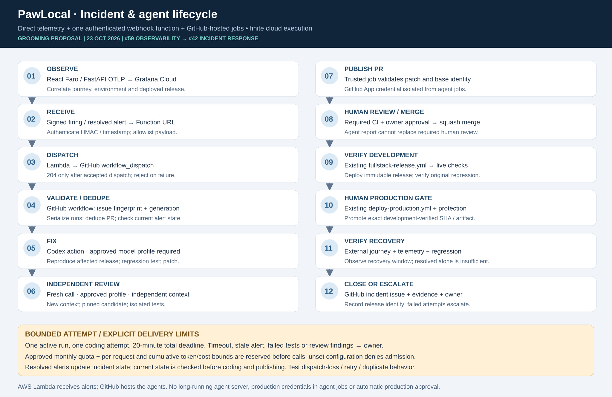

# Incident responder specification — Issue #42

**Status: owner-approved unattended MVP contract (#239); implementation and live acceptance pending.** Baseline [#42](https://github.com/alanlima/pawlocal/issues/42), dependent on development acceptance G1 under [#59 hosted observability](hosted-observability.md). See the [implementation plan](../plans/monitoring-implementation.md) and [DEC-011](../decisions.md#dec-011--hosted-observability-and-minimal-cloud-incident-responder).

## Explicit amendment and readiness boundary

The selected design replaces the older backend `POST /api/v1/webhooks/grafana/alerts`, durable recording/queue and `202` proposal with **one independent Lambda Function URL**, HMAC authentication and `204` only after accepted GitHub dispatch. It weakens receiver durability: there is no AWS incident database/queue and no exactly-once promise. Record the reviewed #42 acceptance/host/OpenAPI amendment before live activation. This docs PR does not change the running API or add a fictional backend route to `openapi.yaml`; the implementation PR defines a separate receiver contract/host rather than silently claiming the application API owns it.

P0 records live-readiness evidence; stale open #43 and unmerged PR #182 are not definitive deployment status. Approved mock/schema/job work can proceed while live gates are resolved. One-time model/budget/privacy/identity/provisioning setup and G1/G2 acceptance remain explicit. Once activated, the allowlisted application-repair path has **no human approval at runtime**, including merge and production promotion. The optional human-approval switch is deferred; do not implement it in this MVP. [DEC-012](../decisions.md#dec-012--fully-unattended-incident-remediation-mvp) supersedes earlier runtime approval clauses.

## Resources and ownership

### Resource inventory and ownership

Names below are default examples for `project_name=pawlocal`, not deployed IDs. Receiver Lambda/role/log/SSM names derive from the configured project prefix; runtime reads trusted `PAWLOCAL_PROJECT_NAME` and exact derived paths. `<env>` is exactly `development` or `production`; development goes first. Generated Function URLs and Grafana stack/account identifiers come from approved setup.

| Component | Proposed name / existing source | Responsibility |
|---|---|---|
| Existing application | `infra/terraform/modules/pawlocal-environment` and matching roots | Existing S3/CloudFront, Lightsail, DSQL and Cognito; direct exporter configuration |
| Receiver Lambda + role | `pawlocal-<env>-oncall-receiver` | Validate webhook; read only matching secrets; request fixed dispatch; no AWS mutation |
| Function URL + invocation policy | Attached to matching receiver, auth `NONE` | Public HTTPS with application HMAC authentication; Terraform-managed permissions |
| Log group | `/aws/lambda/pawlocal-<env>-oncall-receiver` | Proposed 14-day retention; status/metadata only |
| Runtime SSM sources | Exact paths in hosted observability source contract | SecureStrings; approved owner lifecycle outside Terraform values |
| Optional CloudWatch role | `pawlocal-<env>-grafana-cloudwatch-reader` | Reviewed datasource trust/external ID, scoped read-only metrics; assess metadata-wide APIs |
| Grafana objects | Folder `PawLocal <env>`, Faro app `pawlocal-<env>`, six dashboard UIDs in the hosted observability spec | Hosted ingestion, dashboards and environment selection |
| Initial alert/contact point | `pawlocal-<env>-search-detail-failure`, `pawlocal-<env>-oncall` | One reviewed alert; signed webhook to matching receiver |
| Workflow | `.github/workflows/incident-responder.yml`, trusted default branch `main` | Admission/deduplication, fixer, fresh reviewer, verdict broker, publisher, trusted squash-merge job and fixed production promoter |
| Dispatch GitHub App | Proposed `pawlocal-alert-dispatch` | Separate App installed only on the configured PawLocal repository; Actions write; receiver-only credential |
| Publisher GitHub App | Proposed `pawlocal-oncall-publisher` | Separate identity with permitted issue/content/PR writes; publication and separate trusted squash-merge jobs only |
| Protected GitHub configuration | Proposed `oncall-development`, `oncall-production` Environments | Restricted API/query/publisher secrets; no deployment credentials |
| Model runner | Full-commit-pinned `openai/codex-action` and compatible pinned CLI | Fixer/reviewer use an explicitly approved model profile; selection pending |
| Existing release authority | `fullstack-release.yml`, `deploy-production.yml`, `terraform-environment.yml` | Automatic exact development-verified commit/digest promotion; release-only Terraform and recovery checks |

Existing bootstrap state owns new IAM identities/trust/boundaries. Existing development/production states own matching Lambda, URL/policy, log groups, non-secret SSM Strings and exact-resource policy attachments. No fourth state. Extend delegated Terraform authority explicitly; Cognito-only delegation does not cover this receiver. Terraform provisions AWS resources and application deployments; runtime agents cannot mutate them.

Runtime secret **values** remain outside Terraform state, deployment environment fields, artifacts and logs. Prove backend secret retrieval/rotation with the approved runtime identity before enabling direct export. Grafana/App registrations, installation and secret population require separately approved setup. Grafana manifests remain source-controlled, provisioned by trusted code retrieving credentials at runtime.

## End-to-end workflow and lifecycle

[Editable SVG](../images/monitoring/stage5-monitoring-agent-lifecycle.svg)

1. **Observe/alert:** direct OTLP and Faro correlate the journey; external probes detect low-traffic outages. Grafana sends signed `firing`/`resolved` events.
2. **Receive/dispatch:** Lambda verifies raw-body HMAC/timestamp, schema/size and environment/service/alert allow-lists. It dispatches only `incident-responder.yml` on trusted `main` in the repository bound by trusted deployment configuration, never alert input. Return **204 only after GitHub accepts dispatch**. Failure or uncertainty returns non-2xx so Grafana can retry; demonstrate actual retry behaviour.
The configured Grafana alert defines incident eligibility. Lambda imposes no hardcoded API-route allowlist and omits route hints from dispatch. Trusted preflight revalidates the configured rule, environment and release before reading bounded telemetry. Source-change and security bounds remain independent; unsupported repairs escalate.

3. **Admit:** trusted preflight serializes work, rechecks current alert state, and checks deterministic incident issue/PR markers. It owns the incident issue claim **before any model call**. Resolved, duplicate, stale, unsupported or unknown incidents exit or escalate with redacted evidence.
4. **Fix:** reproduce against the affected deployed SHA. Construct candidate on current trusted main, add regression test and run applicable checks. If already fixed, report release lag instead of another patch.
5. **Fresh review:** a separate workspace/model call reviews the pinned candidate/patch with independent context and reruns checks. A trusted verdict broker binds the result to base/candidate SHA, candidate tree and patch hash. Findings or missing/invalid evidence stop the run. The model neither holds merge credentials nor fabricates a GitHub check result.
6. **Publish/CI:** trusted deterministic code verifies allowed paths, base/candidate/tree/patch hashes and authentic verdict/test evidence; publisher App creates the incident branch and PR. Real applicable GitHub CI runs on that exact candidate SHA; candidate code cannot alter the required workflow or supply its own privileged verdict.
7. **Automatic merge/development:** a separate trusted job mints the publisher App token only after confirming the bound fresh-review verdict, current PR head/base, real required CI and resolved review threads. It squash-merges through normal protections without a bypass actor. The App merge triggers the existing `fullstack-release.yml` path. Bind the resulting main SHA, immutable backend digest and verified development run; verify the original regression and served frontend/backend identities.
8. **Automatic production/recovery:** a separate trusted promoter uses its job-local `GITHUB_TOKEN` with `actions: write` to dispatch only `deploy-production.yml` on `main`, passing exact development-verified `release_commit` and `backend_image`. It confirms the matching release run, release-only Terraform plan/apply, publication/readback, original regression, healthy external journey and stable resolved alert. The run records verified recovery or a failed/unknown outcome; it never waits for runtime human approval.

Timestamp-enabled Grafana HMAC signs `timestamp + ":" + raw body` with HMAC-SHA256. Pin headers, reconstruct base64 bodies correctly, use constant-time comparison and reject expired signatures. Without durable receiver storage, freshness is not persistent replay tracking; repeated in-window events rely on workflow deduplication. [Grafana HMAC](https://grafana.com/docs/grafana-cloud/observe-and-act/alert-and-measure-reliability/alerting/configure-notifications/manage-contact-points/integrations/webhook-notifier/)

The Function URL uses `NONE` because Grafana does not send AWS SigV4; authentication runs inside Lambda. Terraform must create the public invocation policy. Public requests consume capacity before rejection: bound processing/reserved concurrency and disclose abuse/cost exposure. [AWS access controls](https://docs.aws.amazon.com/lambda/latest/dg/urls-auth.html)

**Delivery boundary:** dispatch acceptance is not an AWS durable queue, completed workflow or exactly-once guarantee. A lost response may duplicate dispatch; GitHub outage, cancellation, overflow or exhausted notification retries require owner inspection/replay. Propose an explicit #42 amendment replacing backend-owned durable-before-202 acceptance with independent Function URL/accepted-dispatch/204 semantics, including OpenAPI ownership/host/path. This supersession must be reflected in the reviewed issue amendment before activation; deployment and live acceptance remain separate.

One global workflow concurrency group `pawlocal-oncall-global-quota` spans both environments and uses `cancel-in-progress: false`; validate `queue: max`, which currently supports up to 100 pending runs. This avoids default pending replacement but remains bounded. **Concurrency is not deduplication.** Keep the per-incident/environment lease through release/recovery outcome reconciliation. Under global serialization, trusted preflight checks issue/PR markers derived from environment + fingerprint + `startsAt`, including closed outcomes, and claims an attempt before coding. A resolution belongs to that generation. Requery actual alert state before work and publication so late firing events cannot blindly restart a resolved incident. [GitHub concurrency](https://docs.github.com/en/actions/reference/workflows-and-actions/workflow-syntax#concurrency)

Lifecycle: `RECEIVED → DISPATCH_ACCEPTED → ADMITTED → TRIAGING → REPRODUCED → TESTED → MACHINE_REVIEWED → PR_OPEN → CI_PASSED → AUTO_SQUASH_MERGED → DEV_VERIFIED → AUTO_PROD_PROMOTED → PROD_RECOVERED`. Side exits: duplicate, resolved-before-work, low-confidence escalation, timeout, rejected fix and failed release. GitHub incident/PR/run/deployment links are the audit record; no AWS incident database. The activated MVP promotes an eligible application fix through development to production; development-only demonstrations exercise the earlier stages before production-path acceptance. Out-of-scope or failed work stops/escalates without an approval-wait state.

## Agent authority, review and runtime

**The model, reasoning effort and service tier will be selected later.** No default profile is approved. Pin the Action commit/CLI when implementation is reviewed, and verify the owner-selected model profile/API project and data handling before admission. `OPENAI_API_KEY` remains a protected setup credential; an interactive subscription does not fund unattended API work. The selected profile must include supported limits, current rate provenance and a reviewed API entitlement smoke test. See the [model policy](../model-policy.md#incident-responder-model-selection-and-admission-42).

Coder/reviewer receive read-only GitHub access, bounded redacted evidence and no App keys, publication, deployment or AWS write credentials. Only trusted preflight/publisher have issue-write capability; only trusted publication/merge jobs receive scoped content/PR writes, and neither executes candidate scripts. The promoter alone receives fixed-workflow dispatch authority; model jobs receive neither merge nor release credentials. Fixes exclude workflow/infrastructure/security-policy/IAM/authentication/secrets/data repair. Logs/source/model output are untrusted data, never shell instructions.

Dispatch and publisher are **different App identities**: Lambda cannot hold a publisher-capable key. The receiver reads required trusted deployment `PAWLOCAL_DISPATCH_REPOSITORY` from `oncall_receiver.repository`, verifies repository identity/installation, and fixes workflow/ref; alert input cannot override these bindings; GitHub does not offer a per-workflow App permission. Publisher App permissions can merge in principle, so token custody and deterministic trusted job operations enforce the boundary. The separate squash-merge job alone performs that operation after machine evidence checks; the publishing step does not merge. The fixed promoter uses job-local `GITHUB_TOKEN actions: write`, not the App key or candidate-provided inputs. Like App Actions write, this permission is repository-wide; GitHub does not intrinsically limit the token to one workflow. Deterministic trusted code and token isolation enforce the fixed workflow/ref and exact verified release, rejecting arbitrary candidate/model workflow, commit or image inputs.

### One-time protection setup and activation

Observed live rules require CodeOwner review despite zero numeric required approvals, have no required-status-check rule and no bypass actors; the production Environment requires an owner reviewer. These are **activation blockers**, not the intended runtime workflow. Before enabling the unattended path, apply a concrete reviewed setup that removes the human CodeOwner requirement and all human reviewer requirements on transitive incident release Environments, adds actual required candidate CI, and retains main-only trust, PR-based changes, squash-only merge, thread resolution, force-push/deletion protections and no bypass actors. Do not mint a fake candidate check from a model report. The trusted verdict broker validates fresh review independently of real GitHub CI. Removing human gates must not precede the reviewed functioning machine path. This documentation changes no live settings.

A stale base/head, changed tree, reopened incident generation, failed CI/review, unresolved thread, unavailable quota ledger, unverified development artifact, unexpected Terraform change or uncertain deployment stops new mutations and records escalation. No runtime approval/retry switch is introduced. Direct main pushes, model merges, arbitrary production dispatch, candidate access to credentials and infrastructure/IAM/data repairs remain denied. Normal feature work retains its applicable review process; the narrowly scoped incident controller is the automatic exception.

### Separate bounded phases

One attempt per incident generation; one active incident lease across remediation and release/recovery. **Admission to trusted PR publication has one absolute 20-minute deadline**, including preflight, both model calls, tests, review and job scheduling. Initial queue waiting is excluded; 20 minutes per job is insufficient. A separate proposed **60-minute absolute deadline from trusted PR publication** spans real CI, squash merge, development verification, exact production promotion and recovery observation. It never extends the model envelope or admits another coding attempt. Propagate trusted phase deadlines across workflows; missing/stale deadline evidence fails closed.

After a deadline, start no new mutation. Do not blindly cancel an in-flight Terraform apply or assume a lost response means nothing happened: reconcile its bounded observed result using trusted run/state/release evidence, preserve the incident lease while outcome is uncertain, and report failed/unknown recovery. A known failed check or unsupported repair escalates without waiting for approval. No automatic infrastructure rollback, production fault or data repair is authorized. Metadata records run/model/token/duration/cost and phase outcomes without raw prompts/telemetry.

### Enforced admission quotas and token reservations

No monthly spending amount is approved here; the earlier $20 figure was illustrative and is not an operative limit. Profile/model/rates and quota values remain unset, so **model admission is disabled**.

Before admitting an incident, trusted code must validate an explicitly approved monthly run quota, monthly usage/spend ceiling, per-request input/output token limits and a cumulative per-incident token/cost ceiling spanning fixer, fresh review and tools. Serialize the workflow globally and reserve both jobs' full worst-case envelope upfront in a protected monthly issue ledger; admission fails closed if anything is unset, stale, exhausted or cannot be enforced. The ledger's ownership, month boundary, reservation write/readback and crash recovery need reviewed implementation and negative tests. A bounded concurrency queue does not constrain monthly spend.

Never automatically refund or settle this monthly reservation against actual usage. Each request gateway charges counted input and the full `max_output_tokens` allowance before forwarding, retaining charges for unknown, failed or interrupted usage. This conservative envelope remains consumed for the month; any operator correction requires a separately reviewed reconciliation. All distinct alert generations count against the same approved monthly quota. Deny further calls if the cumulative incident ceiling would be exceeded, and escalate. Token bounds must cover repeated context, reasoning output and tool/model calls, with provider request limits verified before use. Notifications support operations but cannot replace this gate.

Grafana Free can remain within its actual allowance; AWS/API/runner/artifact costs remain separately reviewed. This specification authorizes neither an API spending amount nor provisioning. Actual profile/rates and enforceable limits must be selected and reviewed before live model work.

## Exact runtime secrets and public configuration

Use the [single SSM source contract](hosted-observability.md#exact-planned-ssm-source-and-destination-contract). Receiver reads only `/pawlocal/<env>/secrets/grafana/webhook-hmac` and `/pawlocal/<env>/secrets/oncall/dispatch-app-private-key`. Backend reads only `/pawlocal/<env>/secrets/grafana/otlp-token`. Query-only source `/pawlocal/<env>/secrets/grafana/query-token` and `PAWLOCAL_GRAFANA_QUERY_TOKEN` are a future protected query-credential proposal, absent from the active public mapping and public reader grant. Its credential kind, exact-source/KMS authority and lifecycle require separate setup before use; a Cloud Access Policy token is not automatically a Grafana Stack API token. No duplicate Secrets Manager containers or unused ARN settings.

Terraform publishes non-secret Strings and owns resource/policy lifecycle, never secret payloads. P1 records a narrowly approved SecureString creation/population/rotation procedure before live mutation; the spec does not silently create an ownership exception. Exact SSM/KMS grants and encryption context constrain each reader. Lambda stores public App identifiers and validated exact secret paths, not private payloads in Terraform-managed configuration.

Protected on-call Environments also hold separately provisioned `OPENAI_API_KEY` and `PAWLOCAL_ONCALL_PUBLISHER_APP_PRIVATE_KEY`, outside synchronization. Verify main-only rules/job credential boundaries; do not require a human approval on each intended unattended model run. Trusted merge and fixed production promotion are automatic after their machine checks; no human reviewer is configured on this runtime path.

Trusted preflight retrieves scoped telemetry into bounded redacted evidence; model/test jobs receive no production query token. Only trusted preflight/publication jobs hold issue-write; trusted publication/merge jobs hold scoped content/PR authority and never execute candidate scripts. Prove Action API credential isolation from tests in P6. Dispatch and publisher App identities remain separate.

Planned prompt sources `agents/prompts/incident-fixer.md` and `agents/prompts/incident-reviewer.md` will define allowed paths/untrusted data/regression/review/escalation. This PR does not implement prompts, Lambda, workflows or grants.

## Acceptance, failure handling and operations

G2 maps evidence to the amended #42 contract: automatic safe alert wake-up, reproducible regression, single patch attempt, independent pinned review, machine-checked PR, trusted automatic squash merge and successful exact development release. P9 extends that evidence through automatic production promotion and recovery with no human gate. Prove duplicate/lost dispatch handling, replay within timestamp window, stale firing after resolution, grouped alerts, GitHub outage, pending queue overflow, cancellation, model timeout, failed test/review, already-fixed release lag and low-confidence escalation. Owner inspection/replay is the documented recovery path for lost delivery; do not claim serialization persists every event.

Emergency disablement removes/disables the Grafana contact point and closes workflow admission before further model work. Existing in-flight runs check cancellation/current incident state before publication. Reenable only after signed-delivery and generation tests pass. Rotation updates server-side HMAC/App secrets and Grafana signing configuration using approved owner procedures, validates new signing before retiring old material, and records metadata-only evidence. Never automate production faults or data/IAM/infrastructure repair.

P9 requires G2/P8 plus explicit production telemetry-read authorization and approved enforceable admission quotas. P9 proves automatic fixed-workflow dispatch and release-only apply of the exact development-verified release, followed by actual production recovery. Deny any infrastructure/IAM/data change in the release plan. Unhealthy or uncertain readback records escalation and starts no additional mutation; future recovery/rollback extensions remain separately scoped under #44.
